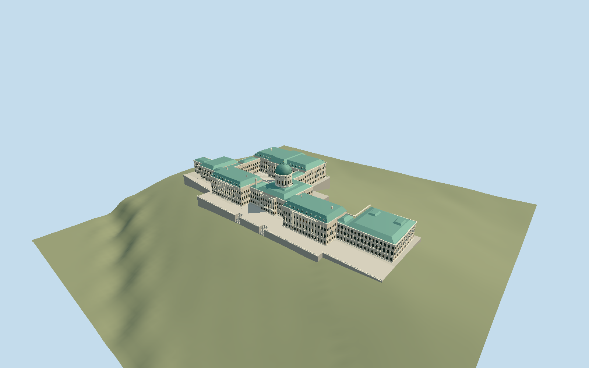

# Buda Castle

Six-wing Royal Palace exterior with long stepped Danube frontage, two tall river pavilions, the ribbed green postwar dome, open Lions Court, library wing, South Range and immediate stone terraces; documented 2021 reference state.

## Evidence and reconstruction

Published dimensions and reconstructed details are separated in spec.json. Primary references:

- [Reference](https://nemzetihauszmannprogram.hu/nhp-strategy-2021.pdf)
- [Reference](https://info.budavaripalotanegyed.hu/)
- [Reference](https://commons.wikimedia.org/wiki/File:Floor_plans_of_Buda_Castle_en.svg)
- [Reference](https://www.pestbuda.hu/en/cikk/20201117_a_bird_s_eye_view_of_the_royal_palace_of_buda_castle)
- [Reference](https://pestbuda.hu/en/cikk/20201121_masterpieces_with_a_view_a_visit_to_the_royal_palace_of_buda_castle)
- [Reference](https://www.openstreetmap.org/relation/6486918)

No third-party geometry, photograph or bitmap texture is embedded. Shared surface graphs come from the central library; vertex tints carry model colors. Glazing uses PBR materials; transparent surfaces are declared per model.

## Model and axes

57,385 triangles; 128,179 vertices; 7 material groups; 5,307,316 bytes. Native bounds: -174.000, -19.390, -94.200 to 175.019, 61.539, 78.200. Source hash: `sha256:1d97816eb981d0488e6cf01589b58b5f70463bda674568a5abc5d6e3c227883e`.

{"up":"+Y","longitudinal":"+X 48.909 degrees south of east","front":"Danube frontage toward native -Z; north A pavilion toward -X","origin":"Signed palace anchor; Y0 decoded152.564 m working datum."}

Fresh Q46313 palace relation6486918 v33 matches saved outline within0.000592 m. This checks stable horizontal registration, not current exterior state. Native +X southeast bearing138.909404 degrees; +Z southwest228.909404 degrees. Danube/Pest frontage -Z, north A/B pavilions -X, restored South Range +X and library/Lions Court +Z sign heading -0.853630134323 at [19.039308745,47.495824657]. Official programme PDF actual 2021 panorama/north pavilion/restored South Range photographs inspected; 1935/1945/1905 photographs and future north-wing designs are separate. Historical-only appearance interval2021-08-20 inclusive to2022-01-01 exclusive follows South Range opening and conservatively excludes2022 A/B reconstruction; explicit viewingDate2021-10-01 used for placement QA. Numeric terrain16641 values on4 m grid, anchor datum152.564 m. Highest occupied palace/court/immediate terrace sample plus0.25 m selects floor3.5393 m; rigid -0.4607 m shift preserves source proportions. Immediate terrace feet reach four meters below retained ground; paired eastern stairs fit lowest tread to sampled ground. Lions Court remains roofless and restored South Range portal is truly open at all tiers. Broader Castle Hill remains host terrain; no cut or whole-hill replacement.

## Reproduce

Run `node packages/worldgen/scripts/generate-signature-towers.mjs --ids=N0255` (or add `--check`). The generator preserves manually edited masters by checking their baseline hashes. Import through the standard authored-model workflow with optimization disabled; then capture all QA cameras, including shared-surface views.

## Pending work

- Original394698-triangle /33677224-byte master reproduces at sha256:96d12a760a6a61c59e37040aad4a25a1b9188ed8719d89b445c1b211ed56fffa from unchanged buda-castle-model.mjs#budaStudy.build and map-parts.json.
- Fresh Q46313 palace relation6486918 v33 matches saved outline within0.000592 m. This checks stable horizontal registration, not current exterior state. Native +X southeast bearing138.909404 degrees; +Z southwest228.909404 degrees. Danube/Pest frontage -Z, north A/B pavilions -X, restored South Range +X and library/Lions Court +Z sign heading -0.853630134323 at [19.039308745,47.495824657]. Official programme PDF actual 2021 panorama/north pavilion/restored South Range photographs inspected; 1935/1945/1905 photographs and future north-wing designs are separate. Historical-only appearance interval2021-08-20 inclusive to2022-01-01 exclusive follows South Range opening and conservatively excludes2022 A/B reconstruction; explicit viewingDate2021-10-01 used for placement QA. Numeric terrain16641 values on4 m grid, anchor datum152.564 m. Highest occupied palace/court/immediate terrace sample plus0.25 m selects floor3.5393 m; rigid -0.4607 m shift preserves source proportions. Immediate terrace feet reach four meters below retained ground; paired eastern stairs fit lowest tread to sampled ground. Lions Court remains roofless and restored South Range portal is truly open at all tiers. Broader Castle Hill remains host terrain; no cut or whole-hill replacement.
- Coarse terrain cannot resolve precise palace terraces, under-building ground, cellar levels or historic2021 terrain. Pixel ground spacing is a sample interval, not surveyed resolution. Native vertical datum/vintage/under-building contamination remain unverified.
- Highest occupied palace/court/immediate terrace sample plus0.25 m selects one rigid palace/court floor. Bounded immediate palace terraces are interpreted level platforms; skirts descend four meters below retained ground. Broad Castle Hill is solely host terrain, no cut or whole-hill replacement.
- Temporal policy permits only2021-08-20 through2021-12-31 via explicit historical viewingDate. That conservative interval follows restored South Range opening20Aug2021 and excludes the year of A/B works begun2022; it is not a measured daily construction chronology. Current footprint checks registration only.
- Paired eastern stairs interpolate their lowest tread to retained ground and last tread to palace terrace; their proportions and exact historic grade are interpreted. Lions Court remains roofless and South Range portal remains open. Separate Guardhouse/Riding Hall/towers/Bazaar/interiors/figurative sculpture are excluded.
- Accepted medium-fi dated exterior includes six linked palace wings, stepped Danube frontage/two taller pavilions, ribbed circular postwar dome, roofless Lions Court, library wing, restored South Range with open entrance/paired columns, and bounded immediate stone terraces/stairs. Exact architectural and figurative ornament is interpreted or excluded. War/Peace statues, equestrian monuments, fountains, interior halls, separate Riding Hall/Guardhouse/towers/Bazaar and whole Castle Hill are outside this asset.
- Six common graphs supply granite, two limestone treatments, wood, painted metal and copper. Finial shares metal, glass stays local/opaque. Ordinary roof seams use shared copper surface detail; major dome ribs remain geometry. No embedded images. Skyline uses baked common linear material means.
- Precise bay counts, dome/drum profile, roof junctions, ornate capitals/cartouches, terrace walls and historic2021 terrain are reconstructed, not measured. Large immediate retaining faces reflect coarse terrain. Current construction condition or future completion is not claimed. Physical laptop/phone timings pending.

This bundle follows the medium-fi standard. Medium-fi appearance and geographic fit are reviewed separately. Hash-bound visual acceptance is recorded separately after capture inspection.

## Additional geographic data

Map data © OpenStreetMap contributors, ODbL-1.0. Original deterministic geometry; reference photos and third-party meshes are not embedded.
