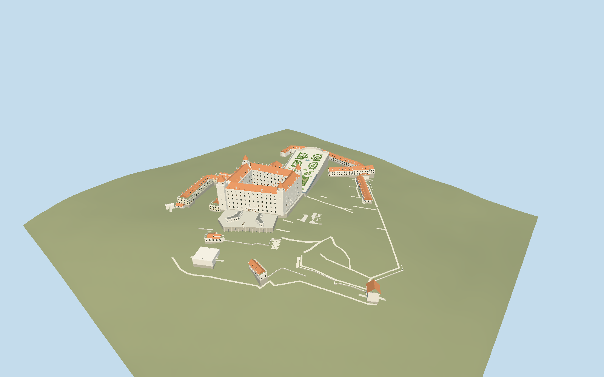

# Bratislava Castle

White four-wing palace around a real open courtyard, unequal square/octagonal corner towers and swept terracotta crowns; curved Court of Honour pavilions, separate gates, mapped barracks, riding hall and Baroque garden.

## Evidence and reconstruction

Published dimensions and reconstructed details are separated in spec.json. Primary references:

- [Reference](https://www.snm.sk/en/museums/museum-of-history/museum-of-history/visit/expositions?clanok=crown-tower-1)
- [Reference](https://www.visitbratislava.com/places/bratislava-castle/)
- [Reference](https://www.visitbratislava.com/wp-content/uploads/2020/01/4DL_hrad_2023_EN_web.pdf)
- [Reference](https://www.nrsr.sk/web/Dynamic/Download.aspx?DocID=448675)
- [Reference](https://www.openstreetmap.org/way/1128350263)
- [Reference](https://www.openstreetmap.org/relation/14610630)

No third-party geometry, photograph or bitmap texture is embedded. Shared surface graphs come from the central library; vertex tints carry model colors. Glazing uses PBR materials; transparent surfaces are declared per model.

## Model and axes

57,728 triangles; 125,674 vertices; 8 material groups; 5,221,592 bytes. Native bounds: -173.410, -32.857, -155.332 to 167.573, 52.865, 158.954. Source hash: `sha256:bd983d93d5a6d05029e6571d2c3924533600fc42c1def78f7c3d3962967d819e`.

{"up":"+Y","longitudinal":"+X east-northeast, 58.412 degrees north of east","front":"South entrance toward native -X/+Z; +Z southeast","origin":"Signed grounds anchor; Y0 decoded 202.3571 m working datum."}

Fresh grounds way1128350263 v23 identifies Q593311; palace way8160490 identifies Q13425656. Native +X NNE at 31.587323 degrees clockwise from north and +Z ESE at 121.587323 degrees sign heading 1.019493535917 at [17.100792149,48.142390437]. Southwest Crown Tower, south triple portal/Court of Honour and north Baroque garden confirm the frame. Current hedge/path vertices differ from original up to 0.570799 m; derivative uses fresh points while original source remains reproducible. All four gate centers and tunnel directions follow mapped passage/footprint intersections; three original tunnel bearings were transverse to their roads and have been corrected. Public numeric terrain supplies 16641 values on a 4 m native grid. Decoded Y0 working datum 202.3571 m; palace/court floor 5.2147 m above anchor is highest occupied platform sample plus 0.25 m, with rigid -4.7853 m translation. Garden/riding hall retain this interpreted level. Other barracks and gates use separate footprint/entry samples, bounded ramps and buried retaining feet. The broader hillside/park remains exclusively host terrain, with no ground cut or whole-grounds replacement.

## Reproduce

Run `node packages/worldgen/scripts/generate-signature-towers.mjs --ids=N0253` (or add `--check`). The generator preserves manually edited masters by checking their baseline hashes. Import through the standard authored-model workflow with optimization disabled; then capture all QA cameras, including shared-surface views.

## Pending work

- Original 684637-triangle / 58208900-byte master remains independently reproducible at sha256:1e9b67723d4932c70c47afbe1a86850894ed9bc183b75aefafbb26deabd32802 from bratislava-castle-model.mjs#bratislavaStudy.build and unchanged map-parts.json.
- Fresh grounds way1128350263 v23 identifies Q593311; palace way8160490 identifies Q13425656. Native +X NNE at 31.587323 degrees clockwise from north and +Z ESE at 121.587323 degrees sign heading 1.019493535917 at [17.100792149,48.142390437]. Southwest Crown Tower, south triple portal/Court of Honour and north Baroque garden confirm the frame. Current hedge/path vertices differ from original up to 0.570799 m; derivative uses fresh points while original source remains reproducible. All four gate centers and tunnel directions follow mapped passage/footprint intersections; three original tunnel bearings were transverse to their roads and have been corrected. Public numeric terrain supplies 16641 values on a 4 m native grid. Decoded Y0 working datum 202.3571 m; palace/court floor 5.2147 m above anchor is highest occupied platform sample plus 0.25 m, with rigid -4.7853 m translation. Garden/riding hall retain this interpreted level. Other barracks and gates use separate footprint/entry samples, bounded ramps and buried retaining feet. The broader hillside/park remains exclusively host terrain, with no ground cut or whole-grounds replacement.
- Coarse terrain cannot resolve paved terraces, narrow retaining walls, building feet or underground parking. Pixel ground spacing is a sample interval, not surveyed resolution. Native vertical datum/vintage/under-building contamination remain unverified.
- Palace/forecourt level is the highest occupied platform sample plus 0.25 m; one rigid palace shift preserves its relative architectural heights. Garden/riding hall keep that explicitly interpreted level; four historical garden terraces remain unmeasured. Other barracks and gates use separate highest footprint/entry samples plus 0.15/0.12 m with bounded civil connections.
- Mapped structural skirts extend four meters below retained ground. Broad park/hill is exclusively host terrain. No whole-precinct cut or replacement. Crown Tower 47 m published height versus OSM 31 m part height has unresolved datum scope; interpreted roof-tip height is retained, not called surveyed.
- Accepted exterior scope is the four-wing palace/open court, unequal corner towers, swept crowns, south portals/curved pavilions, four entrance gates, mapped barracks/riding hall, garden/parterre/fountain, low archaeological foundations and perimeter walls. Interiors, underground parking, mature trees and detailed figurative garden sculpture are separate scope. Equestrian Svátopluk remains an original interpretive silhouette, not a likeness.
- Six common graphs provide granite, lime plaster, wood, painted metal, ceramic tile and gravel. Carved white trim shares tinted plaster; bronze sculpture shares metal; dark dormer/clock recesses share opaque glass. No embedded images. Texture courses replace duplicated roof-course geometry. Skyline bakes shared linear material means.
- Official 2014/2016 photographs and 2023 brochure depict restored castle/garden; NR SR2018 illustration is a reconstruction proposal, not a survey. Palace height datum, bay/window counts, gate body envelopes, garden levels and exact terrace foundations remain interpreted. No physical phone/laptop timings claimed.

This bundle follows the medium-fi standard. Medium-fi appearance and geographic fit are reviewed separately. Hash-bound visual acceptance is recorded separately after capture inspection.

## Additional geographic data

Map data © OpenStreetMap contributors, ODbL-1.0. Official illustrations and photographs were inspected as architectural references; no third-party photograph or mesh is embedded.
