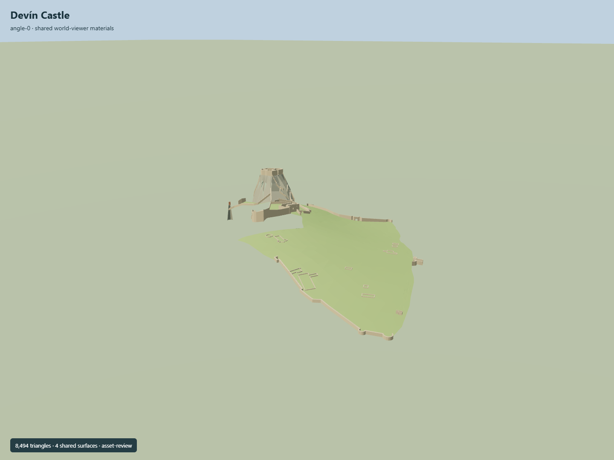

# Devín Castle

Roofless upper ruins raised on a faceted pale cliff, lower terrain-following curtains, Garay palace remnants, Bathory scalloped attic, open middle courtyard and the separate tiny octagonal Maiden Tower on a slender rock spur.

## Evidence and reconstruction

Published dimensions and reconstructed details are separated in spec.json. Primary references:

- [Reference](https://hraddevin.mmb.sk/wp-content/uploads/2025/02/Areal-Hradu-Devin-mapa.png)
- [Reference](https://hraddevin.mmb.sk/wp-content/uploads/2023/07/DJI_0584-1.jpg)
- [Reference](https://hraddevin.mmb.sk/wp-content/uploads/2023/07/Spoznajte-hrad-Devin-foto.png)
- [Reference](https://hraddevin.mmb.sk/en/castle-map/information-and-navigation-system/19-2/)
- [Reference](https://hraddevin.mmb.sk/en/castle-map/information-and-navigation-system/20-2/)
- [Reference](https://overpass-api.de/api/interpreter)
- [Reference](https://hraddevin.mmb.sk/en/castle-map/information-and-navigation-system/21-2/)
- [Reference](https://hraddevin.mmb.sk/en/castle-map/information-and-navigation-system/13-2/)
- [Reference](https://hraddevin.mmb.sk/en/castle-map/information-and-navigation-system/18-2/)
- [Reference](https://s3.amazonaws.com/elevation-tiles-prod/terrarium/14/8964/5683.png)
- [Reference](https://api.openstreetmap.org/api/0.6/map?bbox=16.976,48.1712,16.983,48.1751)
- [Reference](https://hraddevin.mmb.sk/en/castle-map/information-and-navigation-system/26-2/)
- [Reference](https://bucket-mmb-production.up.railway.app/strapi-uploads/hrad_Devin_47400516fa.JPG)
- [Reference](https://bucket-mmb-production.up.railway.app/strapi-uploads/F3_A7294_526f71ad3a.JPG)
- [Reference](https://bucket-mmb-production.up.railway.app/strapi-uploads/hrad_Devin_7bd760ef08.JPG)

No downloaded meshes or photo textures. Own attributed map traces are interpreted with original height controls. Detailed relative terrain is a source study,not a real-site height certification.

## Model and axes

6,460 triangles; 19,380 vertices; 4 material groups; 778,148 bytes. Native bounds: -249.176, -35.037, -189.998 to 176.211, 44.763, 186.841. Source hash: `sha256:cc07b36ef68818e1c8ee943ffc2672d9ad6c2a6a5733d0fefa95f799b4eaa055`.

{"up":"+Y","longitudinal":"+X east","lateral":"+Z south","origin":"Site anchor; Y0 standard PMTiles working datum."}

Inspected aerial picture confirms roofless upper ruins on the pale cliff, lower irregular curtains, ruined palaces, middle court and small separate Maiden Tower on a spur. Retained east/south mapped wall traces and standard viewer PMTiles set approximate location, scale and orientation. The derivative omits the broad grass terrain patch, uses current PMTiles for architectural footings and shifts the old134.99m study datum into the170.02671087466376m PMTiles anchor datum. The bounded pale upper cliff and Maiden Tower spur remain explicit architectural landscape proxies; host PMTiles supplies surrounding ground. Anchor 16.979973665,48.17314752; heading 0; standard PMTiles datum 170.02671087466376m. Floors are reconstructed and foundations extend below the coarse sampled ground.

## Reproduce

Run `node packages/worldgen/scripts/generate-signature-towers.mjs --ids=N0292` (or add `--check`). The generator preserves manually edited masters by checking their baseline hashes. Import through the standard authored-model workflow with optimization disabled; then capture all QA cameras, including shared-surface views.

## Pending work

- Approximate current ruins/cliff exterior from one inspected picture and standard viewer PMTiles; no bespoke survey or exact thresholds.
- Detailed original master/hash/recipe preserved. The bounded upper cliff/spur, ruin heights and terrace levels remain reconstructed; broad duplicated terrain is omitted.
- Four common graphs plus local color slot, zero embedded images. Waterlines, river simulation, vegetation, caverns, interiors and terrain cutouts excluded.
- Footprint replacement remains off; physical-device timing unmeasured.

This bundle follows the medium-fi standard. Medium-fi appearance and geographic fit are reviewed separately. Hash-bound visual acceptance is recorded separately after capture inspection.

## Additional geographic data

© OpenStreetMap contributors;Bratislava City Museum;Mapzen Terrain Tiles;Copernicus/EU-DEM.
