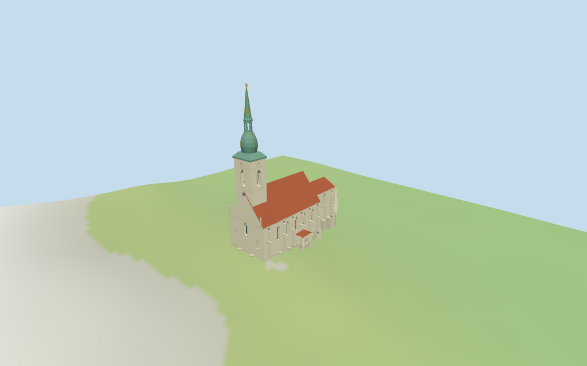

# N0350 — St. Martin's Cathedral, Bratislava review

Reviewed 2026-10-14 against current source/runtime bytes. Accepted for the recorded medium-fi exterior and approximate geographic scope.

## Built result

Inspected all 11 final portable/source-terrain views. Pale single western tower,three west Gothic window fields,steep red nave roof,lower polygonal eastern chancel,north/east chapels,southern vestibule,stepped outward buttresses and selected west pinnacles are present. Tower has four actual pointed belfry openings,clock/rose fields,green copper apron/rounded bulb,open octagonal lantern,tall spike,restrained golden ribs and abstract crown. Side doors/glazing have closed recessed backing. Corrected inward buttresses and their tapered steps,removed the window covered by the northern chapel,moved apse supports away from lancets and aligned metal/clock details to the model floor.

Individual medium-fi exterior based on two useful inspected elevated-front/tower-detail pictures and standard viewer PMTiles/DEM. Eaves,wall cores/roof subdivisions,buttress profiles,selected windows/closed side portals,clock/rose fields,copper apron/bulb/lantern/spike and abstract crown are picture-led estimates. Tower subdivisions are 50m wall,53..63m bulb,63..68m open lantern and 83.5m spike/85m crown above the estimated floor. Exact crown insignia,sculpture,tracery,full interiors,adjacent city walls/buildings and certified walking are excluded. Physical phone/laptop timings remain pending.

## Shared materials and placement

Inspected all 11 final shared-material/geographic views. Five existing 256-square graphs provide lime plaster,raw limestone,ceramic tile,copper and plain wood. Green/gold stages share copper with separate linear tints;glazing is flat blue-gray. UVs are metric and skyline uses graph mean tints. Each graph reads once. Unloading disposes geometry,leaves zero live model geometries and restores ground. Flat placement compares the signed footprint;source-terrain views complement coarse DEM contact. Ground colors are diagnostic.

Retained exact-QID relation16609274 and eight current PMTiles controls preserve the approximately 77.22x38.07m cathedral envelope without rescaling. Anchor [17.10506053,48.142001435],heading 0.309301458594rad: native-X faces the western tower/gable,native+X the eastern polygonal chancel,native+Z the southern vestibule and native-Z the northern chapels. Raw transforms match. Mapped tower 85m,nave 34m,chancel 25.03m,east chapel 15.5m and vestibule 8m heights are retained;the earlier 16m fact is not the overall height. Standard DEM datum 155.384861m and estimated 4.4m floor clear sampled footprint peak 4.005m. All 78 viewer footprint checks retain the eight selected controls and preserve four nearby buildings and the western plaza across all six outputs. Adjacent urban/citywall masses remain outside the authored scope. Exact plaza/portal thresholds and walking fit remain approximate;no road replacement.

Inspected all 27 final Earth-lighting views: Economy/High,noon/late,three distances,silhouette,six details,four matched whole-model levels and four transitions. Skyline preserves principal masses,steep roof,single copper spire,crown and coarse outward buttresses. District adds shared graphs,selected flat lancets/closed doors,clock fields and pinnacles. Street adds real recessed glazing/portals and open belfry/lantern with selected metal ribs. Closeup/master refine copper profile,clock marks and window mullions. Curvature/ornament/aperture changes remain visible. Matched cameras show the entire model;street/detail cameras intentionally crop it. Italian-palazzo neighbors are synthetic context,not local map buildings.

## Browser budgets

| Level | Triangles | Bytes | Draws |
| --- | ---: | ---: | ---: |
| skyline | 947 | 97984 | 1 |
| district | 2381 | 219992 | 7 |
| street | 5888 | 525996 | 7 |
| closeup | 8280 | 750812 | 7 |

Skyline plus district: **317976 bytes** of geometry. Source master: **997836 bytes / 8280 triangles**. Five graphs cached separately; no embedded images. Initial geometry excludes graph definitions/texture generation. Separate POSITION/NORMAL streams have equal CPU/GPU buffer totals. Physical device timings pending.

## Verification

- Targeted source reproduction: generate-additional-landmarks.mjs --ids=N0350 --check. Current source/import/derivative/review hashes match.
- Six GLBs pass Khronos with zero errors,warnings or embedded images. Four browser levels meet triangle/draw/download budgets.
- Eight raw map controls,retained exact-QID outline,signed frame and standard DEM match. All six outputs retain the mapped 85m overall top above the estimated floor. Five mapped height controls retained.
- **310 imported geometry probes** pass: principal/chapel/copper roofs,crown and outward nave/chancel buttresses across all levels;detailed bell floor,clear glazing/closed portal recesses and backing,four belfry/eight lantern apertures.
- **78 actual viewer footprint checks** pass: eight selected map controls covered,four neighboring buildings and west plaza preserved across all six outputs.
- Five graphs read once;unloading disposes geometry and restores ground.
- Source inventory/schema,map-frame and medium-fi readiness bindings pass.
- Scene validation/30-tick simulation pass: sha256:f181fc66331aa0599845670fb8eace01a1eada2c40fda269f4b3332161bcf7ae.
- Inspected **49 current frames**: 11 portable,11 shared/placement,27 medium-fi. Reports retain paths,cameras and hashes;bulk views remain local/ignored.

Source hash: sha256:728551c4796c709d4f699a2526c252a1de9c2d9042d1fb1158452c5868bbf74f. Runtime hash: sha256:0fef05d96e556755a45799191a77fb364e5265754be5ed21a98eb0f7dcb37f2a. Input hash: sha256:f55d06906755f724476d45c4a8b6bc45f52b10126b0d344e4e3c7d9ccb41a59c.

Commands: targeted generate/import/LOD;capture-next-1000-models.mjs --ids=N0350 --reflections --antialias --fit-shadows;capture-landmark-library.mjs --ids=N0350 --reflections --adaptive-clipping --bounded-placement;capture-medium-fi.mjs --ids=n0350_st_martin_s_cathedral_bratislava --reflections;molen validate;molen sim run --ticks 30 --hash. No repository-wide engine suite/audit or full source rebuild repeated;next routine source checkpoint follows N0359.

## Limits

- Exact-QID relation16609274 and eight current cathedral/part controls retain the approximately77.2x38.1m plan. Current85m tower,34m nave roof,25.03m chancel roof,15.5m east chapel and8m vestibule control overall stages. The retained16m fact is not the tower or whole-building height. Nave/chancel wall cores are reconstructed inside mapped buttress footprints,with projected buttresses and roofs retaining the mapped envelope. Estimated eaves are18m nave/18.5m chancel,11.5m east chapel and5.3m vestibule;north chapel9.5/13.5m eave/ridge. Tower wall50m,copper apron50..53m,bulb53..63m,lantern63..68m,spike69..83.5m and simplified gold crown85m. Openings,body cores,buttress profiles,pinnacle height,metal stages and terrain thresholds remain picture-led estimates;no independent survey.
- Standard DEM datum 155.384861m;estimated floor 4.4m clears sampled footprint peak 4.005m and perimeter -4.81..4.01m. Foundation follows coarse terrain. Exact plaza/portal thresholds remain approximate;no independent survey or certified walking.
- Individual medium-fi exterior from two useful inspected pictures and standard PMTiles/DEM. Map tower/nave/chancel/east chapel/vestibule heights retained. Other eaves,wall core/roof subdivisions,buttresses,openings,clock/rose fields,copper bulb/lantern,spire and abstract crown are picture-led estimates. Exact crown insignia,sculpture,tracery,full interiors,adjacent city walls/buildings and certified walking excluded. Physical device timings pending.
- Skyline preserves principal masses,steep roof,single copper spire,crown and coarse buttresses. District adds shared graphs,selected flat lancets/closed doors/clocks/pinnacles. Street adds real recessed glazing/portals and open belfry/lantern with selected ribs. Closeup/master refine copper curve,clock marks and window mullions. Changes in curvature and small ornament remain visible.

Readiness accepts this exterior scope. The 1,000-candidate goal remains incomplete.
