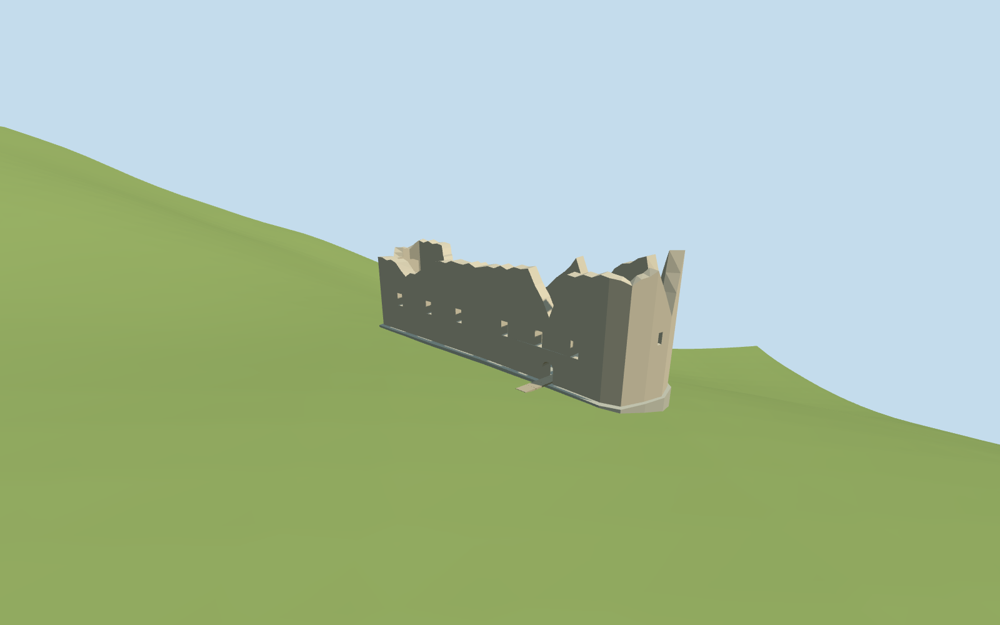
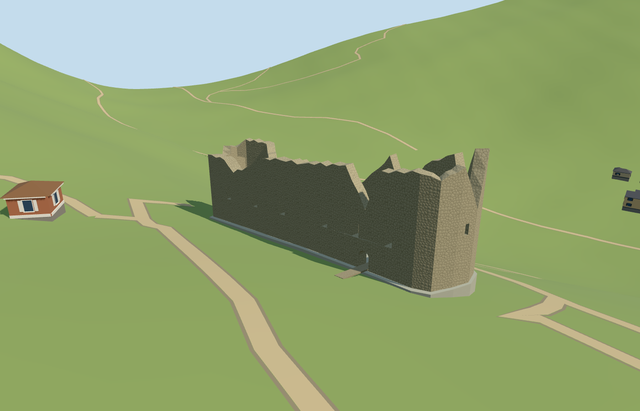

# blatnica_castle — Blatnica Castle

Reviewed 2026-10-20 in one continuous author/build/inspect/fix round.

## Appearance

Inspected all47 current portable/shared/medium-fi/native-site views in one continuous construction and correction pass. The narrow roofless castle core retains its southwestern broken rounded end, long hollow palace walls, northeastern end, thick open window/gateway reveals, two low arched partitions and bare sloping court. Corrected sheared inner window reveals during construction and moved the interior camera inside the hall to expose its floor and open connecting arch. Jagged crowns remain distinct in all four levels; no intact roofs, missing outward masonry faces or floating visible approach was observed in the accepted views.

## Shared materials and browser levels

Three existing shared256-square graphs: stone_drywall, stone_limestone_raw and gravel, at most three material draws. Shared rubble stone supplies the wall rhythm, continuous raw limestone covers the bounded faceted ridge/floor, and gravel covers only the short supported approach. Regular shared stones and a simple ridge are explicit library/coarse-map approximations. Shared renders exercise metric surfaces, tinting and graph reuse; each graph is read once and eviction disposes geometry. Zero embedded images or copied picture pixels. All canonical refs, six GLB hashes, separate runtime LOD position/normal streams and matching counted CPU/GPU bytes pass.

| Level | Triangles | Bytes | Draws |
| --- | ---: | ---: | ---: |
| skyline | 399 | 44764 | 1 |
| district | 991 | 107028 | 3 |
| street | 1299 | 140920 | 3 |
| closeup | 1299 | 140920 | 3 |

Inspected24 medium-fi views at three distances, noon/late afternoon, Economy/High, neutral silhouette, four matched levels and transitions. Skyline retains the long hollow roofless core, rounded southwestern end and broken crowns. District adds open window/gateway rhythm; street and closeup retain thick reveals and interior partitions. Levels399/991/1299/1299 triangles; skyline plus district151792bytes, below phone3MB/laptop6MB initial targets. Physical laptop/phone and dense-city timings remain pending.

## Approximate map fit

Retained exact-QID OSMway111989326 and native named castle35184484078158 fix the irregular44.356x10.423m core. Anchor18.947088674,48.947190751/global heading0/native east-south axes; internal NE-SW axis0.625590709588rad follows the retained/native footprint. The ordinary west aerial places the broken rounded end southwest and opposite end northeast; fine aperture/gateway allocation retains20degree/2m uncertainty. Only the corresponding native castle shell is replaced, with zero residual. All10 independent resident buildings among11 originals (14 in the wider extract), original6m ground/native path inputs and native zero-water condition remain unchanged. Failure restores all11 originals; four loaded levels unload with zero live model geometry. Narrow buried rock feet and the short supported approach retain original terrain without flattening or ground/water cutouts.

## Limits

Original medium-fi geometry represents the visible roofless castle core, using ordinary2020/2021 aerial/interior pictures through construction. No qualified height is present in retained/native data. Wall profile roughly4.5..13.5m above the sloping court,1.25m wall thickness, opening sizes, internal partitions and damage/conservation inventory are picture-led visualization estimates. The floor/rock top follows local cross-ridge maxima plus0.20m on standard6m Mapzen terrain; exposed ridge/foundation engineering is a coarse approximation, not a surveyed historic floor. Shared rubble masonry is more regular than real repairs. No intact roof, glass-filled ruin, complete unmapped lower bailey, temporary platforms/tarps, copied sign/photo atlas, separate shelter or whole mountain is authored.

## Selected checks

Six Khronos files: zero errors/warnings.460 actual mesh/material/contact checks; 47 current inspected views. Scene validation/sim30 and strict selected medium-fi audit pass. Source/runtime/LOD hashes and material bindings verified.

Rebuild: node packages/worldgen/scripts/generate-additional-landmarks.mjs --ids=blatnica_castle; node packages/worldgen/scripts/import-structure-models.mjs --ids=blatnica_castle; node packages/tooling/scripts/generate-landmark-lods.mjs --ids=blatnica_castle --force.

Source: sha256:5ece44e4409b003480e223534ca9fddb1b55efca467ded163a8e26e7564bb70b

Runtime: sha256:2b9101e5beb49800a7acc50d5cbc15afe13af705d5b960410bc4aa458e508d94

Input: sha256:a5d4e3206ae9961a8e4299e12a22f9bf01972a6bfd05a6528c1be803fce53137

## Viewed ordinary pictures

https://commons.wikimedia.org/wiki/File:Blatnica_Castle_aerial_2020_1.jpg — VargaA; CC-BY-SA-4.0. Viewed only; no pixels copied.

https://commons.wikimedia.org/wiki/File:Blatnica_hrad,_pal%C3%A1c.jpg — Alekme; CC-BY-SA-4.0. Viewed only; no pixels copied.
