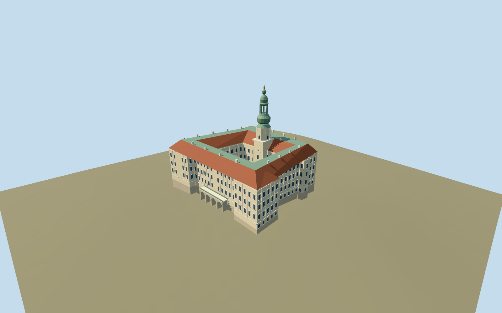

# Kroměříž Castle

Quadrangular Baroque palace with a real mapped open courtyard,cream pilastered facades,red lower roof pitches with broad green upper panels,garden arcade and84m stacked copper tower with an open lantern.

## Evidence and reconstruction

Published dimensions and reconstructed details are separated in spec.json. Primary references:

- [Reference](https://www.zamek-kromeriz.cz/en/tours/chateau-tower/)
- [Reference](https://www.zamek-kromeriz.cz/en/the-chateau-attractions/)
- [Reference](https://www.zamek-kromeriz.cz/wp-content/uploads/2023/12/dji-00013-1.jpg)
- [Reference](https://www.zamek-kromeriz.cz/wp-content/uploads/2023/12/dji-00011-1.jpg)
- [Reference](https://www.zamek-kromeriz.cz/wp-content/uploads/2024/04/bd9a9958.jpg)
- [Reference](https://www.zamek-kromeriz.cz/wp-content/uploads/2023/12/dji-0708-hdr-1-1.jpg)
- [Reference](https://www.zamek-kromeriz.cz/wp-content/uploads/2023/12/dji-0802-hdr-1.jpg)
- [Reference](https://www.zamek-kromeriz.cz/wp-content/uploads/2023/12/dji-0725-hdr-1.jpg)
- [Reference](https://www.openstreetmap.org/relation/33992)

No third-party geometry, photograph or bitmap texture is embedded. Shared surface graphs come from the central library; vertex tints carry model colors. Glazing uses PBR materials; transparent surfaces are declared per model.

## Model and axes

12,897 triangles; 38,691 vertices; 6 material groups; 1,551,428 bytes. Native bounds: -51.791, -5.106, -46.939 to 52.057, 88.400, 46.940. Source hash: `sha256:67581665352993521bdd7fbf02b2d6c60782bc13bd206ba6e9ccd4692c576cb3`.

{"up":"+Y","lateral":"+X along cached mapped axis; direction remains undirected","longitudinal":"+Z toward garden-facing wing in this original reconstruction","origin":"Site anchor; Y0 standard PMTiles working datum."}

Two inspected pictures confirm pale pilastered palace, red roof pitches/green upper panels, garden portico, projecting corner masses and stacked copper tower. Standard viewer PMTiles and retained mapped outer/court rings set approximate location, scale and orientation. The mapped courtyard notch supports the original tower control; the tourist POI is approximate and does not override this geometry. Original portico and corner roofs fit the mapped recessed facade and projecting corners. A reconstructed4.4m working rise clears coarse ground; bounded wall bottoms extend below terrain. Anchor 17.393266452,49.300303249; heading -0.813010109964; standard PMTiles datum 202.37749866501176m. Floors are reconstructed and foundations extend below the coarse sampled ground.

## Reproduce

Run `node packages/worldgen/scripts/generate-signature-towers.mjs --ids=kromeriz_castle` (or add `--check`). The generator preserves manually edited masters by checking their baseline hashes. Import through the standard authored-model workflow with optimization disabled; then capture all QA cameras, including shared-surface views.

## Pending work

- Approximate current exterior from two inspected pictures and standard viewer PMTiles, without bespoke survey or exact thresholds.
- Original master/hash/recipe preserved. Tower and portico controls retain the mapped courtyard notch and recessed facade; tourist POI is not a measured footprint.
- Roof, portico, court floor and facade proportions reconstructed; orientation is approximate visual map fit.
- Five common graphs plus an explicit recess slot; zero embedded images. Gardens, town neighbors, interiors and terrain cutouts excluded. Footprint replacement remains off; physical-device timing unmeasured.

This bundle follows the medium-fi standard. Medium-fi appearance and geographic fit are reviewed separately. Hash-bound visual acceptance is recorded separately after capture inspection.

## Additional geographic data

© OpenStreetMap contributors;Archbishop’s Chateau Kroměříž primary factual/photo references.
