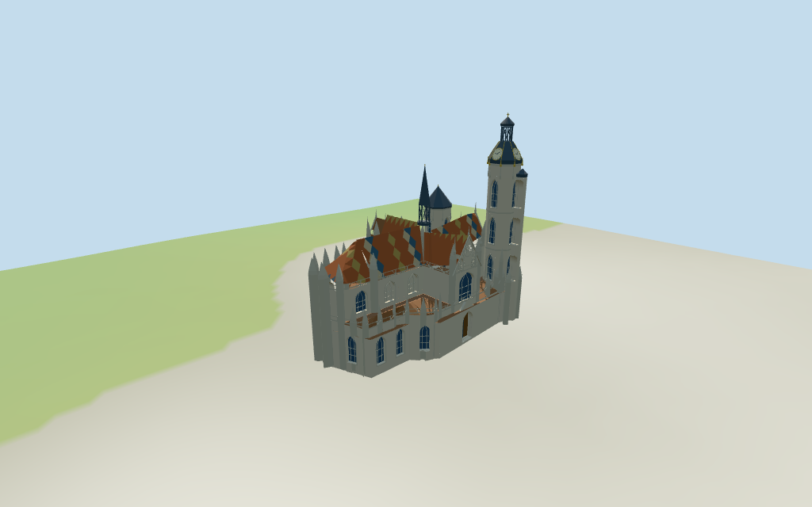

# Cathedral of St. Elizabeth

Individual Košice Cathedral of St. Elizabeth:cruciform Gothic stone hall/polygonal choir and lower aisle envelope,patterned tile roofs,slender crossing fleche,unequal western towers with northern clock/onion crown and lower southern dark pyramidal cap,three deep portals/ornamental gables,recessed lights/blind tracery,stepped buttresses and pinnacles. Shared materials/four medium-fi LODs. St. Michael chapel,Urban tower and surrounding streets excluded.

## Evidence and reconstruction

Published dimensions and reconstructed details are separated in spec.json. Primary references:

- [Reference](https://commons.wikimedia.org/wiki/File:St_Elisabeth_Cathedral_Kosice.jpeg)
- [Reference](https://commons.wikimedia.org/wiki/File:View_of_St._Elizabeth%27s_Cathedral_from_Alzbetina_street.jpg)

Five existing cached256-square ashlar,continuous limestone,ceramic tile,standing-seam metal and plain wood graphs supply seven merged groups.Pale/grey stone,red/ochre/slate/cream roof-pattern colors,dark metal and gold accents use linear tints and metric UVs.Flat architectural normals.No embedded images,unique facade maps,reference-photo textures or baked lighting.Roof pattern is coarse geometry/vertex color over the shared tile graph;its detailed motif sequence is approximate.

## Model and axes

31,686 triangles; 95,058 vertices; 7 material groups; 3,806,468 bytes. Native bounds: -30.804, -0.634, -20.972 to 30.852, 59.450, 20.592. Source hash: `sha256:38825707555cf6b1699d35d1d464f3c432888f9e3fa1dfb1709bfff99ce5d212`.

{"x":"east toward polygonal choir","y":"up","z":"south toward lower western tower"}

Standard viewer DEM datum213.023687 m; raw perimeter-0.30..0.81 m. Estimated floor0.45 m; footings crossY=0 and extend below samples. No flattening,host DEM changes or road replacement. Exact plaza/door joins,base clipping,absolute altitude and walking remain unverified. Separate St. Michael chapel,Urban tower,neighboring blocks and streets remain host content.

## Reproduce

Run `node packages/worldgen/scripts/generate-additional-landmarks.mjs --ids=N0394` (or add `--check`). The generator preserves manually edited masters by checking their baseline hashes. Import through the standard authored-model workflow with optimization disabled; then capture all QA cameras, including shared-surface views.

## Pending work

- Retained whole height=1 m conflicts with building:levels=6, photographs and 107 mapped parts. It remains raw evidence and is not used as the cathedral height. Part heights fix low ranges12/14 m, high roof ridges29.5 m, crossing30.2 m, central fleche46 m with min_height30.2, north tower46 m, inner crown51.7 m with min_height45.4, stair turret42.5 m and south tower30 m. Interpret high eaves20 m, low eaves9.5/11.5 m, north onion46..51.7 m with an estimated upper lantern/finial to59 m, and south dark roof to37 m above an estimated0.45 m floor. Upper/roof/door/clock/tracery partitions, part height datums and total59 m tip remain picture estimates. No independent height/width/length facts or horizontal rescale. Whole roof:shape=onion applies visually to the north tower,not the entire cruciform roof.
- Standard viewer DEM datum213.023687 m; raw perimeter-0.30..0.81 m. Estimated floor0.45 m; footings crossY=0 and extend below samples. No flattening,host DEM changes or road replacement. Exact plaza/door joins,base clipping,absolute altitude and walking remain unverified. Separate St. Michael chapel,Urban tower,neighboring blocks and streets remain host content.
- Medium-fi exterior from two actually inspected2019/2020 whole oblique/western photographs and standard viewer PMTiles/DEM only.No bespoke plans/surveys.Reference images not redistributed.Roof motif sequence,fine saints/crockets,tracery lobes,inscriptions,glass artwork,gold crown flourishes,hidden elevations,full interiors and engineering sections are approximate or excluded.Separate St. Michael chapel/Urban tower and streets remain host content.Current finish and precise host-ground joins unverified.Physical laptop/phone timing pending.
- Skyline retains cruciform/choir roof hierarchy,tall staged onion clock tower,lower southern roof-cap tower,crossing fleche and lower aisle envelope.District adds shared surfaces,selected recesses/clock/portals and principal pinnacles.Street adds coarse multicolor roof pattern,fuller windows/blind tracery,stone trim/parapet rhythms.Closeup/master refine the roof color rhythm,selected tracery/transoms,clock ticks/gold ribs and gable detail.No unique roof texture.Raw micro-projections are simplified;partitions/eaves/roof joins are explicit estimates.Regional neighbors are fixtures.

This bundle follows the medium-fi standard. Medium-fi appearance and geographic fit are reviewed separately. Hash-bound visual acceptance is recorded separately after capture inspection.

## Additional geographic data

©OpenStreetMap contributors;Protomaps;Mapzen/USGS terrain tiles.
