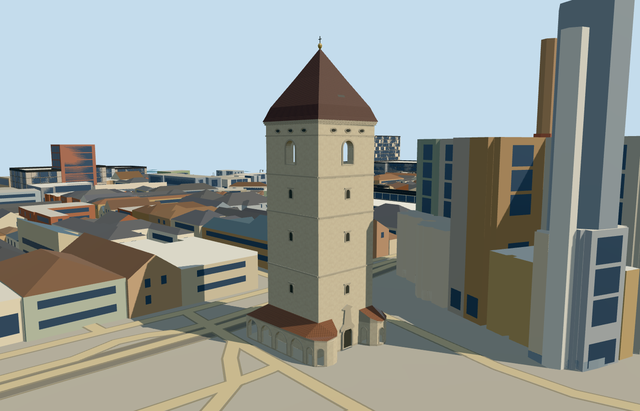

# N0632 — St. Urban Tower

Reviewed 2026-10-20 in one continuous author/build/inspect/fix round.

## Appearance

Inspected47 current portable/shared/medium-fi/native-site views in the same construction/correction pass. The specific restored pale square tower retains horizontal bands, small closed lower windows, a hollow upper belfry with genuinely open round-arched windows, original simplified roundels, flared steep pyramidal brown roof/vent/gilt ball/iron finial, and the low open arcade/two rounded western projections/central portal. Seated the roof at the actual attachment datum before captures; shared renders showed noisy tiled fascia, so changed the arcade fascia/soffit to quiet existing raw stone. No missing roof faces, closed arcade bays, floating finial or unsupported visible floors were observed in the accepted views.

## Shared materials and browser levels

Five existing shared256-square graphs: stucco, stone_sandstone_raw, slate, tile_glazed and metal_painted. Pale stucco covers the restored body; continuous raw stone supplies bands/frames/portal/quiet fascia; slate covers the main brown roof; tinted glazed tile approximates the red-brown low arcade roofs; painted material supplies closed small panels, original roundel centers and finial colors. Six roles merge into five near-level draws. Each graph is read once; eviction disposes geometry. Zero embedded images/copied pixels, canonical refs, six verified GLB hashes, separate runtime LOD position/normal streams and equal counted CPU/GPU bytes.

| Level | Triangles | Bytes | Draws |
| --- | ---: | ---: | ---: |
| skyline | 948 | 100180 | 1 |
| district | 2996 | 304356 | 5 |
| street | 6670 | 683716 | 5 |
| closeup | 6670 | 683716 | 5 |

Inspected24 medium-fi views at three distances, noon/late afternoon, Economy/High, neutral silhouette, four matched levels and transitions. Skyline retains the tall pyramid/belfry and low open arcade with rounded corners; district adds the small-window/frieze/portal rhythm, nearer levels add frames and roof vent. Skyline plus district404536bytes, below phone3MB/laptop6MB initial targets. Current procedural neighbors are generalized rather than a reconstruction of historic Kosice; the independent cathedral stays native in this fixture. Physical laptop/phone and dense-city timings remain pending. Levels948/2996/6670/6670 triangles; at most five draws.

## Approximate map fit

Retained exact-QID OSMway25720529 and seven native parent/core/arcade records establish anchor21.258135114,48.7206616. The native quadrilateral gives center[.253606748,.156506027]m, internal X[.935601609,-.353057544]/Z[.353057544,.935601609], approximate11.2283x10.9745m core and global heading0/native east-south. The older reference point does not control fit. West portal and rounded-corner arrangement follow the footprint/pictures; fine facing/reverse layout retains20degree/2m uncertainty. Only the seven corresponding native records are replaced, with numerical remainder areas below1.36e-9m2 and no visible old shell. All1313 independent resident inputs among1320 originals (2158 wider records), original6m terrain/native road inputs and7509.41326812937m2 water remain unchanged. Failure restores1320 originals; all four levels unload with zero live geometry.

## Limits

Original medium-fi geometry follows two actually inspected ordinary December2025 pictures of the restored exterior. Parent1m, core44m and five arcade5m map attributes are preserved as distinct evidence;1m is not used as a whole-tower height or a measured foundation. Allocations of32.1m eave, pyramid42.2m and gilt-ball/iron tip44m, low roof3.35..5m, bands/arches/frieze/portal/window inventory and hidden reverse details are picture-led estimates within the native component envelopes. The roof is pyramidal, not the separate cathedral clock tower dome. Blank original relief replaces copied heraldry/epitaphs/text. No furnished museum/bell interior, temporary restoration fencing, photo atlas, neighboring cathedral or whole-square platform is authored. Bounded buried feet and narrow arcade walks use a0.227591m attachment plane above coarse anchor terrain; native terrain is neither flattened nor cut.

## Selected checks

Six Khronos files: zero errors/warnings.342 actual mesh/material/contact checks; 47 current inspected views. Scene validation/sim30 and strict selected medium-fi audit pass. Source/runtime/LOD hashes and material bindings verified.

Rebuild: node packages/worldgen/scripts/generate-additional-landmarks.mjs --ids=N0632; node packages/worldgen/scripts/import-next-1000-models.mjs --ids=N0632; node packages/tooling/scripts/generate-landmark-lods.mjs --ids=N0632 --force.

Source: sha256:d6efdbe521172567da8e47f4612a8066ecc7ecf12ebb39efff911456c6536004

Runtime: sha256:77802cb80e2e7217004a25abd34fa69aee1bf003c6a02cf3f03181aab41c86d8

Input: sha256:7fbc221efe7fb3e57c322d5f472c946d63b73d9e5d8f5133265af9e9f7c76c7e

## Viewed ordinary pictures

https://commons.wikimedia.org/wiki/File:Košice_-_Hlavná_(Main_Street)_-_Hlavné_námestie_(Main_Square)_-_Urbanova_veža_(Saint_Urban_Tower)_after_recent_outside_restoration,_with_the_ground_floor_fenced_off_due_to_ongoing_restoration_works_(December_2025).jpg — ZemplinTemplar; CC-BY-SA-4.0. Viewed only; no pixels copied.

https://commons.wikimedia.org/wiki/File:Košice_-_Hlavná_(Main_Street)_-_Hlavné_námestie_(Main_Square)_-_View_of_St_Urban_Tower_and_the_Cathedral_of_Saint_Elisabeth_from_the_city_park_(December_2025).jpg — ZemplinTemplar; CC-BY-SA-4.0. Viewed only; no pixels copied.
