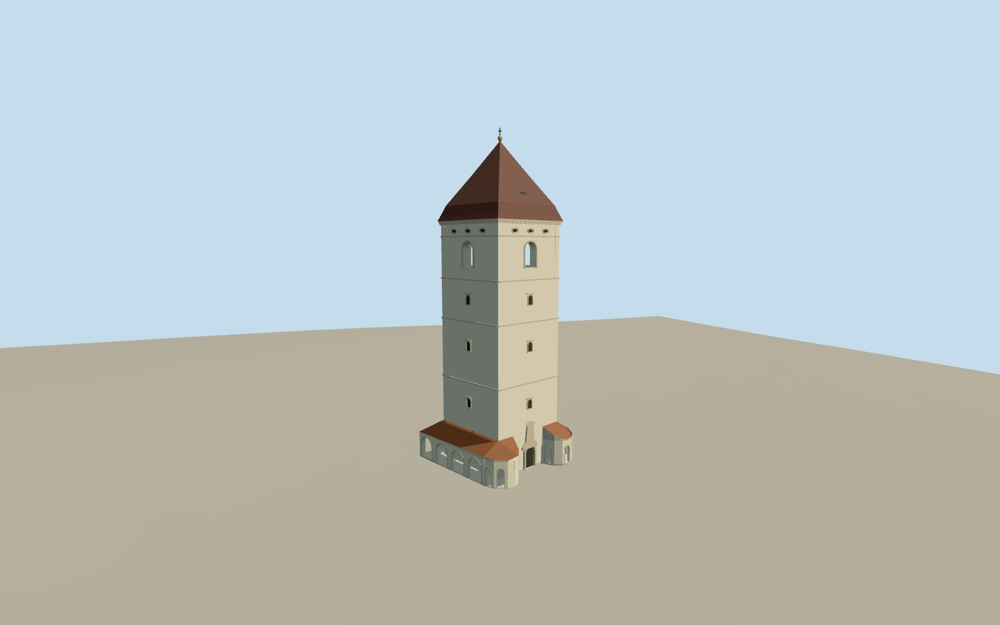

# St. Urban Tower

Specific restored St Urban Tower in Kosice: pale-plaster square body/floor bands, small closed windows, genuinely open round-arched upper belfry, simple original roundel frieze, steep flared pyramidal brown tiled roof/vent/gilt ball/iron finial, low open round-arched arcade with two rounded western corners/red-brown roofs and selected central portal relief. Existing shared low-frequency stucco/stone/roof/paint graphs; no copied epitaphs, heraldry, inscriptions, photographs, museum interior, temporary restoration fence, neighboring cathedral or whole square platform.

## Evidence and reconstruction

Published dimensions and reconstructed details are separated in spec.json. Primary references:

- [Reference](https://commons.wikimedia.org/wiki/File:Košice_-_Hlavná_(Main_Street)_-_Hlavné_námestie_(Main_Square)_-_Urbanova_veža_(Saint_Urban_Tower)_after_recent_outside_restoration,_with_the_ground_floor_fenced_off_due_to_ongoing_restoration_works_(December_2025).jpg)
- [Reference](https://commons.wikimedia.org/wiki/File:Košice_-_Hlavná_(Main_Street)_-_Hlavné_námestie_(Main_Square)_-_View_of_St_Urban_Tower_and_the_Cathedral_of_Saint_Elisabeth_from_the_city_park_(December_2025).jpg)

Specific restored St Urban Tower in Kosice: pale-plaster square body/floor bands, small closed windows, genuinely open round-arched upper belfry, simple original roundel frieze, steep flared pyramidal brown tiled roof/vent/gilt ball/iron finial, low open round-arched arcade with two rounded western corners/red-brown roofs and selected central portal relief. Existing shared low-frequency stucco/stone/roof/paint graphs; no copied epitaphs, heraldry, inscriptions, photographs, museum interior, temporary restoration fence, neighboring cathedral or whole square platform.

## Model and axes

6,670 triangles; 20,010 vertices; 5 material groups; 803,772 bytes. Native bounds: -9.497, -0.517, -10.087 to 10.201, 44.228, 9.218. Source hash: `sha256:d6efdbe521172567da8e47f4612a8066ecc7ecf12ebb39efff911456c6536004`.

{"x":"east","y":"up","z":"south"}

The geographic proposal uses exact-QID OpenStreetMap evidence. Map-derived orientation and estimated architectural details require real-site visual review; preview eligibility is distinct from geographic/fidelity approval. Map attribution: © OpenStreetMap contributors, ODbL-1.0.

## Reproduce

Run `node packages/worldgen/scripts/generate-additional-landmarks.mjs --ids=st_urban_tower` (or add `--check`). The generator preserves manually edited masters by checking their baseline hashes. Import through the standard authored-model workflow with optimization disabled; then capture all QA cameras, including shared-surface views.

## Pending work

- Specific restored St Urban Tower in Kosice: pale-plaster square body/floor bands, small closed windows, genuinely open round-arched upper belfry, simple original roundel frieze, steep flared pyramidal brown tiled roof/vent/gilt ball/iron finial, low open round-arched arcade with two rounded western corners/red-brown roofs and selected central portal relief. Existing shared low-frequency stucco/stone/roof/paint graphs; no copied epitaphs, heraldry, inscriptions, photographs, museum interior, temporary restoration fence, neighboring cathedral or whole square platform.
- Retained exact-QID OSMway25720529 and native parent35184397809361/core35185247715697/five arcade parts identify the tower. Native core quadrilateral supplies internal axes/center[0.25360674849280684,0.15650602748593623]m at anchor21.258135114,48.7206616. The older reference point is offset and does not control placement. Global heading0/native east-south retains mapped footprint; the west-side rounded arcade corners and central portal follow pictures/outline. Fine facade/reverse layout retains20degree/2m uncertainty.
- Retained parent height1 also appears on the native parent. Native core child has44m and five low arcade children5m. Preserve these distinct attributes;1m is not a plausible overall height or proof of a measured1m foundation. Use44m overall model envelope with picture-led allocations for the core/roof/finial and5m low-arcade roof envelope. Actual architecture/engineering remains approximate. Nominal plaster/eave32.1m, curved pyramid to42.2m, gilt ball and iron finial to44m; low arcade eave3.35m/top5m. Floor-band/window/frieze/portal inventory and allocations remain picture-led estimates, not surveyed conservation dimensions.
- Retain original6m standard Mapzen terrain, native streets/paths/water and independent cathedral/surrounding buildings. Replace only seven corresponding native tower/arcade records. Bounded buried tower/arcade feet and narrow occupied arcade floors meet the coarse grid; no full-square slab, terrain flattening or ground/water cutout. Arcade openings extend to their occupied floors, and the upper belfry is hollow. Foundation/floor datum and obscured lower works remain coarse-map estimates.
- Two ordinary December2025 pictures of the restored tower carried through construction. Main44m/arcade5m native components qualify the parent1m tag. Fine frieze/portal/reverse/roof allocation and coarse-terrain contact remain approximate. No copied heraldry/epitaphs/text/photo atlas, temporary fence, whole cathedral or furnished interior.

This bundle follows the medium-fi standard. Medium-fi appearance and geographic fit are reviewed separately. Hash-bound visual acceptance is recorded separately after capture inspection.
