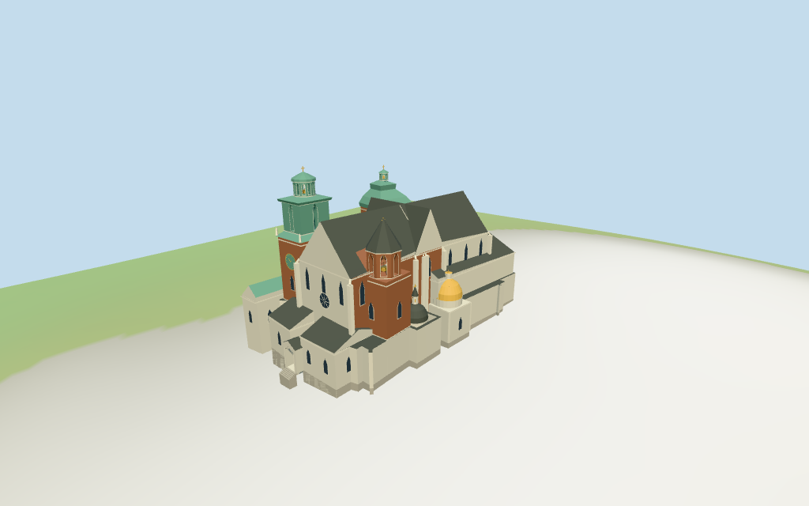

# Wawel Cathedral

Individual Wawel cathedral exterior with pale west gable/rose and portico, separate green clock/Sigismund and brick Silver Bells towers, steep nave/transept/choir roofs, dark Vasa/gold Sigismund domed chapels and connected northern treasury/chapterhouse. The existing royal palace remains a separate asset.

## Evidence and reconstruction

Published dimensions and reconstructed details are separated in spec.json. Primary references:

- [Reference](https://www.inyourpocket.com/krakow/Wawel_73574f)
- [Reference](https://przewodnicypokrakowie.pl/katedra_wawelska.php)
- [Reference](https://www.apollo.no/polen/krakow/reisetips/severdigheter-i-krakow)

Six existing shared256-square limestone/brick/slate/copper/raw-stone/wood graphs, metric UVs and linear tints. Green patina and gold chapel use one copper graph/material with different vertex tints; glazing uses vertex colors. No embedded image.

## Model and axes

17,476 triangles; 52,428 vertices; 8 material groups; 2,101,792 bytes. Native bounds: -43.000, -3.528, -31.545 to 39.912, 48.200, 19.872. Source hash: `sha256:816765b11c4bb87a2e62048100e205957a72193561ba5464ad035bbb1add5a79`.

{"x":"east along cathedral toward choir","y":"up","z":"south toward domed chapels"}

Individual cathedral exterior fit from useful pictures and standard viewer PMTiles/DEM. Separate palace asset excluded. NativeY0 follows225.461986m datum;3.2m estimated floor and foundations approximate hill/plaza contact. Exact shared thresholds, structural dimensions and walking surfaces unverified.

## Reproduce

Run `node packages/worldgen/scripts/generate-additional-landmarks.mjs --ids=wawel_cathedral` (or add `--check`). The generator preserves manually edited masters by checking their baseline hashes. Import through the standard authored-model workflow with optimization disabled; then capture all QA cameras, including shared-surface views.

## Pending work

- Main35m roof,22m lower choir,12m west chapels and45m north crown retained as nominal map heights. South55m cap conflicts with pictures/named Silver Bells crypt; use36m lower component for that crown. Northern Sigismund41m and all intermediate roof/drum/gable splits are estimates. Exact heights unverified.
- Individual cathedral exterior fit from useful pictures and standard viewer PMTiles/DEM. Separate palace asset excluded. NativeY0 follows225.461986m datum;3.2m estimated floor and foundations approximate hill/plaza contact. Exact shared thresholds, structural dimensions and walking surfaces unverified.
- Exact sculpture, tracery, inscriptions, interiors and monastic/royal compound are excluded. Green/gold roof material shares one metallic compromise. Neighboring palace thresholds and physical phone/laptop timing are unverified.
- Skyline preserves primary tower/gable/dome silhouettes; district restores selected openings/shared textures, street restores complete stages and buttresses, closeup refines domes, rose/clock trim and stone surrounds. Detail/profile changes remain visible.

This bundle follows the medium-fi standard. Medium-fi appearance and geographic fit are reviewed separately. Hash-bound visual acceptance is recorded separately after capture inspection.

## Additional geographic data

©OpenStreetMap contributors; Protomaps; Mapzen/USGS terrain tiles.
