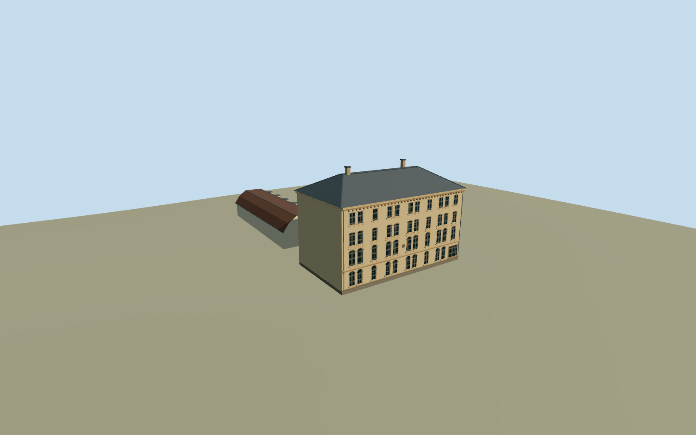

# Mendelssohn House, Leipzig

The surviving Leipzig home of Felix Mendelssohn with its grouped Late-Classical street arches, warm sandstone detailing, low slate hip, and the white garden house with terracotta dormered roof.

Authoring state: **review-in-qa.json**. Current completion evidence is in [qa.json](qa.json) and the [completion ledger](../../../../qualla-structures/batches/qualla-003.PROGRESS.md).

- [Mendelssohn House, Leipzig](https://qualla.com/mendelssohn-house-leipzig/)

The 1900 street image covers most of the original frontage. The precise current siding color, door and shop joinery, modest rear openings, roof vents and exact projecting dimensions are approximate.

The open garden is preserved between both models. Neighboring apartments, courtyard planting and interiors are outside the selected scope.

Build: `node content/worldgen/source/places/u3/u30/mendelssohn_house_leipzig/models/generate-mendelssohn-house-leipzig.mjs`. Add `--check` to verify exact regeneration. 5649 triangles; 8 materials; no embedded photographs.
