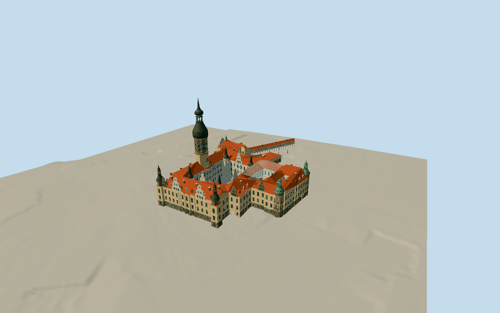

# Dresden Castle

Native reconstructed castle with three actual courtyard voids,100.27m Hausmann tower/39m platform, red-blue clocks below the platform, one main arched-window tier and small upper round lights in the dark octagonal drum, substantial rounded lead roof/open lantern/upper bulb/tall needle. Two dark west corner lantern towers, two green-copper south turrets and four pointed court stair towers. Ochre exterior/rusticated ground storey and original abstract black-white Great Court sgraffito, stepped/curved gables, red tiled roofs, small roof dormers and chimneys, three-tier Altan loggia and two-storey Small Court arcades under a raised double-curved transparent ETFE diamond net. Connected Georgenbau through-gateway and100m skewed Langer Gang/22 real open arches, upper gallery windows and abstract gold frieze. Four actual through-entry routes, closed wooden south entrance, court basin and two tournament columns. Own paving follows independent unchanged GeoSN DGM. Cathedral/covered church bridge, Zwinger, Johanneum, Taschenbergpalais, gardens, temporary works and interiors excluded.

Authoring state: **review-in-qa.json**. Current completion evidence is in [qa.json](qa.json) and the [local 100 ledger](../../../../qualla-structures/batches/PROGRESS.md).

- [Dresden Castle](https://qualla.com/dresden-castle/)

All117 candidate contacts reviewed, plus12 selected local Furstenzug sibling contacts; eight positive full originals individually inspected. Two2025 Cathedral views were read for discrimination and rejected as castle geometry. Unrelated museums, churches, theatres, gardens, airport, food, interiors, historical schemes and1980 ruin do not control this exterior.

Scope retains main castle with three native court voids (Great Courtyard, covered Small Courtyard and southern Wirtschaftshof), Hausmann tower, Georgenbau through-gateway, connecting stable-court wings and Langer Gang/22-arch gallery. Adjacent cathedral/covered church bridge, Zwinger, Taschenbergpalais, Johanneum and other neighbors excluded.

Current2025 local courtyard/entry images and2008–2019 exterior references control surviving architecture. The2025 conservation report gives a planned end date only; no exact present-day paint/conservation completion claim. Temporary scaffolding, signs, market stalls, cars, people and vegetation omitted.

Owner100.27m tower and39m platform,22 arcade spans and approximately100m gallery are dimensional controls. Native own footprints and skewed connected wings retained; other heights/roof forms/bay rhythm/ornament/thresholds are proportional interpretations.

Original restrained geometric sgraffito, relief and gold frieze density may approximate decorated surfaces; do not reproduce literal historical paintings, procession figures, heraldry, monograms or inscriptions. No facade photographs as textures.

Independent source terrain must be preserved and verified before model geometry. Geographic preview requires compatible ground; no terrain flattening/fitting, surveyed engineering or exact interior reconstruction.

Roof ridges, dome rise, bay/window counts, intermediate heights, precise geometric ornament and thresholds are photo/map interpretations, not surveyed construction drawings. Original abstract decoration replaces literal paintings, procession figures and inscriptions. Lower service-court roof form is uncertain. Translucent ETFE is a simplified material proxy; interior engineering is not reconstructed. Native Langer Gang polygon is independently retained/checked but outside the single primary magenta placement overlay.

Build: `node packages/worldgen/scripts/generate-authored-places.mjs --ids=dresden_castle`. Add `--check` to verify exact regeneration. 61144 triangles; 8 materials; no embedded photographs.
