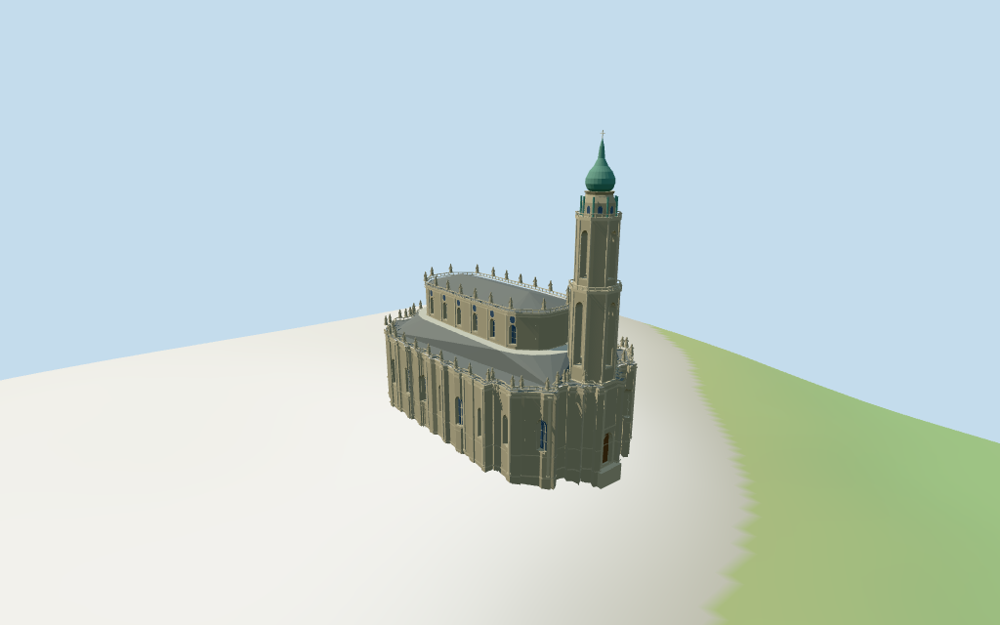

# dresden_cathedral — Dresden Cathedral review

Reviewed 2026-10-14 against current source/runtime bytes. Accepted for the recorded medium-fi exterior and approximate geographic scope.

## Built result

Inspected all 11 final portable/source-terrain views. Individual broad rounded lower body, narrower rounded upper nave, gray hipped roofs/pale metal apron, two balustrade/selected-figure tiers, repeated pilasters/tall windows/oval lights, one tall stepped tower with actual open bays, green onion/spike/cross and one closed recessed entrance are present. Corrected the inward-folded upper roof and excessive silhouette reduction; bounded outline simplification now retains the curved ends. Figures, crown openings and facade relief are medium-fi approximations.

Individual medium-fi current exterior from two useful inspected elevated pictures and standard viewer PMTiles/DEM. Retained map tags explicitly flag inconsistent part heights. The 24m lower cornice,29.8m apron and 49.5/67.5/79.5/86m tower stages plus 87.9m top are approximate controls. Conflicting upper-body/roof/figure prisms are replaced by picture-led 40m cornice,43.5m roof ridge and about 3.5m figures. Openings, crown subdivision, sculpture silhouettes and roof profiles are estimated. Exact sculptures/carved crests/inscriptions, full interiors, adjacent castle/covered connection and certified walking are excluded. Physical laptop/phone timings remain pending.

## Shared materials and placement

Inspected all 11 final shared-material/geographic views. Four existing 256-square graphs supply raw sandstone, sandstone trim, standing-seam metal and wood. Gray roofs, pale apron and green crown share metal through linear tints. UVs are metric; glass is flat blue-gray and skyline uses mean tints. Each graph reads once. Unloading releases all model geometries and restores ground. Flat placement checks the signed plan; portable views complement coarse DEM contact. Ground colors are diagnostic.

Retained exact-QID way14879154 and 86 current cathedral controls retain the approximately 94.3x53.9m parent, upper-body/apron/tower plans and mapped figure locations. Native+X faces the northeast single tower/entrance, native-X the southwest rounded nave, native+Z the southeast castle side, at heading 0.455206290833rad. Raw transforms match without overall rescaling. The inward-folded upper-body input supplies a reconstructed convex envelope; distant lower-body LODs retain the parent outer envelope while the master keeps facade relief. Figure centers project to the reconstructed cornice. Standard DEM datum 122.273763m and estimated 1.3m floor clear sampled footprint peak 0.866m. All 24 actual viewer mask checks retain the cathedral and leave the adjacent castle block,castle tower and open front square uncovered. Precise portal/ground contact and walking fit remain approximate; no road replacement.

Inspected all 27 final Earth-lighting views: Economy/High, noon/late, three distances, silhouette, six details, four matched whole-model levels and four transitions. Skyline preserves the rounded lower/upper envelopes, layered roofs/apron and stepped single tower/onion/spike/cross, omitting glazing and figures. District adds shared graphs, tall/oval panels, selected pilasters/balustrades and five coarse figures. Street adds actual tower bays, recessed windows/closed portal and all selected mapped figures. Closeup refines profiles, railings, figures, frames and mapped lower facade relief. Detail changes remain visible. Four matched cameras retain the full model; closer details/street cameras crop intentionally. Italian-palazzo neighbors are synthetic context, not local map buildings.

## Browser budgets

| Level | Triangles | Bytes | Draws |
| --- | ---: | ---: | ---: |
| skyline | 996 | 83224 | 1 |
| district | 3969 | 345800 | 5 |
| street | 14031 | 1325108 | 5 |
| closeup | 39121 | 3787908 | 5 |

Skyline plus district: **429024 bytes** of geometry. Source master: **4697848 bytes / 39121 triangles**. Four shared graphs cached separately; no embedded images. Initial geometry excludes graph definitions/texture generation. POSITION/NORMAL streams have equal CPU/GPU buffer totals. Physical device timings pending.

## Verification

- Exact targeted reproduction with --ids=dresden_cathedral --check. Current source/import/derivative/review hashes match.
- Six GLBs pass Khronos with zero errors, warnings or embedded images. Four browser levels meet triangle/draw/download budgets.
- All 86 raw current map controls, retained exact-QID outline, signed frame and standard DEM match. Height inconsistency is explicit; all six outputs retain the declared 87.9m top above the floor.
- **410 imported probes** validate roofs, three tower floors, crown and landing across six outputs; all principal recessed window panes/closed portal and eight open tower bays in source/import/street/closeup. Glazing probes avoid mullions.
- **24 current viewer footprint checks** cover the cathedral and leave the adjacent castle block,castle tower and open front square uncovered across all six outputs.
- Four material graphs read once; unloading disposes model geometry and restores ground.
- Source inventory/schema, map-frame and medium-fi readiness bindings pass.
- Scene validation and 30-tick simulation pass: sha256:6ecdd1d07d7f575c21d4b0c3edc8137ef6698e2f57b119eee07924cd7595a514.
- Inspected **49 current frames**: 11 portable,11 shared/placement,27 medium-fi. Reports retain paths,cameras and hashes; bulk views remain local/ignored.

Source hash: sha256:6aeb595a4d0d33702da5cb5d986929d094e731bde386538fff078259defd11fa. Runtime hash: sha256:6761180e4427ed20504610b9a615096db328965a70343834d0a79698683e58a7. Input hash: sha256:51896916343d8db10c6da0128618832d52d53a851759d4a9434423612ef31658.

Commands: targeted generate/import/LOD; capture-structure-models.mjs --ids=dresden_cathedral --reflections --antialias --fit-shadows; capture-landmark-library.mjs --ids=dresden_cathedral --reflections --adaptive-clipping --bounded-placement; capture-medium-fi.mjs --ids=dresden_cathedral --reflections; molen validate; molen sim run --ticks 30 --hash. No repository-wide engine suite/audit or full source rebuild repeated; next routine source checkpoint follows transfiguration_cathedral.

## Limits

- Retained exact-QID way14879154 and86 current cathedral controls retain the approximately94.3x53.9m plan,tower/nave/apron outlines and mapped figure locations. The retained source explicitly flags inconsistent overall/part heights,especially tower stages. The mapped24m lower cornice and29.8m inner apron plus49.5/67.5/79.5/86m tower stages and87.9m cross top are used as approximate controls,not surveyed values. Upper nave has a conflicting26..53m mapped prism and47..53m figures;photo-led40m upper cornice,43.5m roof ridge and3.5m figures replace these vertical values for coherent proportions. Tower subdivisions/openings,roof slope,facade details and all thresholds remain approximate. The raw upper-body plan has an inward fold;its convex outer envelope supplies the reconstructed upper nave. Raw controls remain unchanged.
- Standard DEM datum 122.273763m;estimated floor 1.3m clears sampled footprint peak 0.866m and perimeter -3.75..0.87m. Foundation follows coarse terrain. Exact plaza/portal thresholds remain approximate;no independent survey or certified walking.
- Individual medium-fi current exterior from two inspected useful pictures and standard PMTiles/DEM. Upper wall/roof heights adjusted from flagged inconsistent map values. Figure positions project to the nearest reconstructed cornice;selected faceted figures,bands,pilasters,ovals,tower crown profiles and side/rear details are approximate. Exact sculptures/carved crests/inscriptions,full interiors,adjacent castle/covered connection and certified walking excluded. Physical device timings pending.
- Skyline preserves rounded lower/upper body envelopes, layered roofs, pale apron and a single stepped tower/onion-spike/cross; figures and glazing are omitted. District adds shared graphs, selected tall/oval glazing, pilasters, balustrades and five coarse figures. Street opens actual tower bays and recesses principal windows/closed portal; closeup refines curved profiles, frames, facade relief and figures. Bounded outline reduction preserves the curved ends. Detail changes remain visible.

Readiness accepts this exterior scope. The 1,000-candidate goal remains incomplete.
