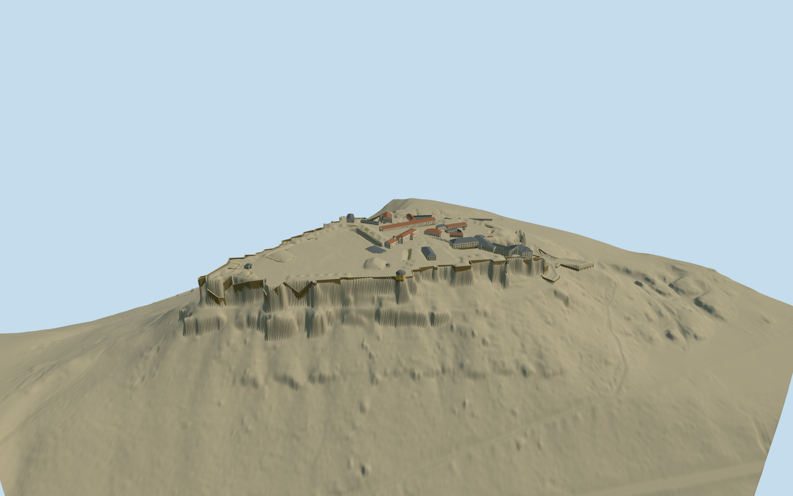

# Königstein Fortress

Königstein Fortress on the Elbe sandstone plateau, with its ramparts, western gate complex and timber ramp, 49 mapped structures, the garrison church and golden Friedrichsburg.

Authoring state: **review-in-qa.json**. Current completion evidence is in [qa.json](qa.json) and the [completion ledger](../../../../qualla-structures/batches/qualla-003.PROGRESS.md).

- [Königstein Fortress](https://qualla.com/konigstein-fortress/)

The named perimeter follows the fortress edge. Visible parapet heights and where masonry becomes sandstone are approximate. The narrower plateau walls and lower western works follow the separate terrain elevation bands.

The native building polygons set plan, and selected OpenStreetMap heights help size principal masses. Roof shapes, many floor heights and window or dormer positions are estimates, especially for unmapped distinctions within connected buildings.

The scope is the exterior and visible mouths of the western passages. Underground rooms, artifacts and decorative text are outside this model.

Build: `node content/worldgen/source/places/u3/u31/konigstein_fortress/models/generate-konigstein-fortress.mjs`. Add `--check` to verify exact regeneration. 12252 triangles; 8 materials; no embedded photographs.
