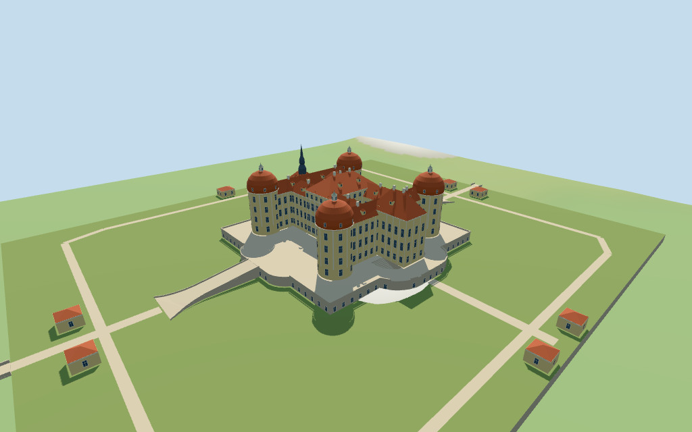

# Moritzburg Castle

Individual Moritzburg island palace: four pale cylindrical towers with red rounded domes, lanterns and finials; connected hipped palace ranges, projecting east entrance and separate dark west chapel spire; stone terrace, curved stair cut-outs, two axial retaining ramps, eight paired pavilions and two short mapped bridge gaps.

## Evidence and reconstruction

Published dimensions and reconstructed details are separated in spec.json. Primary references:

- [Reference](https://www.aerialviews.org/photos/Moritzburg-Castle.jpg)
- [Reference](https://www.regiontourist.cz/uploads/what_to_do/241/zamek-moritzburg-wiki2220.jpg)

Five existing256-square shared graphs supply plaster, ceramic tile, sandstone, slate and painted metal; glass and lawn use linear vertex tints. Metric UVs, no unique bitmap or embedded photograph.

## Model and axes

15,424 triangles; 46,272 vertices; 7 material groups; 1,854,940 bytes. Native bounds: -128.820, -3.707, -104.000 to 136.486, 43.000, 107.000. Source hash: `sha256:5428c8f8ded4b15eb64ac7e7975dad5c9712d714341eb26bbe387291a1738850`.

{"x":"southward to town bridge","y":"up","z":"westward to chapel and spire"}

Retained exact-QID low main plan and current PMTiles components, island park and two bridge segments control approximate plan/scale. Facade, roof profiles, terrace levels and water/DEM joins remain exterior-picture estimates; no surveyed fidelity claimed. © OpenStreetMap contributors, ODbL-1.0.

## Reproduce

Run `node packages/worldgen/scripts/generate-additional-landmarks.mjs --ids=moritzburg_castle` (or add `--check`). The generator preserves manually edited masters by checking their baseline hashes. Import through the standard authored-model workflow with optimization disabled; then capture all QA cameras, including shared-surface views.

## Pending work

- Mapped components establish approximate scale and facing; eaves, dome profiles, window/dormer rhythm and material colors are exterior-picture estimates.
- The0.8m exact-QID part is a low plan only. Component heights are approximate mapped data, not certified building surveys.
- The park polygon maps grass areas; the rectangular island retaining edge is a photo-led estimate against pavilion/bridge locations. Terrace stairs, island levels, short bridge engineering and coarse DEM/water joins are approximate; no terrain carving or surveyed lake level.
- Long land causeways, lake, formal gardens beyond the island, site trees, detailed interiors and certified walkable collision are excluded.
- Physical laptop and phone frame-rate measurements remain pending.

This bundle follows the medium-fi standard. Medium-fi appearance and geographic fit are reviewed separately. Hash-bound visual acceptance is recorded separately after capture inspection.

## Additional geographic data

© OpenStreetMap contributors; Protomaps; Mapzen/USGS terrain tiles.
