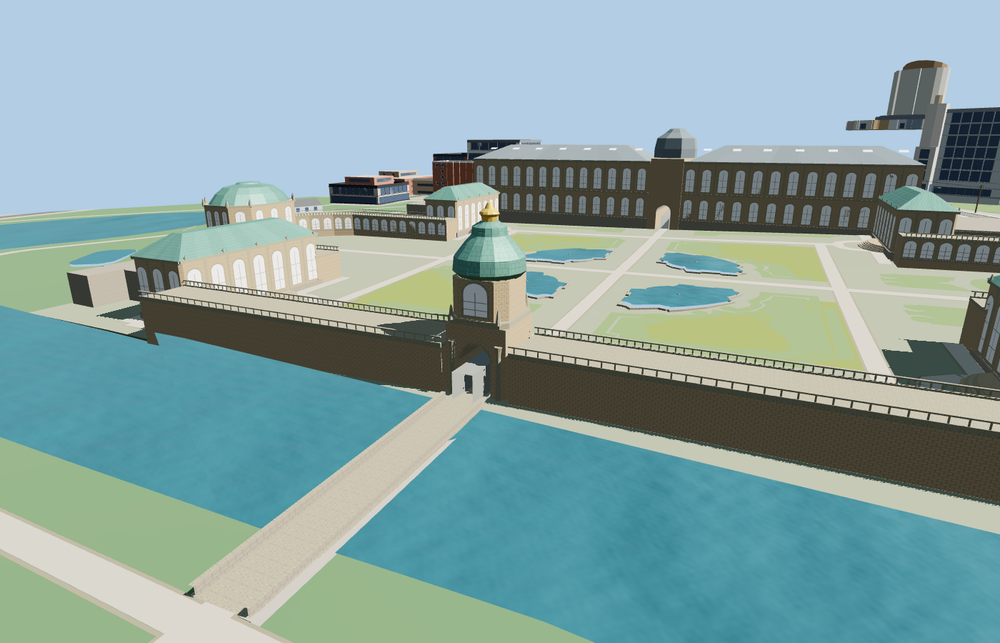

# Dresden Zwinger

The Dresden Zwinger encloses an open courtyard with curved sandstone arcades, four corner pavilions, two domed end pavilions and Semper Gallery. The copper and gold Kronentor frames the open passage and its stone moat crossing.

The 49,947-triangle source rebuilds byte for byte. Skyline, district, street and close-up use 906, 3,887, 15,666, 36,154 triangles. Skyline and district total 452,808 bytes. Six GLBs validated and 36 current views were inspected.

Seven open-court probes, six pavilion probes and three clear gate-passage probes passed at each level. The nine bridge deck samples match the authored grade, and the deck clears the sampled moat by at least 0.32 m. The outer landing matches native paving within 0.1 cm. The model replaces 34 mapped palace features and the two clipped bridge records. All 225 independent buildings and 272 other road and path records remain.

Mapped footprints, the moat crossing and courtyard basin outlines set the site fit. Pavilion profiles and stone details are reconstructed from visible exterior photographs. Garden surfaces follow the restored courtyard layout. Fountain plumbing, sculptural likenesses and room interiors are outside this exterior model. The viewer supplies terrain, mapped water and surrounding streets. The model includes low perimeter stones, terrace paving and the covered pedestrian route through the Kronentor.

Rebuild with `node packages/worldgen/scripts/generate-zwinger.mjs`. Append `--check` to compare exact bytes. Use `--ids=zwinger` for targeted import, LOD, placement and readiness.
