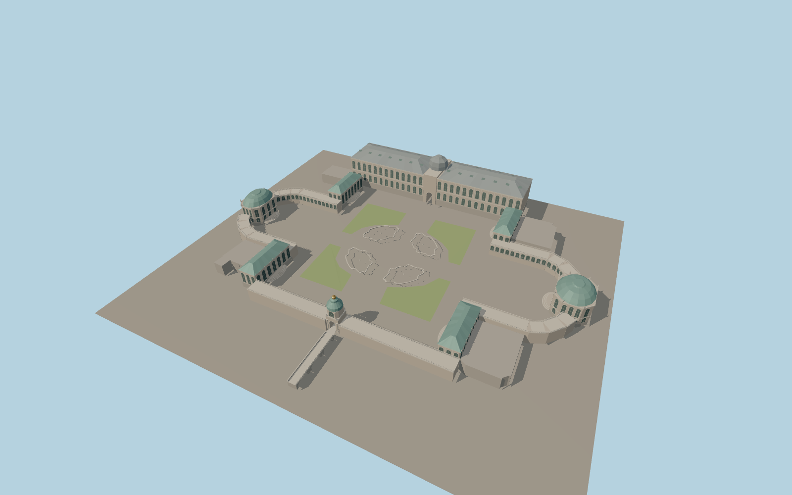

# Dresden Zwinger

The Dresden Zwinger encloses an open courtyard with curved sandstone arcades, four corner pavilions, two domed end pavilions and Semper Gallery. The copper and gold Kronentor frames the open passage and its stone moat crossing.

Run `node packages/worldgen/scripts/generate-zwinger.mjs` to rebuild the source master. Append `--check` to compare the exact bytes. Use `--ids=zwinger` for targeted import, LOD generation and placement.

Mapped footprints, the moat crossing and courtyard basin outlines set the site fit. Pavilion profiles and stone details are reconstructed from visible exterior photographs.

Garden surfaces follow the restored courtyard layout. Fountain plumbing, sculptural likenesses and room interiors are outside this exterior model.

The viewer supplies terrain, mapped water and surrounding streets. The model includes low perimeter stones, terrace paving and the covered pedestrian route through the Kronentor.

Original geometry follows the repository license. Map data is © OpenStreetMap contributors under ODbL-1.0 via Protomaps. Terrain samples are described in terrain-grid.json. Ordinary pictures stay local and are not redistributed or used as textures. Current acceptance is recorded in qa.json.
