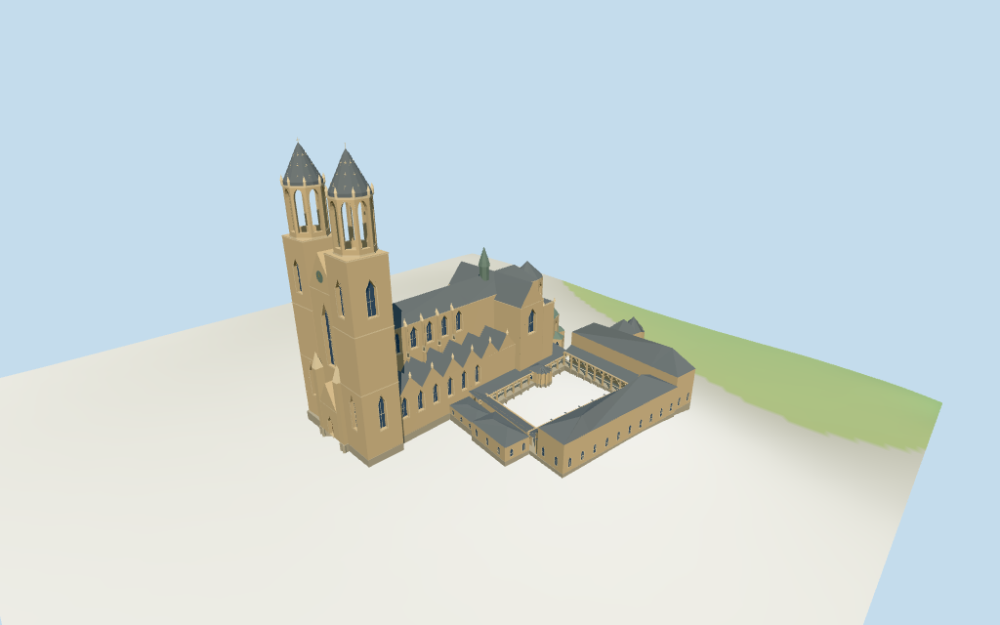

# N0355 — Cathedral of Magdeburg review

Reviewed 2026-10-14 against current source/runtime bytes. Accepted for this medium-fi exterior and approximate geographic/terrain scope.

## Built result

Inspected all 11 final portable/source-terrain views. Individually authored warm-stone cathedral has two western square towers with open octagonal round-arched belfries, gray-tinted stone cones, corner pinnacles and finials. A central clock gable and pointed wood portal connect the towers. Tall nave, transverse crossing, clerestory, lower aisle gable rhythm, square eastern flank towers, green crossing turret, polygonal choir, lower ambulatory and five radiating chapels retain the current map plans. Southern cloister ranges surround an empty court with actual post/pointed-arch galleries and sloping roofs; the eastern chapel retains its separate mass. Corrected upper window/buttress alignment, excluded inward tower fields blocked by the central gable, supported the sloping gallery roofs and widened the portal/court review cameras. Peripheral cloister facades and carved ornament remain simplified.

Medium-fi exterior from three useful pictures and standard viewer PMTiles/DEM only. Current 68m western square blocks, 68..99m upper tower parts, 66m west gable, 42m nave/transept/choir, 32m eastern towers and 54m turret control the approximate silhouette. Current 99m tower parts conflict with retained unqualified 104m overall height; the model uses 99m and records that uncertainty. Lower aisle 17m is interpreted as eave with estimated 23m gable tips. Exact tower inequality, wall/eave/roof/chapel/belfry/cone subdivisions, arcade rhythm, glazing/tracery, clock and pinnacles are picture-led estimates. Adjacent chapter/cloister plans are retained but peripheral facade functions are not independently verified. Exact sculpture, inscriptions, clock numerals, full interiors and certified walking are excluded. Terrain thresholds and physical laptop/phone timings remain pending.

## Shared materials and placement

Inspected all 11 final shared-material/geographic views. Five existing 256-square graphs provide raw limestone, slate, copper, granite and plain wood. Warm stone walls, pale trim, gray roofs, subdued green-gray copper and brown wood use linear tints and metric UVs; glazing is a flat blue-gray surface. The stone cones use the limestone graph with a gray tint. Skyline uses graph mean colors. Every graph reads once. Unload disposes model geometry, leaves zero live model geometries and restores ground. Geographic-flat-terrain captures show the signed map alignment; portable terrain captures show coarse ground contact. Ground colors are diagnostic.

Retained exact-QID OSM way 22993770 matches current main PMTiles feature 35184395082602 by the way-ID offset. Current main/cloister and 35 parts preserve unscaled plans/tags at anchor [11.63472471,52.124648732], heading -0.169401623226rad. Western twin towers, eastern choir and southern courtyard in three inspected pictures sign the retained undirected axis. Current PMTiles does not itself expose wikidata. Derived compound courtyard and ambulatory-roof subtraction match raw controls. All 42 current viewer footprint checks cover both mapped buildings and preserve the courtyard, three unrelated neighbors and western plaza across six outputs. Standard DEM datum 57.575970m, estimated common floor 2.8m and sampled compound peak 2.419m give coarse contact; foundations follow that grid. Exact street/court/door thresholds, absolute altitude and certified walking are unverified. No road replacement.

Inspected all 27 final world-viewer-lighting frames: Economy/High, noon/late, three distances, silhouette, six details, four matched whole-model LODs and four transitions. Matched views include the whole cathedral/cloister and finials. Skyline keeps the individual main masses, open four-post rectangular belfries, coarse cones, simplified aisle slopes and flat-roofed cloister ranges. Two small overlapping peripheral masses and portal pinnacles are omitted; gallery floors follow terrain. Its 6.5m error allowance reflects the roughly 6m aisle-roof silhouette change. District adds shared textures, flat facade fields, octagonal round arches, aisle gables, clock and pointed court arcades. Street opens major window/door recesses and adds mullions/pinnacles; closeup/master refine curve facets, frames and abstract crockets. Curvature, openings, roofs and ornament change visibly. Swedish-cottage neighbors are synthetic context, not local mapped buildings.

## Browser budgets

| Level | Triangles | Bytes | Draws |
| --- | ---: | ---: | ---: |
| skyline | 995 | 102624 | 1 |
| district | 3967 | 374276 | 8 |
| street | 13556 | 1242608 | 8 |
| closeup | 19807 | 1828224 | 8 |

Initial skyline plus district: **476900 bytes** of geometry. Master: **2381552 bytes / 19807 triangles**. Five separately cached shared graphs; zero embedded images. Initial geometry excludes graph definitions/texture generation. Separate POSITION/NORMAL streams have equal CPU/GPU totals. Physical device timings pending.

## Verification

- Targeted byte reproduction: generate-additional-landmarks.mjs --ids=N0355 --check. Source/import/LOD/review hashes match.
- Six GLBs pass Khronos with zero errors, warnings or embedded images; four browser budgets pass.
- All 37 raw map controls/tags, retained exact-way identity, signed frame and standard DEM match. Compound courtyard and ambulatory roof compositions match; all outputs retain a 99m top above the common floor.
- **1,050 imported geometry probes** pass: principal/range roofs, finials, open belfries/heads and arcade bays, empty court, detailed clear window/door recesses and closed backing.
- **42 actual viewer footprint checks** pass: cathedral/cloister covered, courtyard/three neighbors/west plaza preserved across six outputs.
- Five graphs read once; unload disposes geometry/restores ground.
- Source inventory/schema, recipe index, map-frame and medium-fi review bindings pass.
- Scene validation and 30-tick simulation pass: sha256:cbb09fad588ce06385df5a82a9b1707e78db0e4d7a0c8e7a48947a7443b67bfc.
- Inspected **49 final frames**: 11 portable, 11 shared/placement and 27 medium-fi. Reports keep paths/cameras/hashes; bulk images stay local and ignored.

Source hash: sha256:a8c115f483709781427c343305167cb6ede43a942294f4485c14d2d70a3e54d8. Runtime hash: sha256:c1269b533e00817583582564ded2f6cd51990cd7b8305445498650839c608de7. Input hash: sha256:f389ad83e692dcfb5445f5ed16db97b57e2d58a679dbaae3eace8fb537e2910f.

Commands: targeted generate/import/LOD; capture-next-1000-models.mjs --ids=N0355 --reflections --antialias --fit-shadows; capture-landmark-library.mjs --ids=N0355 --reflections --adaptive-clipping --bounded-placement; capture-medium-fi.mjs --ids=n0355_cathedral_of_magdeburg --reflections; molen validate; molen sim run --ticks 30 --hash. No full engine suite/audit or full source rebuild repeated; next routine source checkpoint follows N0359.

## Limits

- Retained exact-QID OSM way22993770 matches current main PMTiles feature35184395082602 by way-ID offset. Main/cloister and35 current parts retain unscaled plans/tags. Current western square blocks68m,central west part66m,upper belfry/spire parts68..99m,nave/transept/high choir42m,east flank towers32m and crossing turret54m control silhouette. Retained unqualified104m height fact conflicts with current99m parts;use current99m overall top and record uncertainty. Other tags and all wall/eave/cone/belfry/gable/roof subdivisions are picture-led interpretations. Lower aisle17m tag is used as eave with estimated23m gable tips.
- Standard DEM datum 57.575970m;estimated common floor 2.8m clears sampled compound peak 2.419m and perimeter -2.77..2.41m. Foundations follow coarse terrain. Exact court/street/door thresholds,absolute altitude and certified walking unverified;no independent survey.
- Medium-fi exterior from three useful exterior pictures and standard PMTiles/DEM. Exact twin-tower height inequality,wall/eave/roof/belfry/cone subdivisions,windows/doors/tracery,pinnacles,clock and arcade rhythm are estimated. Current 99m tower parts differ from retained unqualified 104m fact. Adjacent cloister/chapter massing retains current plans;peripheral facades/functions are not independently verified. Exact statues,inscriptions,clock numerals,full interiors and certified walking excluded. Absolute altitude/thresholds and physical device timings pending.
- Skyline keeps individual primary masses,coarse stone cones,four-post rectangular open western belfries and sparse gallery posts;aisle roofs use simple slopes and cloister ranges use flat roof masses. Two small overlapping peripheral masses are omitted;gallery floors use terrain. Its 6.5m error allowance reflects these roof/secondary-mass changes. District adds shared surfaces,flat facade fields,octagonal round-arched belfries,aisle gable rhythm,clock and pointed court arcades. Street opens major facade recesses and adds sparse mullions/pinnacles;closeup/master refine curved aperture/cone/trim detail and abstract crockets. Peripheral range fields remain shallow. Curvature,openings,aisle roof silhouette and ornament change visibly. Swedish-cottage context is synthetic,not local map buildings.

Readiness accepts this exterior scope. The 1,000-candidate goal remains incomplete.
