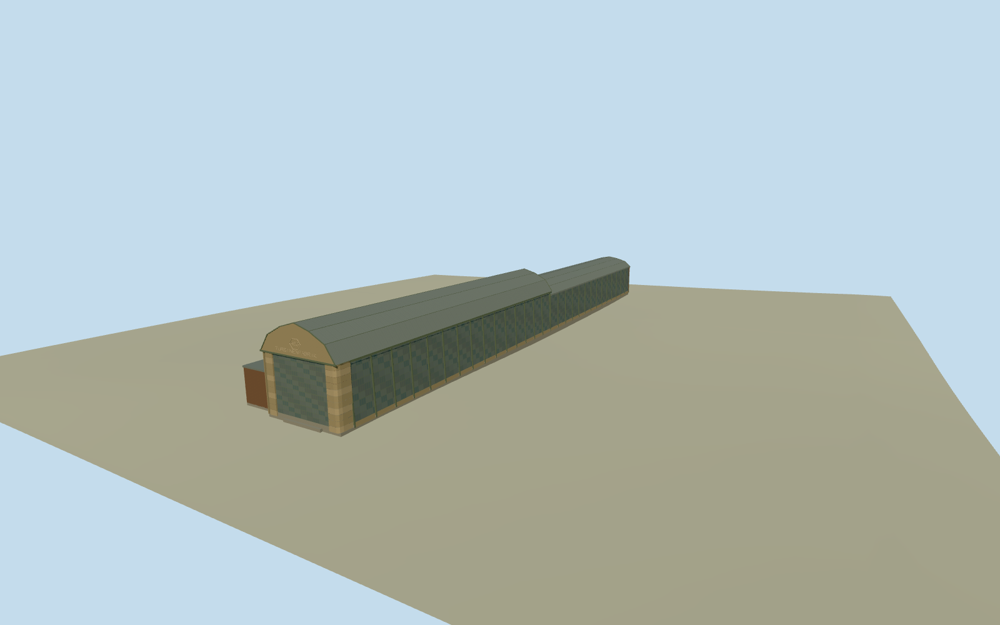

# AEG Turbine Factory

Berlin’s AEG Turbine Hall with a polygonal main roof, sloping street glazing and an attached aisle and north extension.

Authoring state: **review-in-qa.json**. Current completion evidence is in [qa.json](qa.json) and the [completion ledger](../../../../qualla-structures/batches/qualla-004.PROGRESS.md).

- [AEG Turbine Factory](https://qualla.com/aeg-turbine-factory/)

The 28 m original roof crest follows the published architectural study. Steel bay spacing and glazing details use the Qualla view.

The building model includes the attached aisle and the mapped standing extension. Side-yard service façades and roofing details are approximate.

Scope covers the Turbine Hall and its attached volumes. Separate offices and neighboring factories are outside this asset.

Build: `node content/worldgen/source/places/u3/u33/aeg_turbine_factory/models/generate-aeg-turbine-factory.mjs`. Add `--check` to verify exact regeneration. 12887 triangles; 8 materials; no embedded photographs.
