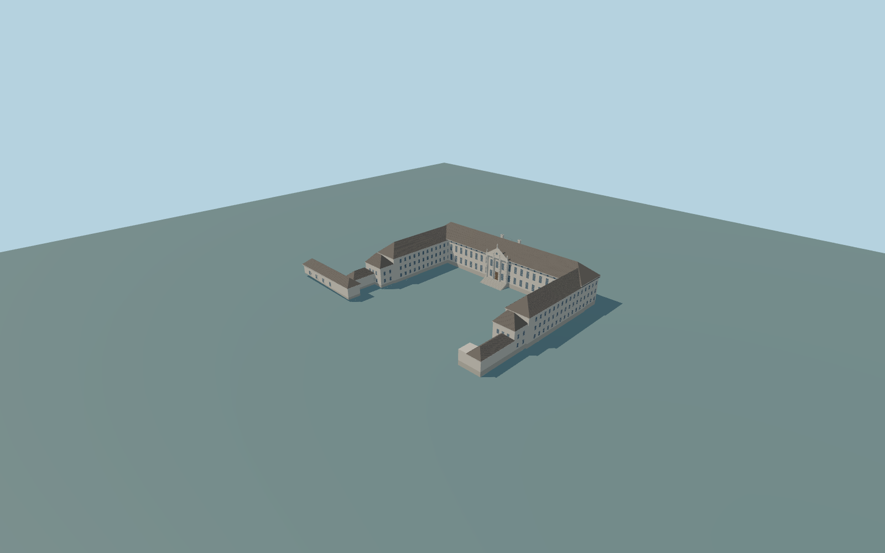

# Bellevue Palace

Complete principal U-shaped Bellevue Palace exterior:main front/rear range,two perpendicular three-level wings,hipped wing-end pavilions and attached southwest low service link. Include dark pitched tiled roofscape,chimneys/rooflights,front giant pilasters/triangular pediment/clock/original statues,rectangular and oval glazed windows,central doorway/steps and rear doorway/terrace. Separate oval modern office,guardhouse,wider park,walls,flags,furniture and optical interiors excluded.

Rebuild: `node packages/worldgen/scripts/generate-bellevue-palace.mjs`;append `--check` for exact source bytes. Select import/LOD/placement with `--ids=bellevue_palace`. Detailed source and four browser tiers are separate ignored GLB outputs.

Complete principal U-shaped Bellevue Palace exterior:main front/rear range,two perpendicular three-level wings,hipped wing-end pavilions and attached southwest low service link. Include dark pitched tiled roofscape,chimneys/rooflights,front giant pilasters/triangular pediment/clock/original statues,rectangular and oval glazed windows,central doorway/steps and rear doorway/terrace. Separate oval modern office,guardhouse,wider park,walls,flags,furniture and optical interiors excluded.

Native main10m,side11m and end/link8m tags are generalized;source original photo-proportional cornice/roof/level envelopes are not surveyed. Main floor2.2m above32m approximate datum;main eave15.2m/ridge22.2m,pediment20.2m/central statue22.45m;wings eave14.4m/ridge20.4m,low link7.2m/10.5m. Variable-depth structural foundations and original front/rear grade-adapter steps meet the unchanged global field;no flattening.

Original exterior interpretation from four ordinary pictures,actual PMTiles and one global terrain tile. Fine relief,statue,clock,window/rooflight/chimney inventories,roof junctions and historic thresholds/stair/accessibility grades approximate. No copied artwork/lettering,no private/new/embedded texture images. Closed panes/doors exclude optical interiors. Physical phone/laptop timings unmeasured.

Six existing256px plaster,limestone,tile,window-grid,painted-metal andpainted-wood graphs,metric UVs/linear colors. Main-front19-bay rhythm and smaller three-row wing windows are original photo/map interpretation;fine inventory approximate. Source keeps more oval curves,pilaster flutes,roof course seams and sculptural profiles. Far keeps full open U/service link,hipped roofs,pediment and three statue cues;district keeps flat windows and aggregate trim;street flat frames;close-up denser grid/frames/roofs/figures. Error estimates4/2/1/.35m are not measured mesh distances. No optical interiors or copied text/art;physical device timing unmeasured.

Original geometry:repository license. Map:© OpenStreetMap contributors,ODbL-1.0;Protomaps. Standard terrain:terrain-grid.json. Ordinary pictures stay local and are not redistributed or used as textures. Current acceptance:qa.json.
