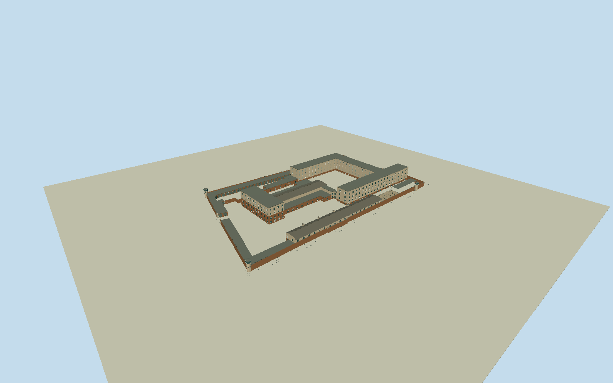

# Berlin-Hohenschönhausen Memorial

Complete permanent Berlin-Hohenschönhausen former-prison memorial complex within originalnamednative367216314site:all20mappedintrinsicbuildingfeatures (oldmainhouse/factoryannexes,newcell/interrogationU-wings,prisonhospital,workshops,garages,roofcanopy,openexerciseenclosures,smallutilitybuilding andthreewatchtowers), originalindividualfootprints/courtyardvoids/connectingpassage, boundednativebricksecuritywalltraces/gate/fences. Not anentrance/watchtowercrop oronefilledpropertyblock. Separateoutsidegreen-whiteMfSoffice/neighborbuildings,temporaryexhibits/prisontransportwagon/mobileprops,trees/road/paving/landscape/interiors excluded. Preservealloriginalindividualbuildingvertices/courtyardvoids,threeseparateoctagonalwatchtowers/brickperimeterandopenentrancegate; oldmainredbricklower/tanplasteredupperstories, flatnewU-wingroofs/repetitivewhiteframed/frostedcellwindows, longtwo-storeyhospitalwithhalfhiproof/representativedormers andopenexerciseenclosures, graygaragebatten doors/brickpiers/lowworkshops/annexroofs/coveredcanopy. Hiddenfacadecensus/roofvalleys/currentequipment approximate, no copiedcopyrightedsiteplan. Freezeindependent256m129²fieldorigin[-160,-128] atfixedwestgateapproach beforegeometry; all16641samples/tilePNGbytes retained.

Authoring state: **review-in-qa.json**. Current completion evidence is in [qa.json](qa.json) and the [completion ledger](../../../../qualla-structures/batches/qualla-002.PROGRESS.md).

- [Berlin-Hohenschönhausen Memorial](https://qualla.com/berlin-hohenschonhausen-memorial/)

Originalnamedmemorialway367216314 is22vertexsiteperimeter, NOTsinglebuildingfootprint. All20intrinsicbuildingfeatures separatelyretained withoriginalnativevertices, includingthreewatchtowerupperoutlines; overlappingtowerbuilding:parttraces identifythesametowers,not3extra buildings. Native4level tags fornewwings interpretedasthreeabovegroundlevels pluslowsemibasement inagreementwithoperatorthree-storeynewprison; oldmain4levels(primarytwoolderbrick+twoplasteredadditions),two-storeyhospital/hippedroof(primaryhalfhipdetails),lowworkshops/garages/openexerciseenclosures. Heights/windowcounts/roofsmallparts boundedby3clearcomponentphotos/primarytext, hiddencourtfacadesnotclaimedphotographicallysurveyed. Frame+Xeast/+Zsouth, anchororiginal22vertexperimetermean beforefield/geometry. AvoidunrelatedgreenwhiteMfSoffices seenbehindgarages. Gateandnativewallpathswithinprisonbounded; southernwall367216300 haslongexternalcontinuation explicitlyexcludedafteroriginalnodeat[46.71,57.19]. Southernfence367216302 firsttwooriginaloutside-propertypoints excluded, retainingthelastthreeoriginalverticesontheactualmemorialsouthernboundary. Originalbroadtracepreservedseparately; no exteriorneighborfencemodel.

All20mappedintrinsicfeatures/161originaloutlinevertices retained independently ascontrol;threeupperwatchtowersregularizedto8photo-supportedfaceswithinoriginalextents:oldmain/attachedfactoryannexes/newcell/interrogationU/hospital/workshops/garages/canopy/exerciseyards/utility/3towers. Native4levels onnewprisoninterpreted3mainfloors+lowsemibasement; operator3floors/primaryoldmain2brick+2plaster/hospital2levels+halfhiproof controlverticalmassing. Heights13.5/12.6/6.4m andhospital9.2mridge/8.3mtower, hiddenwindowcensus/dormers/radio/paint/slateroofdetails bounded estimates. Nativewatchtowerheight6m/minheight4m nottreatedasfullmeasuredverticalsurvey; upperrooms/roof photo-proportioned8.3moverall. No filledcourtyard/siteparcel extrusion.

Threeexplicitcreator-PDoriginals individuallyinspected, exactnativeSHA1/dimensions/bytes/revisions/authorgrants/originalownGermanuploadrowsbound. Qualla-first151families/0conflicts; dedicatedstorymodernphotosareCCBYSAandunused,87exterior/29mainnativefilescomplete. Platte/ChristianLiebscher2006PD-user-deentrance/corner,Langinger2009ownPD-releasegarages. Germantransferproofbindsitemgrant/profile/originalfile/name/ownstatement/log/dimensions/bytes;67focusedtests,no source metadata/category/articlebody edits. No restrictedpixels/phototextures/generatedbitmap/downloadedmesh.

Wholepermanentcomplexrecognizableexterior, notsurvey-grade reconstruction: onlythreeclearedcomponentphotos,sohiddennewcellwindowfrostedpanels/grids/oldannexfenestration/hospitalhalfhipend/dormercensus/finecourtyardpartitions/currentmuseumadaptation/patina approximate. Garagecloseddoorsretainhistorichardware; laterglazingbehindthemnotassertedabsent. Openexerciseenclosure8representativebays,notcertifiedexactcensus. Skylinewindowdetails/roofhardware/wire/mesh simplify;allmasses/voids/threeoctagonalwatchtowers/gate/wallsremain.

Sixboundedsecuritywalltraces includeoriginalnativewall367216300first12points,excludeitslongneighborhoodcontinuation. Entrancegate staysopenwithseparateleaves/posts/lintel. Nativebuilding:partwatchtowerduplicatesnotextra towers. Detachedgreen-whiteMfSadministrationblockseenbehindgarageandotheroutsidepropertybuildings excluded; no hugepavingslab/road/grass/tree/temporarysignage/exhibitionwagon/people/interiors.

Independent256m129²fieldorigin[-160,-128]/2mstep/all16641samples/4rawTerrariumtiles/PNG frozenbeforegeometry unchanged. Fixedwestgateproviderdatum56.8198m,absolute55.2278–56.9414m; notthreshold/foundationsurvey. Flatportable/shared/contextfixtures separatefrom actualhostterraincontact,ordinarypreview/replaceFootprint=false; nofieldfitting/flattening/reacquisition.

Build: `node packages/worldgen/scripts/generate-authored-places.mjs --ids=berlin_hohenschonhausen_memorial`. Add `--check` to verify exact regeneration. 24861 triangles; 6 materials; no embedded photographs.
