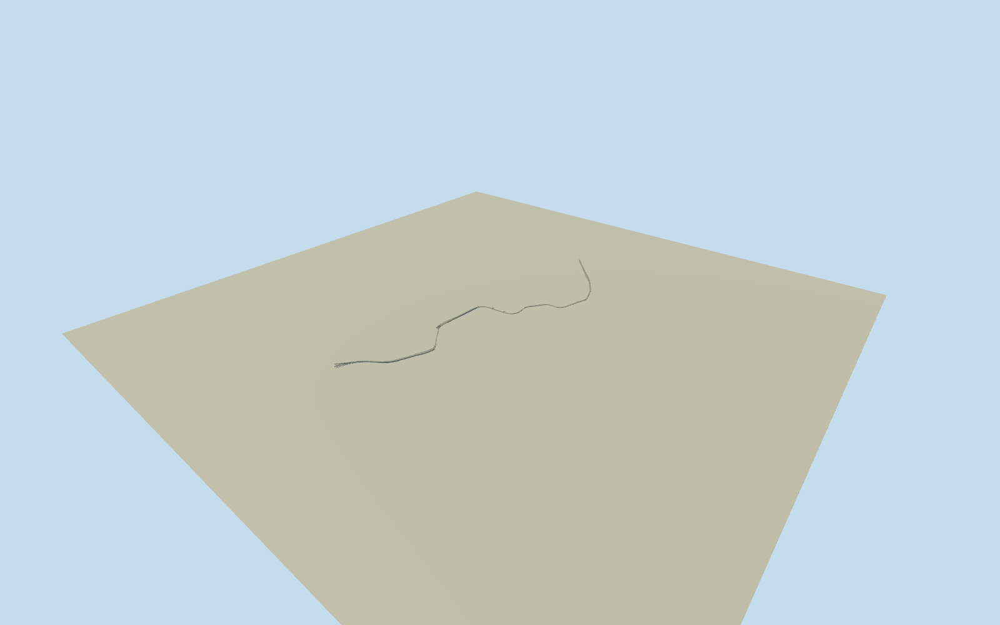

# Berlin Nord–Süd S-Bahn tunnel — complete original network

Whole original curved S-Bahn tunnel/17officialstation-tunnel envelopes/98complete750VDBrailpaths/bothsouthernbranches/all6externaltrackheads/6stationwidenings/intrinsicupper/sidingstubs. Full thinroof/floor/lining shell with hollowrailspace, actualmouths/rectangularframes, estimated3.8mstandard/7.04mjunctionclearance and frozenoriginalgrade. OfficialnumericALKIS/OSMand writtenengineer/operatorfacts only; everyimageunused. Missing/layeredplan, exactprofile/section/finish/grade are estimates; no mainline/U-Bahn/newS21 or arbitraryoneportalproxy.

Authoring state: **review-in-qa.json**. Current completion evidence is in [qa.json](qa.json) and the [completion ledger](../../../../qualla-structures/batches/qualla-002.PROGRESS.md).

- [Berlin Nord-Süd Tunnel](https://qualla.com/berlin-nord-sud-tunnel/)

Whole existing Nord-SudS-Bahn tunnel in approximate2021appearance: complete original98-wayDB750V/1435mmundergroundnetwork, northern6002/6032approaches, both6032/6034southernbranches, allsixactualexternaltrackheads, Nordbahnhof/OranienburgerStrasse/Friedrichstrasse/BrandenburgerTor/PotsdamerPlatz/AnhalterBahnhofstationwidenings and intrinsicdead-end/upperlevelsidings. Seventeen fullofficialALKISnumericenvelopes constrain mainroof/stationboxes; uncoveredshortreaches retainedthroughcomplete originalrailgeometrywithoriginalexplicitestimates. Everyimageunused. Independentmainline/U-Bahn/crossingtunnels, detachedsurfacebuildings and modernS21extensions excluded; not an arbitrary5.884kmstraighttube/oneportal or cityblockslab.

Seventeen actual officialALKISwhole-tunnel/station envelopes plus complete98originalDB6032/6002/6034undergroundrailways and six topology-derived externaltrackheads define whole physicalscope. Both southernbranches, allsixstationwidenings, intrinsicPotsdamerupper/sidingstubs and Nordbahnhofyards retained. Nativeplan765railcontrols and2104cadastralcontrols including42controlPotsdamerinnercadastralvoid retained as source. Mainline/U-Bahn/roadcrossings not adopted. 2026numericaldata only approximates2021registration; no exacthistoricalsurvey or image tracing.

Some officialcadastralplanreaches are absent, and the Potsdamer2Dvoid has a mapped siding under/through it. Actualrunning/sidingroutes receive an original estimated2.45mhalfwidth corridor only where needed to join/complete the layeredphysicalplan. Booleanunion retains whole officialenvelopes and allactualrailreaches; this is not a surveyedroofplan, and the2Dvoid is not asserted to be a physicalopening through everyverticallevel. Nominalplan/componentuncertainty6m; current rawnativeinputs preserved, no providerfield fitting.

Independent original8192m129x129field,16641values/144rawtiles,datum40.0238m/range24.4375..64.5947m fixed BEFORE floors/mainsections/geometry.64mreview samples from compositeDEM, not a precise urbanstreet/tunnel survey. Northernactualtrackhead249189056 fixes approachdatum. Original latitudinal grade profile then chosen once: northportal+.2m, Nordbahnhof-8m, Oranienburger-10m, Friedrichstrasse-16m, BrandenburgerTor-11m, Potsdamer-11.5m, Anhalter-12.5m, Landwehr-14.3m, southportals+.2m relativefixed40.0238mproviderdatum. All slopesunder33permille. Every floor/section and originalfield/frame preserved, never cut/masked/flattened/refetched/reframed/refit for renders.

Railtop+.22mabovebed, nominalinnerceiling4.02mabovebed (3.80mclear above rail); junctionceilings7.26m (7.04mabove rail) nearPotsdamer/Anhalter, .8mroofbuild-up/.35mwall nominal. Original roof/floorplan widths, sectiontransitions, wallthicknesses, completeverticalprofile and all hiddensteel/support/bay census are estimates. WTMactual2020localrolledbeams~.8mhigh do not prove uniformconstruction acrosswhole5.8kmtunnel. Operator5805m/other5884m scalar descriptions are not used torescale actualrailgeometry;18.7km is summednetworktracklength, not tunnelborelength.

Whole thinroof/floor/sidelining shell with real continuousinteriorrailspace and sixexternalmouths, not a solidpropertyextrusion or arbitraryportal. Originalfulltrackpaths preserved; .35mconcretewalls/.8mroof, rectangularportalframes, roofgirders/columns, railprofile and sparsecloseup sleepers are original estimates from writtenforms. Detachedsurfacestationhouses, exactstreetentryfacades/signage/artwork and unrelatedneighbors excluded. Independentoriginalfield may hide most undergroundstructure or cover/expose mouthbases; portable/shared review views independentlyinspect the completegeometry. Groundcontact/verticalregistration remain unverified.

Qualla-first145families/zero conflicts; everyimageunused. Protectedhistoric/statearchive/currentphotos, officialengineerfigures/drawings and regionalPD/CC0images are not adopted. OriginaldirectWTMwrittenreport, officialoperatorhistory and explicitly archivedDB2021writtenrelease only. OfficialnumericALKISDL-DE-Zero2.0 and OSMODbL are factualvectorinputs; no rightsrepair/photo-derivedgeometry or imageapprovalclaimed. Exacttrim/finish/colors remain estimates.

Approximate2021physicaltunnel proposal/currentWorldEligible false. Roof/corridor/lining/sixmouths/allmajorstationwidenings retained in allfourLODs; fine curvature, rails/supports/sleepers reduce atdistance. No modernS21or mainlinetunnelproxy; no surveyedcontact or automaticfootprintreplacement.

Build: `node content/worldgen/source/places/u3/u33/berlin_nord_sud_tunnel/models/generate-house.mjs`. Add `--check` to verify exact regeneration. 26660 triangles; 5 materials; no embedded photographs.
