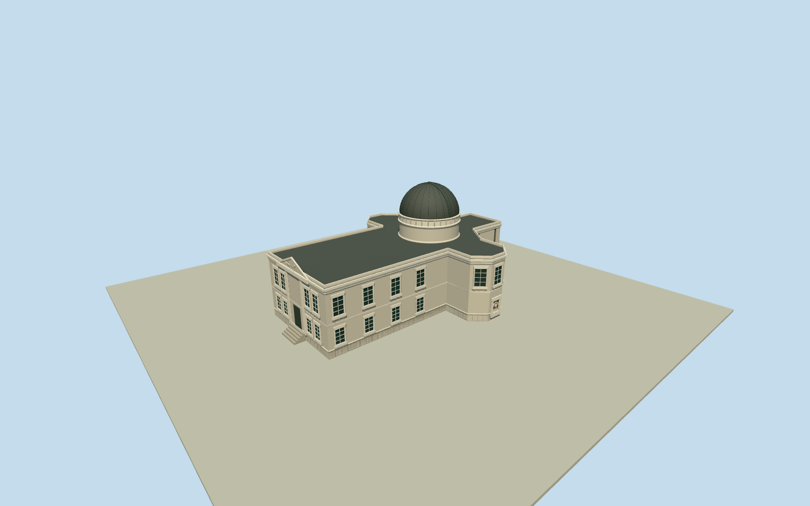

# Berlin Observatory (1880)

Complete historical1880Schinkel Kreuzberg observatory: scaled official cross-plan/eastern residentialwing/opposed chamfered observingbays/short westtransitwing, restrained two-story Hellenic walls/plinth/cornices/tall sash, east temple-front pediment/shallow Apollo-chariot interpretation, central7.5mhemisphericaliron dome/raiseddrum/paneledband/closedmeridian shutters/ribs, intrinsicframednorthheightbenchmark. No present-daybuilding, Babelsberg/stablestower, park/parcel/slab/people or copiedletters.

Authoring state: **review-in-qa.json**. Current completion evidence is in [qa.json](qa.json) and the [completion ledger](../../../../qualla-structures/batches/qualla-002.PROGRESS.md).

- [Berlin Observatory](https://qualla.com/berlin-observatory/)

Exact buildingQ73494076NewBerlinObservatoryidentifies the demolished Schinkel Kreuzberg building, not the broader institution/Babelsberg successor. Native entity declares1913-08dissolution and rounded site coordinate[13.39416667,52.50388889]with coarse stated precision; no surviving footprint or surveyed dome-center registration is claimed. Original official1879printedplan/published1880supplies exterior traced cross geometry, metrebar and northarrow. Hand-traced scaled plan is oriented north+Z/modelwest+X, headingPI; placing its estimated domecentre on the approximate historical sitepoint is provisional geographic registration. No current OSM parcel/roof replacement.

Historical1880only: official1879plan/elevation published1880control this dated reconstruction. Exact buildingQ73494076declares demolition1913-08. Supported1880-01-01to1881-01-01appearance interval is deliberately limited to the plate publicationyear, not the whole1835-1913life. Default current world excludes the asset; date opt-in required. Earlier royalstables observatory and surviving Babelsberg successor excluded.

Printed20mbar/northarrow control original hand-traced30.07mx22.40mcross-plan; currentstreet/parcel is never extruded. Interiorhatchedinstrumentpiers, surveyrodmarkersA/B, people/trees/park and nearbybuildings are absent. Footprintdomecentre is only provisionally registered to the rounded former-site coordinate; exact historical building registration and terrain attachment are unverified.

Original medium-fi exterior from two native inspected publishedQualla official1880plates. NativeSHA1/primaryPD-olddeclarations are pinned; omittedoriginalPDcategories restored from exactprimaryrecords. One unrelated Earthrise gallery record was repaired to its native-verifiedexistingQuallacanonicalfile, preserving the correctplanhero and allstorytext. No outsideimage, generatedbitmap, copiedphototexture or otherlicensedsource used.

Central7.5mdiameter is storydocumented; section heights/storey levels, rooflead/plaster/stonecolors, concealed facades/windows and exact shutter mechanism are drawing-based estimates. North elevation controls benchmarkframe/tallupper sash/chamferedbay/cornice/drum/hemisphere. Story records east templefront/Apollochariot; unseen pilaster/windowcensus and originalshallowrelief are bounded interpretations, not a measuredfront elevation/sculpture scan. Lettering omitted.

Benchmark/closedtransit shutters/windows are modeled exterior surfaces, not accessible interiors; slat/relief/rib detail retireswithdistance. Current120mraw independent providerterrain was frozenbeforegeometry and is not flattened/fitted or an1880grade survey. Foundationextends.35mbelow approximate approachdatum; flatstageY-.53showsarchitecture, not certified historical ground contact.

Build: `node packages/worldgen/scripts/generate-authored-places.mjs --ids=berlin_observatory`. Add `--check` to verify exact regeneration. 19992 triangles; 5 materials; no embedded photographs.
