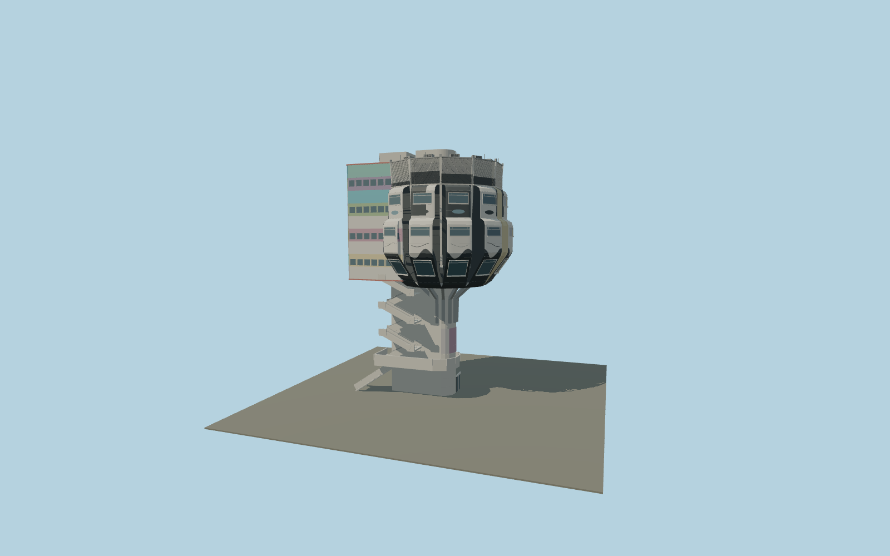

# Bierpinsel

Nine radial aluminum restaurant capsules above a D-shaped lift shaft, branching steel ribs, a rectangular service wing, exposed dogleg stairs, roof machinery and the surviving street-art facade.

## Identity and geometry

Catalog bierpinsel, [Q520281](https://www.wikidata.org/wiki/Q520281). The exact OSM outline and original architect floor plan govern the nine radial capsules and rectangular rear wing. Berlin’s March 2026 LoD2 building DEBE06YYB0000lX5 gives local ground 45.816 m and maximum roof 88.33 m, or 42.514 m above ground; this measured exterior envelope is used instead of silently stretching to the undatumed tourism height 47 m. Occupied tiers and details follow contemporary and September 2026 district photographs. The generalized LoD2 mesh is evidence only, not redistributed geometry.

Center fitted to the nine mapped radial capsule faces; Y=0 at local street level. +X points southeast, away from the northwest rectangular service wing; +Z is southwest; +Y is up. The geographic proposal identifies its anchor and orientation evidence separately from remaining terrain and azimuth uncertainty.

Source facts and measured references are recorded in spec.json. References: [1](https://denkmaldatenbank.berlin.de/daobj.php?obj_dok_nr=09097832), [2](https://www.bauwelt.de/dl/1733389/artikel.pdf), [3](https://www.moderne-regional.de/interview-ursulina-schueler-witte-zum-bierpinsel/), [4](https://gdi.berlin.de/data/a_lod2/atom/LoD2_386_5813.zip), [5](https://www.berlin.de/ba-steglitz-zehlendorf/aktuelles/pressemitteilungen/2026/pressemitteilung.1717697.php), [6](https://www.berlin.de/sehenswuerdigkeiten/5514897-3558930-bierpinsel.html), [7](https://www.tagesspiegel.de/berlin/berliner-chronik-2-juli-1976-808588.html), [8](https://www.openstreetmap.org/way/28503881). Reference pages and images are not redistributed.

## Original source and shared materials

Geometry is authored in `packages/worldgen/scripts/bierpinsel-model.mjs`. Shared material graphs with metric repeat UV0 and original vertex tints; GLB PBR fallback remains self-contained. No per-model texture duplication. No third-party mesh or photograph is embedded.

104,849 triangles; 295,745 vertices; 3 material groups; 11,907,372 source bytes. Source hash: `sha256:71dfb6202da0720eebe2dc54a3e1ed75ee4156c5b1eba12c9cf2f85e814f264d`. Geometry validation checks finite Float32 coordinates, indices, triangle area and winding before export.

Regenerate with `node packages/worldgen/scripts/generate-heritage-towers.mjs bierpinsel`; add `--check` for reproducibility. The generator refuses to overwrite a master whose hash differs from source.json. Import uses `--no-optimize` to preserve facade recesses.

## Remaining detail and review

- Retained September2026 closed-building exterior and42.514m envelope; no proposed restoration or reopening is represented. Current facade art is abstracted as original color fields/forms, not copied artwork or a panel-by-panel damage inventory.
- Mapped projected head footprint and smaller D-shaped street stem remain separate controls. Surrounding road bridge, subway entrances, neighboring buildings, commercial signs and interiors remain excluded. Attached stair-to-road landing fit is photographic and unverified against native host terrain/road elevation.
- Detailed masters remain intact. Stair treads aggregate to ramps at skyline, louver/cassette density and tiny fittings aggregate with distance. Shared256px graphs are reused; exact mural marks and stains are excluded. Physical-device timings remain pending.

Named near/far cameras are included for lit visual review. A valid export is not maximum-fidelity certification.
