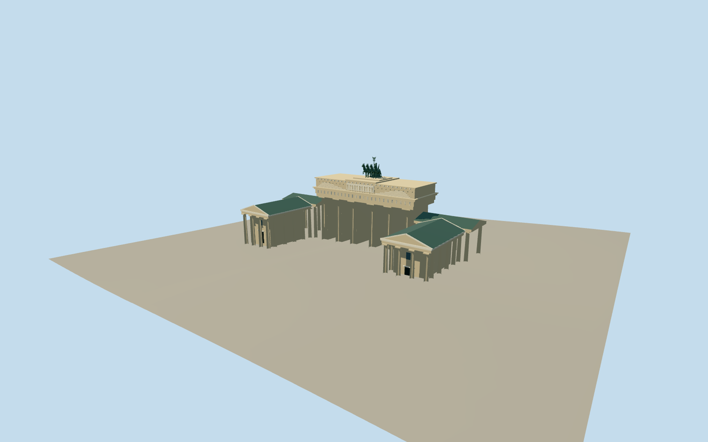

# Brandenburg Gate

Five open passages and paired fluted Doric columns, level sandstone attic with central relief panel, projecting pedimented guardhouses, copper roofs and east-facing four-horse quadriga.

Authoring state: **review-in-qa.json**. Current completion evidence is in [qa.json](qa.json) and the [local 100 ledger](../../../../qualla-structures/batches/PROGRESS.md).

- [Brandenburg Gate](https://qualla.com/brandenburg-gate/)

Original medium-fi exterior; dimensions follow generalized Protomaps controls and photographic estimates, not a measured architectural survey.

Doric fluting, triglyph rhythm, shallow relief figures, chariot, four horses, wings and eagle/wreath emblem are simplified original geometry. Fine carved figures, reins and facial anatomy are not exact replicas.

Guardhouse cores, projecting porticoes and connecting colonnades are included; interiors, adjacent city blocks and freestanding street furniture are omitted.

Warm smooth shared mineral material represents cut sandstone without false small masonry courses across the carved columns.

Local Qualla references are inspected but not embedded or redistributed. Terrain/contact evidence is coarse host data, not surveyed ground levels.

Build: `node packages/worldgen/scripts/generate-authored-places.mjs --ids=brandenburg_gate`. Add `--check` to verify exact regeneration. 20448 triangles; 3 materials; no embedded photographs.
