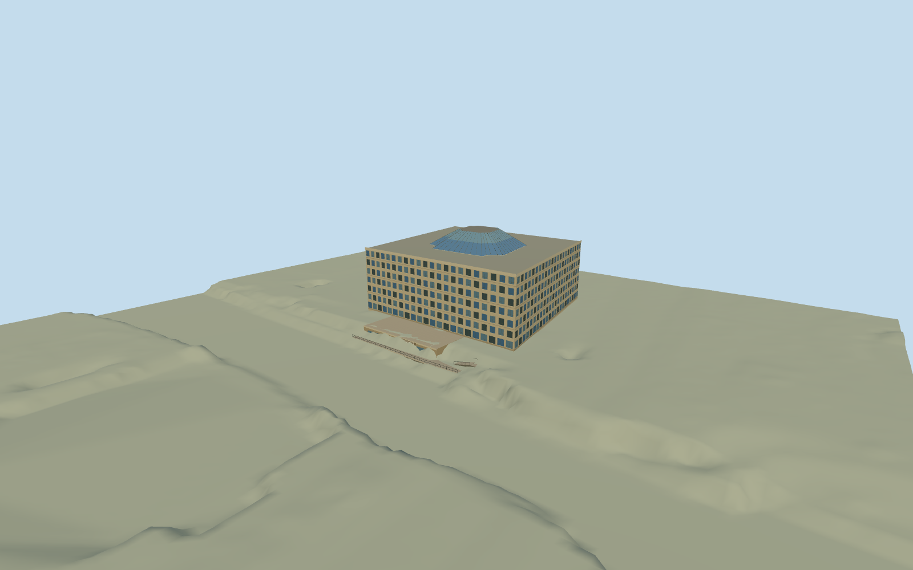

# DDR Museum

Berlin’s DDR Museum at Vera-Brittain-Ufer, with the stair from Karl-Liebknecht Bridge and the stone-and-glass DomAquarée hotel wing above.

Authoring state: **review-in-qa.json**. Current completion evidence is in [qa.json](qa.json) and the [completion ledger](../../../../qualla-structures/batches/qualla-003.PROGRESS.md).

- [DDR Museum](https://qualla.com/ddr-museum/)

The exterior includes the museum entrance and the hotel wing that contains it. The exhibits, other DomAquarée blocks, bridge carriageway and aquarium are outside the scope.

The seven storeys and basement are mapped. Minor walls, materials, window bays, roof sections and museum entrance joinery are approximated from written records and mapped controls.

The city’s source terrain sets the lower promenade and terrace. The precise slender retaining edge along the façade needs bounded rendering clearance to show the lower entrance.

Build: `node content/worldgen/source/places/u3/u33/ddr_museum/models/generate-ddr-museum.mjs`. Add `--check` to verify exact regeneration. 9919 triangles; 6 materials; no embedded photographs.
