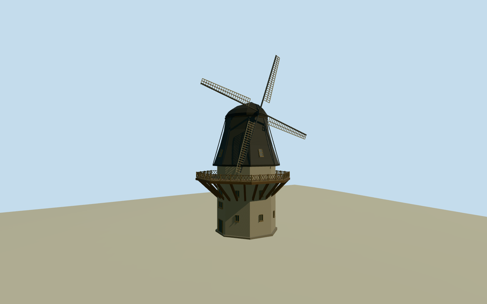

# Historic Mill of Sanssouci

The Historic Windmill of Sanssouci with a timber-braced gallery, dark octagonal smock, and four open lattice sails.

Authoring state: **review-in-qa.json**. Current completion evidence is in [qa.json](qa.json) and the [completion ledger](../../../../qualla-structures/batches/qualla-004.PROGRESS.md).

- [Historic Mill of Sanssouci](https://qualla.com/historic-mill-of-sanssouci/)

The cap is shown in a representative parked orientation and the sails remain stationary.

Roof profiles, timber dimensions and rear enclosure details are estimated from the available photograph and mapped structures.

Build: `node content/worldgen/source/places/u3/u33/historic_mill_of_sanssouci/models/generate-historic-mill-of-sanssouci.mjs`. Add `--check` to verify exact regeneration. 6296 triangles; 6 materials; no embedded photographs.
