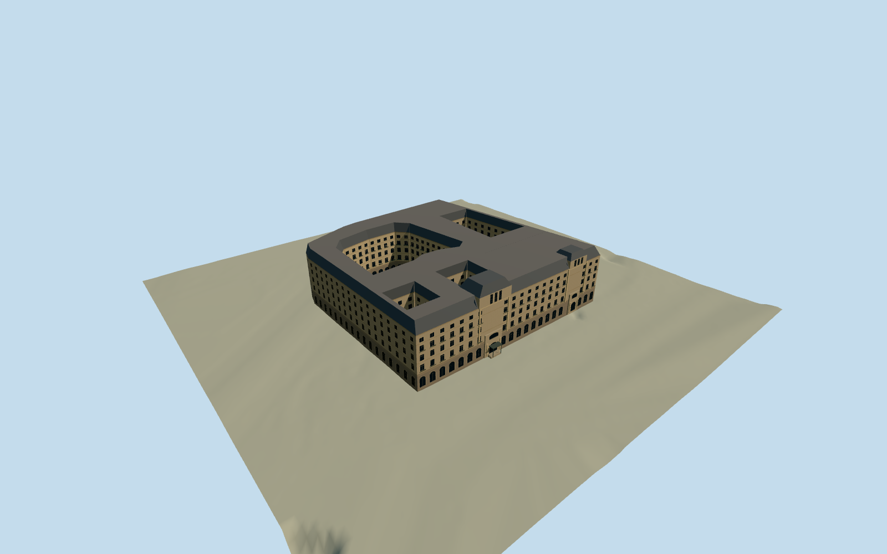

# Grand Hotel Esplanade, Berlin

The prewar Grand Hotel Esplanade at its original Bellevuestraße address, with its mansard-roofed stone wings and formal garden court.

Authoring state: **review-in-qa.json**. Current completion evidence is in [qa.json](qa.json) and the [completion ledger](../../../../qualla-structures/batches/qualla-003.PROGRESS.md).

- [Hotel Esplanade Berlin](https://qualla.com/hotel-esplanade-berlin/)

The reconstruction shows the hotel after its 1911–12 expansion. The conservative date range covers the documented prewar form and ends before wartime damage.

Roof details, exact stone shades, portal relief carving, garden planting and fine courtyard fittings are approximations. The site represents the main connected hotel and its garden, excluding the row of service buildings farther behind the property.

Modern source terrain is independent of the historic building and provides an approximate site datum.

Build: `node content/worldgen/source/places/u3/u33/hotel_esplanade_berlin/models/generate-hotel-esplanade-berlin.mjs`. Add `--check` to verify exact regeneration. 18167 triangles; 7 materials; no embedded photographs.
