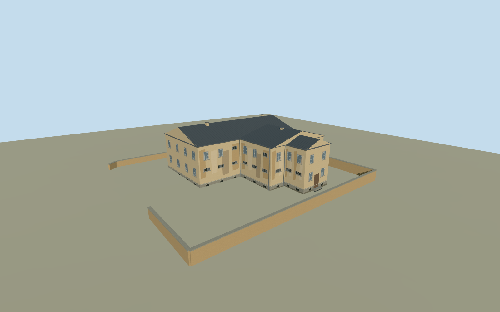

# KGB Prison, Potsdam

The historic rectory at Leistikowstraße 1, now the Potsdam memorial, with its grey roofs, weathered courtyard plaster and original window openings.

Authoring state: **review-in-qa.json**. Current completion evidence is in [qa.json](qa.json) and the [completion ledger](../../../../qualla-structures/batches/qualla-004.PROGRESS.md).

- [KGB Prison, Potsdam](https://qualla.com/kgb-prison-potsdam/)

The footprint and courtyard details are documented. Roof ridge, street-facing fenestration and fine weathering are approximate.

Build: `node content/worldgen/source/places/u3/u33/kgb_prison_potsdam/models/generate-kgb-prison-potsdam.mjs`. Add `--check` to verify exact regeneration. 2274 triangles; 5 materials; no embedded photographs.
