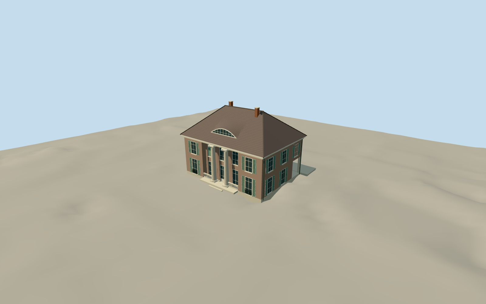

# Liebermann Villa

Restored Wannsee villa with two tall street-front Ionic columns, curved eyebrow dormer, hipped tile roof, lake-facing three-bay pediment, open side loggia, mint shutters and raised terrace.

Authoring state: **review-in-qa.json**. Current completion evidence is in [qa.json](qa.json) and the [local 100 ledger](../../../../qualla-structures/batches/PROGRESS.md).

- [Liebermann Villa](https://qualla.com/liebermann-villa/)

Original medium-fi restored villa exterior reviewed against the public-domain 1918 painting already published on Qualla and factual descriptions by Berlin heritage authorities, the restoring architects and the museum. Earlier attribution-only photos are excluded from the current review; this is not a measured survey.

Mapped rectangle controls main building width and depth. Roof pitch and eyebrow curve, paint shades, terrace depth, side openings, small side entrance/pergola and Ionic capitals are approximate; the painting does not establish every elevation or current paint colour.

Street columns, lake pediment and southwest open loggia are distinct. Wider garden, separate garden house, interiors, furniture and vegetation are excluded.

No reference-image pixels are embedded. Shared materials and original simplified geometry represent tile, shutters, iron guards and limestone.

Independent terrain remains unchanged; another host DEM can change exact foundation contact.

Build: `node packages/worldgen/scripts/generate-authored-places.mjs --ids=liebermann_villa`. Add `--check` to verify exact regeneration. 22741 triangles; 6 materials; no embedded photographs.
