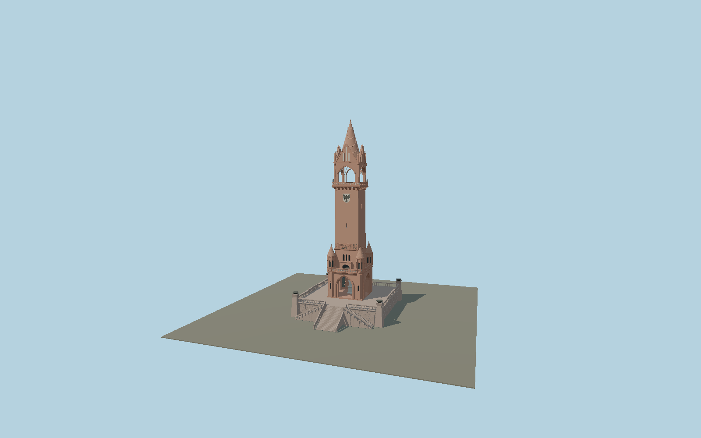

# Grunewald Tower

Red-brick memorial and observation tower on a raised porphyry terrace, with four open pointed memorial-hall arches, clustered corner turrets, pierced gallery rails, tapered inscribed shaft, corbelled upper viewing hall, four decorated gables and a course-built conical brick roof.

## Identity and geometry

Catalog N0616, [Q833787](https://www.wikidata.org/wiki/Q833787). Berlin’s official visitor and district records give a 55 m tower and 36 m viewing floor. The 1899 section supplies proportions, with a four-metre terrace confirmed by the contemporary Gartenlaube account. The mapped 26.068 × 26.045 m outline describes the broad terrace, not the slender shaft. Unreferenced catalog height 56 m is not used.

Native+Z is the Koenig Wilhelm I entrance, northeast at heading2.185851134577897rad. Exact-Q833787 mapped terrace square supplies measured axes; inspected Commons gallery labels Berlin Grunewaldturm.JPG as east and Grunewaldturm Gesamtansicht.jpg as west. East photograph pairs the Koenig inscription/black eagle with central and side stairs; north-up satellite view locates those stairs on the northeast forecourt side. Native−Z faces southwest toward Havel/restaurant. Bearing follows the mapped edge; nominal east/west captions are directional descriptions, not due-east claims.. +Z northeast Koenig Wilhelm entrance and three stair routes; +Y is up. The geographic proposal identifies its anchor and orientation evidence separately from remaining terrain and azimuth uncertainty.

Source facts and measured references are recorded in spec.json. References: [1](https://www.berlin.de/ba-charlottenburg-wilmersdorf/ueber-den-bezirk/bauwerke/tuerme/artikel.1129193.php), [2](https://www.berlin.de/sehenswuerdigkeiten/3560626-3558930-grunewaldturm.html), [3](https://denkmaldatenbank.berlin.de/daobj.php?obj_dok_nr=09046482), [4](https://commons.wikimedia.org/wiki/File:1899_Grunewaldturm2.gif), [5](https://commons.wikimedia.org/wiki/File:1899_Grunewaldturm1.gif), [6](https://commons.wikimedia.org/wiki/File:Berlin_Grunewaldturm.JPG), [7](https://de.wikisource.org/wiki/Die_Gartenlaube_(1899)/Heft_8), [8](https://www.openstreetmap.org/way/23722446). Reference pages and images are not redistributed.

## Original source and shared materials

Geometry is authored in `packages/worldgen/scripts/grunewald-tower-model.mjs`. Shared material graphs with metric repeat UV0 and original vertex tints; GLB PBR fallback remains self-contained. No per-model texture duplication. No third-party mesh or photograph is embedded.

335,988 triangles; 672,410 vertices; 8 material groups; 28,243,240 source bytes. Source hash: `sha256:f66ee5d9fe590d5112549852d8052a484af20126d657980bc0deace677c052cf`. Geometry validation checks finite Float32 coordinates, indices, triangle area and winding before export.

Regenerate with `node packages/worldgen/scripts/generate-heritage-towers.mjs N0616`; add `--check` for reproducibility. The generator refuses to overwrite a master whose hash differs from source.json. Import uses `--no-optimize` to preserve facade recesses.

## Remaining detail and review

- Static exterior and visible memorial hall using1899 architectural drawing,2007 mosaic,2008 east facade and2018 statue/portal details. Berlin official heights55m and36m observation floor,4m raised terrace. Original architectural master preserved; reviewed local master adds marble figure, four interior iron portraits, gold/blue eight-rib vault, opposite colored eagle shields, lower-turret foil recesses, paired back glazing, sparse photo-supported antenna equipment and two side flights; erroneous rear main staircase removed. Sculpture posture and broad relief/mosaic forms are medium-fi reconstructions, not measured likenesses or exact ornaments; inscriptions keep documented text through original line glyphs. Stair rises/runs, interior plinth/figure proportions, minor fittings and date-sensitive equipment remain photographic estimates. Hidden internal stair/rooms, detached restaurant, furniture/vegetation and current operations excluded. Terrain contact assumes locally level approach at lower stairs; host must fit terrain without embedding the4m platform. Exact mapped terrace controls position/orientation, not all exterior stair edges; footprint replacement is disabled.

Named near/far cameras are included for lit visual review. A valid export is not maximum-fidelity certification.
