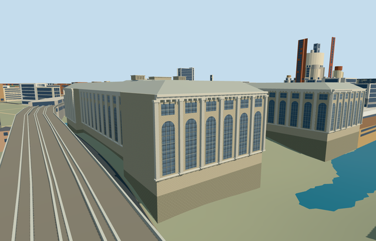

# N0751 — Pergamon Museum

Reviewed 2026-10-22. **Authored exterior and runtime LODs reviewed; native placement remains an inactive terrain-fit draft.**

## Built and inspected

Pergamon Museum in the retained mapped pre-renovation entrance configuration: three connected stone wings around an open western courtyard, tall round-headed lower glazing/upper windows, pilasters with actual close-up flute relief, heavy cornices/dentils, hipped gallery roofs and stepped central roof/lanterns, lower rear alcove and a broad framed glass vestibule with a true door recess, closed soffit and separate low treads. Two ordinary pictures guided this continuous author/inspect/fix pass. Seated a rooftop element and added the photographed entrance-wall cornice before final captures. No antiquities, copied lettering/sign art, interior rooms, temporary cranes/excavation/scaffolds or future fourth wing.

## Shared surfaces and browser LODs

Four existing256px graphs across eight authoring roles: stone_limestone walls/plinth, stone_limestone_raw modeled cornices/pilasters, metal_painted roofs/frames/doors and storefront opaque glazing. Five textured draws, one skyline draw. No new graph, private atlas or embedded image. Linear GLB colors, metric UVs, shared resolver/lifetimes retained; each graph reads once and every LOD unload disposes all model geometry. Shared storefront grid is a stylistic surface rather than an exact inventory of historic glazing bars.

| Level | Triangles | Bytes | Draws |
| --- | ---: | ---: | ---: |
| skyline | 700 | 63,808 | 1 |
| district | 3,958 | 349,132 | 5 |
| street | 12,809 | 1,138,876 | 5 |
| closeup | 22,157 | 1,793,908 | 5 |

Four authored LODs contain700 / 3,958 / 12,809 / 22,157 triangles, all within medium-fi budgets. Initial skyline plus district geometry is 412940 bytes; close-up is 1793908 bytes. Separate POSITION/NORMAL streams, equal CPU/GPU accounting; six GLBs with zero Khronos errors/warnings,54 mesh/contact probes,16 actual PMTiles13/14/15 cases and47 current inspected frames. Economy/High, noon/late light, silhouette and four-level changes inspected. Physical laptop/phone/tablet and dense-city timings remain pending.

## Geographic placement

Native terrain fit rejected; placement stays inactive draft. Q157298 and the named way313659704/native35184685748536 identify Pergamon Museum. Integral ways231549083/084/085/086/087 supply five parts. Internal+X follows the mapped south-southeast front edge; +Z points west-southwest into the open court. Heading0 is baked into world east/south coordinates. Controlled placement replaces six owned records and preserves all989 independent resident /1321 wider buildings, including James-Simon-Galerie, Neues Museum, Bode Museum and surrounding colonnades. Original201x201/6m terrain, roads and134371.78m² of water remain unchanged. Only occupied wings/hall/vestibule/alcove cut ground; court/provider/approach stay original. Failure restores all995 resident buildings; all four LOD unloads restore ground/water and zero live model geometry. However boundary grades span-8.45 to+1.11m relative to the courtyard control, exposing an excessive canal-side foundation/plinth. Exact quay/floor/threshold fit is not established. Do not activate or count the candidate complete; no custom terrain or broad flattening was used.

## Fidelity and limits

Standalone medium-fi exterior reviewed, with geographic completion pending. Overall mapped heights30/25/10m and generic15m are unqualified controls; wall/roof breakdown, bay inventories, flute/cornice shapes, hidden roof/rear elevations and services are reconstructed approximations. The retained map and2004 photograph establish the broad glazed vestibule. The2026 photograph confirms surviving stone wings and shows a changed entrance/construction state; this asset explicitly represents the mapped older entrance configuration, not the completed renovation or future fourth wing. Furnished galleries, antiquities, copied inscriptions, exact engineering dimensions, contemporary construction, threshold/accessibility certification and physical device timings are omitted or unverified.

## Targeted checks

Selected generation/import/placement checks, strict medium-fi, scene validation, sim30 and recipe lint pass. Sim30 sha256:f4da7f10597216bb170c2e07b3d23763329f8ccd8098a707927b8d92a348ee26. Current pins: [qa.json](qa.json). Editable controls: [map-frame.json](map-frame.json).

## Viewed references

- https://commons.wikimedia.org/wiki/File:Pergamonmuseum_Front.jpg — Raimond Spekking; 2004-03-24; CC-BY-SA-4.0. Viewed only.

- https://commons.wikimedia.org/wiki/File:Pergamonmuseum_Berlin,_Baustelle_am_25._Mai_2026.jpg — Peter Christian Riemann; 2026-05-25; CC-BY-SA-4.0. Viewed only.

- https://www.openstreetmap.org/way/313659704 — named PMTiles building and POI, ©OpenStreetMap contributors, ODbL-1.0. No separate survey or bespoke terrain source.
