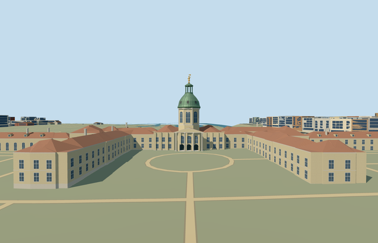

# N0762 — Charlottenburg Palace

Reviewed2026-10-22. **Completed medium-fi principal palace exterior; qualified approximate native fit.**

## Built and inspected

Principal connected Charlottenburg Palace exterior: open southern forecourt, long west Orangery/end pavilion and eastern New Wing, pale repeated facades/crossed glazing, red ceramic hip roofs/dormers/stacks, central three genuine arched portal recesses/thresholds/short treads and tall noble windows under a supported triangular pediment. Octagonal tower has arched window proxies/clock, ribbed copper bell/oculi, open lantern/cap and an original symbolic gilded Fortuna finial. Fitted extra facade bays over fragmented map edges and closed portico/stair footings in the same author/inspect/fix pass.

## Shared materials and LODs

Seven roles use six existing256px shared graphs: plaster_lime, stone_limestone_raw, tile_ceramic, metal_copper, storefront and metal_painted. Neutral ceramic graph tinted red; painted metal supplies gold/dark accents. No embedded images/new graph/private atlas. One skyline draw, bounded textured draws, separate POSITION/NORMAL streams and equal CPU/GPU accounting. Every textured native run reads each graph once; unload releases geometry.

| Level | Triangles | Bytes | Draws |
| --- | ---: | ---: | ---: |
| skyline | 713 | 69760 | 1 |
| district | 3164 | 298940 | 6 |
| street | 8888 | 789936 | 6 |
| closeup | 15865 | 1391436 | 6 |

Four authored LODs 713 / 3164 / 8888 / 15865 triangles; initial skyline+district geometry 368700 bytes, closeup 1391436 bytes; at most 6 textured draws. Six GLBs zero Khronos errors/warnings;211 actual mesh/contact probes and25 actual PMTiles13/14/15 cases (14 owned records across17 detailed tile fragments). Inspected52 current portable/shared/medium-fi/native frames. Native all-LOD/failure/unload checks preserve870 resident/1060 wider independent buildings, original201x201/6m terrain/roads/169085.126m² water and open court/garden/approach ground. Failure keeps all884 originals; unload restores ground/water and zero live geometry.

## Geographic fit

Q154996 and named parent way186517395/native35184558606227 identify Charlottenburg Palace. Thirteen integral mapped parts, including west Orangery/east New Wing and the octagonal tower footing, bring explicit ownership to14 records. Exact union supplies horizontal geometry and leaves the southern forecourt open. Model origin moves to the octagonal tower center; internalX east-northeast along the long palace, internalZ south-southeast toward the court. Geometry is baked into native east/up/south coordinates with heading0; signed facade follows the south-facing photos. All unrelated buildings remain independent. Qualified approximate native exterior placement on original standard Protomaps20261020/Mapzen201x201/6m terrain. Uncovered southern forecourt provider gives datum34.49388945015782m, working floor0.3m and closed foundation-1.325m. Boundary grades-1.175..2.112m leave modest low-side foundations and uphill base burial. Main portal thresholds and the open southern forecourt remain exposed in inspected native views. Portico columns and exterior treads have closed footings to the same foundation. Exact historic paving, floor/step grades and accessibility remain unverified. Only14 owned palace records are replaced; independent buildings, original forecourt/gardens, roads, terrain and169085.126m² water remain. No bespoke terrain or custom flattening; all LOD/failure/unload checks are recorded separately in qa.json.

## Fidelity and limits

Approximate picture-led medium-fi exterior. Unqualified map8/11/5m tags are controls rather than surveyed dimensions. Working eaves6.8..11m, octagonal tower platform15.5m, drum15.5..26m, copper bell26..35.5m, open lantern35.5..40.7m/cap to42.2m and original symbolic gilded finial to48m. These tower subdivisions and overall48m working height are reconstructed from proportions, not verified historic measurements. Roofs use slope0.65/rise capped10m. Facade/window/dormer/chimney inventories, hidden elevations and roof junctions are approximate. Three actual1.2m portal recesses have curved soffits,0.35m thresholds and short treads. No copied sculpture/clock numerals/inscriptions, furnished rooms, garden/equestrian statues or temporary construction. Qualified approximate native exterior fit: boundary-1.175..+2.112m leaves modest low-side foundation and uphill base burial. Main thresholds/forecourt remain exposed. Clock/oculi/noble glazing are exterior surface proxies; lantern is actually open and the three portals have actual recesses/soffits. Hidden roof junctions, permanent unseen western end facade, exact heights/detail inventories, historic sculpture, paving/floor/stair grades and accessibility are approximate or unverified. No furnished rooms, copied faces/reliefs/arms/inscriptions, equestrian/garden/fountain sculpture or temporary scaffolding. Physical laptop/phone and dense-city timings remain pending.

## Targeted checks

Selected generation/import/placement, strict medium-fi, scene/sim30 and recipe lint pass. Sim30 sha256:27fca48ec59daf4aae80cf67e59bdfcc743446e72b1a9d78f2cccecdeddb2c54. Current pins: [qa.json](qa.json); [source controls](map-frame.json).

## Viewed references

- https://commons.wikimedia.org/wiki/File:Aerial_image_of_Schloss_Charlottenburg_(view_from_the_southwest).jpg — Carsten Steger; 2023-05-27; CC-BY-SA-4.0. Viewed only; no copied pixels.

- https://commons.wikimedia.org/wiki/File:Berlin_Charlottenburger_Schloss_Strassenseite.jpg — Times; 2007-05-01; CC-BY-SA-3.0 / GFDL (multi-licensed). Viewed only; no copied pixels.

- https://www.openstreetmap.org/way/186517395 — palace identity and integral parts; ©OpenStreetMap contributors, ODbL-1.0. Standard PMTiles/Mapzen only.

## Completion checklist

- [x] Rebuildable master/import, four authored LODs and shared materials.
- [x] Current actual architecture/context/native renders and geometry checked.
- [x] Explicit identity/orientation, exact ownership union and qualified native exterior fit.
- [x] Forecourt/garden/approaches open; independent buildings/roads/terrain/water retained; failed loading/unload restoration checked.
