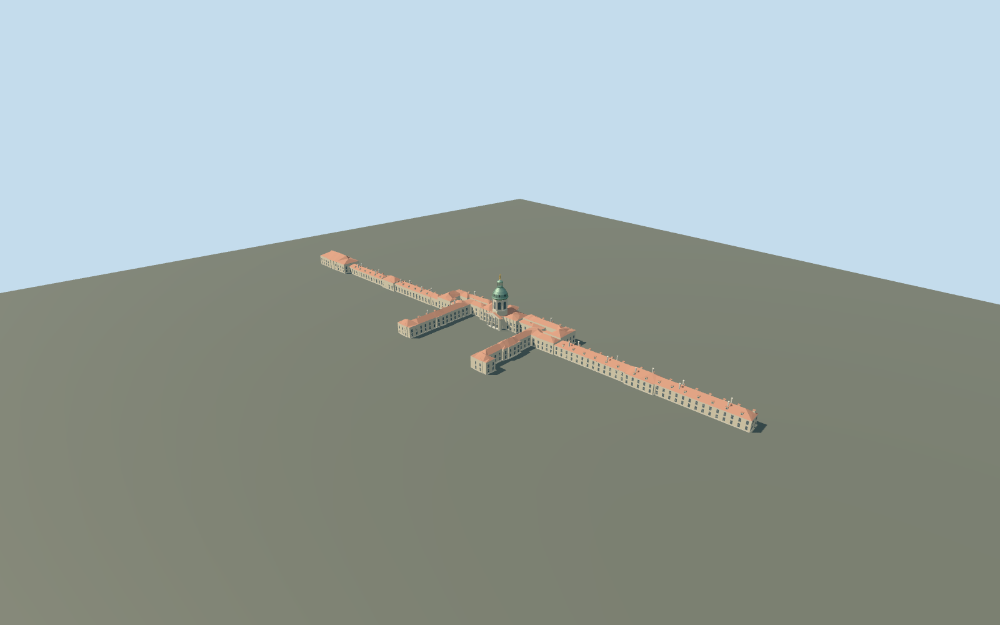

# Charlottenburg Palace, copper dome and long wings

Principal connected Charlottenburg Palace exterior, including the open southern forecourt/main ranges, western Orangery and end pavilion, eastern New Wing, red ceramic hip roofs/dormers/stacks, pale repeated facades, central three arched recessed portals/thresholds, tall noble windows and supported triangular pediment. Mapped octagonal tower supports a windowed drum/clock, ribbed copper bell dome/oculi, open lantern/cap and an original schematic gilded Fortuna finial. Independent garden/campus buildings, forecourt statue, gardens/fountains and temporary scaffolding remain context. No furnished rooms or copied faces, reliefs, arms or inscriptions.

## Evidence and reconstruction

Published dimensions and reconstructed details are separated in spec.json. Primary references:

- [Reference](https://commons.wikimedia.org/wiki/File:Aerial_image_of_Schloss_Charlottenburg_(view_from_the_southwest).jpg)
- [Reference](https://commons.wikimedia.org/wiki/File:Berlin_Charlottenburger_Schloss_Strassenseite.jpg)

Principal connected Charlottenburg Palace exterior, including the open southern forecourt/main ranges, western Orangery and end pavilion, eastern New Wing, red ceramic hip roofs/dormers/stacks, pale repeated facades, central three arched recessed portals/thresholds, tall noble windows and supported triangular pediment. Mapped octagonal tower supports a windowed drum/clock, ribbed copper bell dome/oculi, open lantern/cap and an original schematic gilded Fortuna finial. Independent garden/campus buildings, forecourt statue, gardens/fountains and temporary scaffolding remain context. No furnished rooms or copied faces, reliefs, arms or inscriptions.

## Model and axes

15,865 triangles; 38,237 vertices; 6 material groups; 1,570,824 bytes. Native bounds: -272.983, -1.325, -23.982 to 222.476, 48.300, 76.588. Source hash: `sha256:bcb8b8de14b313663603ab9c9720fc983d8e54b5a4a48700f8ae0791832e5cc1`.

{"x":"east","y":"up","z":"south"}

The geographic proposal uses exact-QID OpenStreetMap evidence. Map-derived orientation and estimated architectural details require real-site visual review; preview eligibility is distinct from geographic/fidelity approval. Map attribution: © OpenStreetMap contributors, ODbL-1.0.

## Reproduce

Run `node packages/worldgen/scripts/generate-additional-landmarks.mjs --ids=N0762` (or add `--check`). The generator preserves manually edited masters by checking their baseline hashes. Import through the standard authored-model workflow with optimization disabled; then capture all QA cameras, including shared-surface views.

## Pending work

- Principal connected Charlottenburg Palace exterior, including the open southern forecourt/main ranges, western Orangery and end pavilion, eastern New Wing, red ceramic hip roofs/dormers/stacks, pale repeated facades, central three arched recessed portals/thresholds, tall noble windows and supported triangular pediment. Mapped octagonal tower supports a windowed drum/clock, ribbed copper bell dome/oculi, open lantern/cap and an original schematic gilded Fortuna finial. Independent garden/campus buildings, forecourt statue, gardens/fountains and temporary scaffolding remain context. No furnished rooms or copied faces, reliefs, arms or inscriptions.
- Q154996 and named parent way186517395/native35184558606227 identify Charlottenburg Palace. Thirteen integral mapped parts, including west Orangery/east New Wing and the octagonal tower footing, bring explicit ownership to14 records. Exact union supplies horizontal geometry and leaves the southern forecourt open. Model origin moves to the octagonal tower center; internalX east-northeast along the long palace, internalZ south-southeast toward the court. Geometry is baked into native east/up/south coordinates with heading0; signed facade follows the south-facing photos. All unrelated buildings remain independent.
- Approximate picture-led medium-fi exterior. Unqualified map8/11/5m tags are controls rather than surveyed dimensions. Working eaves6.8..11m, octagonal tower platform15.5m, drum15.5..26m, copper bell26..35.5m, open lantern35.5..40.7m/cap to42.2m and original symbolic gilded finial to48m. These tower subdivisions and overall48m working height are reconstructed from proportions, not verified historic measurements. Roofs use slope0.65/rise capped10m. Facade/window/dormer/chimney inventories, hidden elevations and roof junctions are approximate. Three actual1.2m portal recesses have curved soffits,0.35m thresholds and short treads. No copied sculpture/clock numerals/inscriptions, furnished rooms, garden/equestrian statues or temporary construction.
- Qualified approximate native exterior placement on original standard Protomaps20261020/Mapzen201x201/6m terrain. Uncovered southern forecourt provider gives datum34.49388945015782m, working floor0.3m and closed foundation-1.325m. Boundary grades-1.175..2.112m leave modest low-side foundations and uphill base burial. Main portal thresholds and the open southern forecourt remain exposed in inspected native views. Portico columns and exterior treads have closed footings to the same foundation. Exact historic paving, floor/step grades and accessibility remain unverified. Only14 owned palace records are replaced; independent buildings, original forecourt/gardens, roads, terrain and169085.126m² water remain. No bespoke terrain or custom flattening; all LOD/failure/unload checks are recorded separately in qa.json.

This bundle follows the medium-fi standard. Medium-fi appearance and geographic fit are reviewed separately. Hash-bound visual acceptance is recorded separately after capture inspection.
