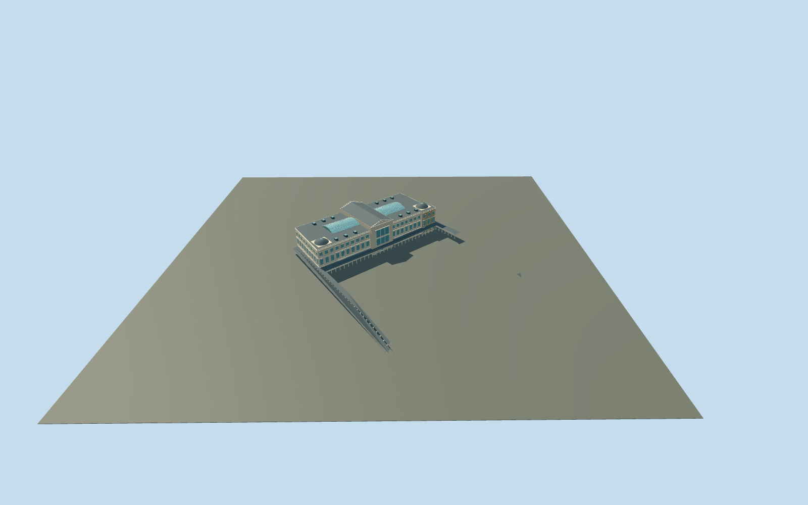

# Neues Museum

Neues Museum connected exterior on its exact PMTiles footprint: warm pale stone and restrained restored brick, three facade levels, central east/west pediments and tall grouped window bays, shared mapped U-shaped outdoor colonnade with open gaps and original terrain under its roof, dark shallow wing roofs, two broad blue-green glazed court roofs, raised central gabled hall and two low corner dome/skylight forms. Covered courts remain covered; no invented open courtyard, copied relief figures/inscriptions, banners, furnished galleries or neighboring James-Simon-Galerie/Alte Nationalgalerie/Pergamon geometry.

## Evidence and reconstruction

Published dimensions and reconstructed details are separated in spec.json. Primary references:

- [Reference](https://commons.wikimedia.org/wiki/File:2021-07-19_Neues_Museum_01.jpg)
- [Reference](https://commons.wikimedia.org/wiki/File:Berlin_James-Simon-Galerie_asv2019-07_img2.jpg)
- [Reference](https://www.smb.museum/en/whats-new/detail/museumsinsel-berlin-20-years-as-a-unesco-world-heritage-site/)

Neues Museum connected exterior on its exact PMTiles footprint: warm pale stone and restrained restored brick, three facade levels, central east/west pediments and tall grouped window bays, shared mapped U-shaped outdoor colonnade with open gaps and original terrain under its roof, dark shallow wing roofs, two broad blue-green glazed court roofs, raised central gabled hall and two low corner dome/skylight forms. Covered courts remain covered; no invented open courtyard, copied relief figures/inscriptions, banners, furnished galleries or neighboring James-Simon-Galerie/Alte Nationalgalerie/Pergamon geometry.

## Model and axes

25,632 triangles; 76,170 vertices; 6 material groups; 3,053,572 bytes. Native bounds: -67.675, -8.297, -112.278 to 123.632, 26.643, 67.949. Source hash: `sha256:9d7b58df41a9f449edfd72abf09798d2772b6a7accca801aeb6c9a3bf1666f26`.

{"x":"east","y":"up","z":"south"}

The geographic proposal uses exact-QID OpenStreetMap evidence. Map-derived orientation and estimated architectural details require real-site visual review; preview eligibility is distinct from geographic/fidelity approval. Map attribution: © OpenStreetMap contributors, ODbL-1.0.

## Reproduce

Run `node packages/worldgen/scripts/generate-additional-landmarks.mjs --ids=N0767` (or add `--check`). The generator preserves manually edited masters by checking their baseline hashes. Import through the standard authored-model workflow with optimization disabled; then capture all QA cameras, including shared-surface views.

## Pending work

- Neues Museum connected exterior on its exact PMTiles footprint: warm pale stone and restrained restored brick, three facade levels, central east/west pediments and tall grouped window bays, shared mapped U-shaped outdoor colonnade with open gaps and original terrain under its roof, dark shallow wing roofs, two broad blue-green glazed court roofs, raised central gabled hall and two low corner dome/skylight forms. Covered courts remain covered; no invented open courtyard, copied relief figures/inscriptions, banners, furnished galleries or neighboring James-Simon-Galerie/Alte Nationalgalerie/Pergamon geometry.
- Q157316 and OpenStreetMap way18578139/native35184390666971 identify Neues Museum. Reused the existing standard N0751 Berlin extract; the parent and seven integral overlapping body/roof records are replaced. Detailed parts identify the central hall, both glazed court roofs, two corner domes and two wing relations; they are museum parts, not neighboring buildings. The exact 12-vertex outline supplies meter scale. Origin is the center of the mapped eastern central risalit front edge; internal X south-southeast along the long facade, Z east-northeast toward Kolonnadenhof. Native east/up/south geometry is baked, heading0. Adjacent James-Simon-Galerie, Pergamon and Alte Nationalgalerie building records remain independent. The shared exterior Kolonnadenhof colonnade way133885752/native35184505974584 is a ninth owned record: the complete U-shaped roof and open supports are modeled together, rather than deleting only its front segment. It is separate from all neighboring museum buildings and garden ground remains untouched.
- Picture-led medium-fi exterior from the inspected 2021 east facade, 2019 west context and official2019 roof aerial. The unqualified14m map height is not a survey. Working main cornice19.7m, central hall eaves23m/ridge26.2m, 5.2m shared outdoor colonnade, two glazed court barrel roofs19.9..22.1m, corner domes20.1..23.1m. Glazed roof polygons and corner dome plan centers/radii follow actual detailed map parts; glazed roof curvature, outdoor colonnade support spacing/count, bay counts, shallow restoration patches, relief abstractions and entrance thresholds are explicit approximations. Courts are glass-covered exterior roof proxies; no rooms, archaeological collections, copied sculpture/text or costly transparency.
- Original standard Protomaps20261020/Mapzen201x201/6m grid retained from the Berlin N0751 extract. Open front provider[0,8] supplies36.67228538201867m datum. Boundary grades-1.480..0.747m; working floor+.15m, closed foundation-1.660m. Only occupied museum footprint is ground-masked; outside forecourt/approaches and independent buildings/roads/water remain original. Exact threshold/accessibility remain approximate; no bespoke terrain, survey lookup or flattening. Outdoor colonnade posts follow the original terrain individually with bases0.15m below local ground. Its mapped U-shaped roof is triangulated through support centers at5.2m above original ground and edge controls, retaining actual ground/paths underneath. Skyline keeps the whole roof and selected end supports. This is an explicit coarse-DEM fit approximation to historic roof levels; no ground samples are edited. Qualified approximate native exterior fit accepted after inspecting the current complete site, east facade, covered roof courts/domes and exposed lower entrance/colonnade. Low-side plinth exposure and uphill burial remain. The west native view is partly occluded by the retained independent James-Simon-Galerie proxy; full source/shared renders cover the hidden facade. Exact threshold/accessibility and historic colonnade roof levels remain unverified.

This bundle follows the medium-fi standard. Medium-fi appearance and geographic fit are reviewed separately. Hash-bound visual acceptance is recorded separately after capture inspection.
