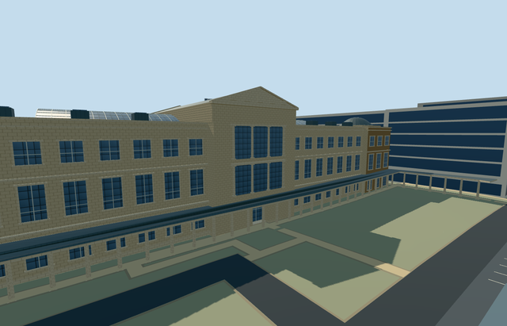

# neues_museum — Neues Museum

Reviewed 2026-10-23. **Completed medium-fi exterior and shared Kolonnadenhof colonnade; qualified approximate native fit.**

## Built

The mapped connected museum body has three facade levels, stone and restrained brick surfaces, central pediments/grouped windows, a raised gabled hall, two mapped glazed court roofs and low corner domes/skylights. A real 1.2m lower entrance recess has a closed soffit and threshold. The complete shared U-shaped outdoor colonnade has 124 open supports; original garden ground and paths remain underneath. Adjacent museum buildings remain independent.

Six roles share five existing 256px graphs: stone_limestone, brick, metal_standing_seam, storefront and metal_painted. Metric UVs, separate vertex streams, six textured draws and one skyline draw. No embedded images, private atlas or new graph.

| LOD | Triangles | Bytes | Draws |
| --- | ---: | ---: | ---: |
| skyline | 454 | 45,372 | 1 |
| district | 3,902 | 392,156 | 6 |
| street | 15,058 | 1,373,308 | 6 |
| closeup | 25,632 | 2,336,268 | 6 |

Initial skyline + district geometry: **437,528 bytes**. Skyline retains the complete colonnade roof and selected end supports; all textured levels retain every support. Detailed window frames and support pads are reserved for closeup.

## Placement and limits

Q157316 and way18578139 identify the museum; seven integral roof/body records and shared colonnade way133885752 are explicitly controlled in [map-frame.json](map-frame.json). Anchor [13.397976011037827,52.52028491091427], baked east/up/south geometry, heading0. Detailed map parts control both glass-roof outlines and dome plan centers/radii.

Original standard Berlin PMTiles/Mapzen ground, roads, **986 resident / 1,318 wider independent buildings** and **134,371.781m² water** remain intact. Failure retains all995 resident originals. Garden/approaches stay open; only the occupied main museum ground is masked. Each used graph loads once; every LOD/failure/unload restores ground/water and releases all model geometry.

The coarse terrain gives main boundary grades -1.480..+0.747m relative to the36.67228538201867m outside datum. Floor+.15m and foundation-1.660m give some base exposure/burial. Outdoor supports follow original ground with bases0.15m below it; the roof is an explicit terrain-aware approximation to historic levels. Heights, bay/support counts, relief abstractions, hidden details, threshold/accessibility and preservation are approximate. No copied sculpture/text, furnished galleries or bespoke terrain.

Flat review planes bury distant colonnade sections. Synthetic neighbors may overlap the enlarged ensemble; the west native view is partly occluded by the independent modern-gallery proxy. Full source views and native entrance/complete-site views cover these limitations. Physical phone/laptop and dense-city measurements remain pending.

## Checks and references

**Six GLBs: zero Khronos errors/warnings; 1,440 actual mesh/contact probes; 52 current inspected frames; 16 map cases including nine owned detailed records.** Selected generation/import/placement, strict medium-fi, scene/sim30 and two-recipe lint pass. Sim30 sha256:f23003c0210f6d28bb4c3b14883c05f44358221c1e98404509b12f40c8d004e7. Current source/runtime/input pins and frame hashes: [qa.json](qa.json).

- [East facade photograph](https://commons.wikimedia.org/wiki/File:2021-07-19_Neues_Museum_01.jpg): Geoprofi Lars,2021-07-19,CC-BY-SA-4.0.
- [West context photograph](https://commons.wikimedia.org/wiki/File:Berlin_James-Simon-Galerie_asv2019-07_img2.jpg): A.Savin, Wikipedia,2019-07-18,Free Art License.
- [Ordinary roof aerial](https://www.smb.museum/en/whats-new/detail/museumsinsel-berlin-20-years-as-a-unesco-world-heritage-site/): Stiftung Preußischer Kulturbesitz / Stefan Müchler,2019; no reuse license established.
- [Mapped museum](https://www.openstreetmap.org/way/18578139) and [shared colonnade](https://www.openstreetmap.org/way/133885752): ©OpenStreetMap contributors,ODbL-1.0.

Pictures were viewed only; no pixels copied. Three ordinary pictures and the cached standard extract guided one continuous author/inspect/fix pass.
