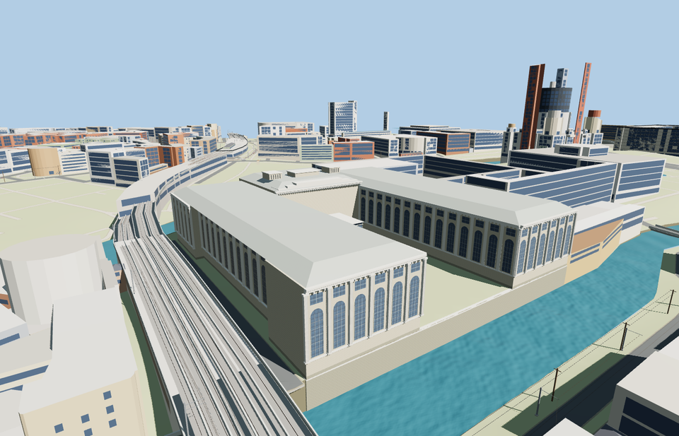

# Pergamon Museum

The three limestone wings surround the open western court. Recessed entrance glazing, pilasters, cornices, the stepped hall roof and hipped gallery roofs follow the reference photographs. A sloped apron meets the vestibule, and a narrow masonry quay supports the wing ends along the mapped canal.
[2004 court photograph](https://commons.wikimedia.org/wiki/File:Pergamonmuseum_Front.jpg) · [2026 construction photograph](https://commons.wikimedia.org/wiki/File:Pergamonmuseum_Berlin,_Baustelle_am_25._Mai_2026.jpg)

The dated pose places the court west-southwest of the hall. The model uses the 36.63 m court control from the retained elevation provider. The localized grade and quay fit the ground and water polygons at the wing ends. The entrance apron joins the court within 9 mm at three sampled points in all four detail levels.
[Signed map geometry](map-frame.json) · [Source elevation controls](pmtiles-fit.json)

When the dated landmark loads, the viewer replaces six museum records and retains 989 neighboring buildings, 4,948 transportation records and eight mapped water inputs in the test tile. The water geometry stays in place. A failed download and views outside the supported date use all 995 native building records. Unloading restores the ground and releases the model geometry.

Four shared material graphs supply the textured levels. Six GLBs passed Khronos validation with no errors or warnings. Inspected 58 current views and ran 162 geometry probes.

| Detail level | Triangles | Download bytes | Draws |
| --- | ---: | ---: | ---: |
| skyline | 724 | 65,572 | 1 |
| district | 3,982 | 350,968 | 5 |
| street | 12,833 | 1,140,712 | 5 |
| closeup | 22,181 | 1,795,744 | 5 |

Skyline and district total 416,540 bytes. The historic vestibule is available for 24 March 2004, the date of the verified reference photograph. The surrounding streets, canal and buildings use present-day map data. The court grade, quay profile, exterior ornament and apron slope are reconstruction approximations. Review covers the museum exterior.

[Verification report](qa.json) · [Dated placement](placement-report.json)
