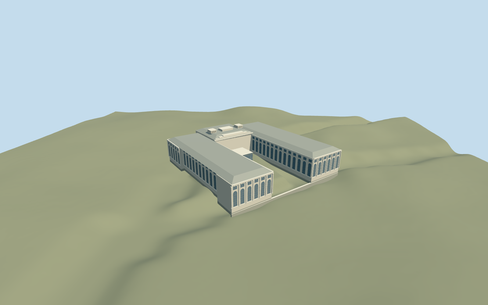

# Pergamon Museum

Pergamon Museum as photographed on 24 March 2004. Three connected limestone wings frame an open western court with the broad glazed vestibule. Recessed glazing, pilasters, cornices, hipped roofs, stepped hall roof and lower east alcove use the retained mapped geometry. The modern street, canal and neighboring buildings provide site context.

## Evidence and reconstruction

Published dimensions and reconstructed details are separated in spec.json. Primary references:

- [Reference](https://commons.wikimedia.org/wiki/File:Pergamonmuseum_Front.jpg)
- [Reference](https://commons.wikimedia.org/wiki/File:Pergamonmuseum_Berlin,_Baustelle_am_25._Mai_2026.jpg)

Pergamon Museum as photographed on 24 March 2004. Three connected limestone wings frame an open western court with the broad glazed vestibule. Recessed glazing, pilasters, cornices, hipped roofs, stepped hall roof and lower east alcove use the retained mapped geometry. The modern street, canal and neighboring buildings provide site context.

## Model and axes

22,181 triangles; 56,599 vertices; 5 material groups; 2,307,160 bytes. Native bounds: -53.281, -8.660, -74.911 to 116.761, 30.900, 94.570. Source hash: `sha256:77df723a206d4e703c8df50bfba8c21d24423dd33be268d245e1964e85b05aab`.

{"x":"east","y":"up","z":"south"}

The geographic proposal uses exact-QID OpenStreetMap evidence. Map-derived orientation and estimated architectural details require real-site visual review; preview eligibility is distinct from geographic/fidelity approval. Map attribution: © OpenStreetMap contributors, ODbL-1.0.

## Reproduce

Run `node packages/worldgen/scripts/generate-additional-landmarks.mjs --ids=pergamon_museum` (or add `--check`). The generator preserves manually edited masters by checking their baseline hashes. Import through the standard authored-model workflow with optimization disabled; then capture all QA cameras, including shared-surface views.

## Pending work

- Pergamon Museum as photographed on 24 March 2004. Three connected limestone wings frame an open western court with the broad glazed vestibule. Recessed glazing, pilasters, cornices, hipped roofs, stepped hall roof and lower east alcove use the retained mapped geometry. The modern street, canal and neighboring buildings provide site context.
- Q157298 and named PMTiles way313659704/native35184685748536 establish the museum. Integral ways231549083/084/085/086/087 identify main hall, south wing, east service alcove, vestibule and north wing. Internal+X follows the mapped south-southeast front edge between wing ends; +Z points west-southwest through the open courtyard toward Kupfergraben. Heading0 with orientation baked into east/south geometry. Do not remove independent James-Simon-Galerie way194422265, Neues Museum way18578139, Bode Museum relation4211594 or neighboring colonnades.
- Mapped30m central hall,25m wings,10m vestibule and15m generic parent are unqualified overall height controls. Reconstructed central wall24.2m with stepped roof/lanterns to30m, wing walls22m with hipped roofs to25m, east alcove14.2m plus roof to15m. Pilaster/window inventories, recess depth, cornice profiles and hidden roof plant are picture-led approximations. The large glass vestibule follows the2004 image and retained map, not the partly rebuilt2026 entrance. Furnished galleries, antiquities, copied lettering/artwork and future construction are omitted.
- Retained Protomaps 20261020 footprints and 201 × 201 Mapzen Terrarium samples at 6 m spacing establish the signed pose and the uncovered 36.63 m courtyard datum. The bounded museum grade corrects elevation bleed from the Kupfergraben across the two wing ends. The entrance floor stands 0.90 m above the court; a gently sloped apron meets the forecourt. A masonry quay closes the bank between and below the wing ends at the mapped canal edge. Water polygons, roads, and neighboring buildings remain native. The grade, apron dimensions and quay profile are visualization approximations.

This bundle follows the medium-fi standard. Medium-fi appearance and geographic fit are reviewed separately. Hash-bound visual acceptance is recorded separately after capture inspection.
