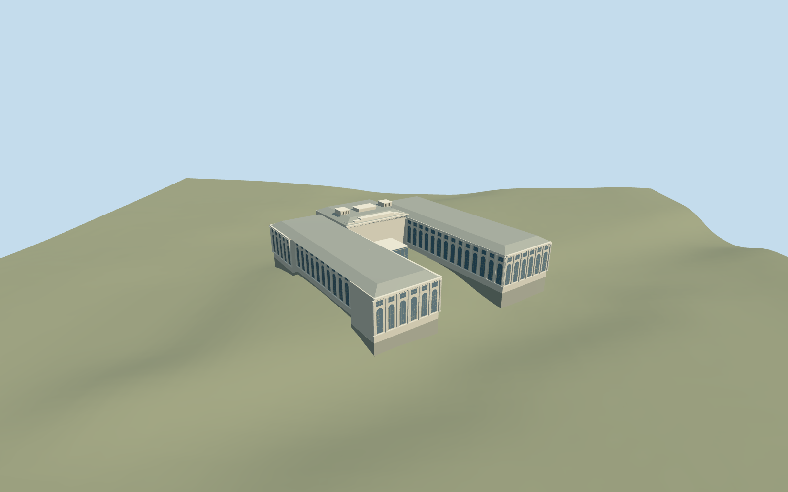

# Pergamon Museum

Pergamon Museum: complete connected mapped three-wing museum with open west court, limestone gallery wings with tall recessed glazing and pilasters, heavy cornices, hipped/stepped roof forms, central stepped entrance wall and roof lanterns, lower east service alcove and the mapped glazed entrance vestibule. This asset represents the mapped pre-renovation entrance configuration. The2026 picture informs surviving stone facades; construction pits, scaffolding, temporary signs and a future fourth wing are not reconstructed. Keep James-Simon-Galerie, Neues Museum, Bode Museum, surrounding colonnades, canal/quays and all unrelated buildings as context.

## Evidence and reconstruction

Published dimensions and reconstructed details are separated in spec.json. Primary references:

- [Reference](https://commons.wikimedia.org/wiki/File:Pergamonmuseum_Front.jpg)
- [Reference](https://commons.wikimedia.org/wiki/File:Pergamonmuseum_Berlin,_Baustelle_am_25._Mai_2026.jpg)

Pergamon Museum: complete connected mapped three-wing museum with open west court, limestone gallery wings with tall recessed glazing and pilasters, heavy cornices, hipped/stepped roof forms, central stepped entrance wall and roof lanterns, lower east service alcove and the mapped glazed entrance vestibule. This asset represents the mapped pre-renovation entrance configuration. The2026 picture informs surviving stone facades; construction pits, scaffolding, temporary signs and a future fourth wing are not reconstructed. Keep James-Simon-Galerie, Neues Museum, Bode Museum, surrounding colonnades, canal/quays and all unrelated buildings as context.

## Model and axes

22,157 triangles; 56,531 vertices; 5 material groups; 2,304,424 bytes. Native bounds: -53.281, -8.654, -74.911 to 116.761, 30.900, 94.570. Source hash: `sha256:e2e78a44f0b07a405e11e29d193866c508a8cf0e871c1af53578a02313e74db0`.

{"x":"east","y":"up","z":"south"}

The geographic proposal uses exact-QID OpenStreetMap evidence. Map-derived orientation and estimated architectural details require real-site visual review; preview eligibility is distinct from geographic/fidelity approval. Map attribution: © OpenStreetMap contributors, ODbL-1.0.

## Reproduce

Run `node packages/worldgen/scripts/generate-additional-landmarks.mjs --ids=pergamon_museum` (or add `--check`). The generator preserves manually edited masters by checking their baseline hashes. Import through the standard authored-model workflow with optimization disabled; then capture all QA cameras, including shared-surface views.

## Pending work

- Pergamon Museum: complete connected mapped three-wing museum with open west court, limestone gallery wings with tall recessed glazing and pilasters, heavy cornices, hipped/stepped roof forms, central stepped entrance wall and roof lanterns, lower east service alcove and the mapped glazed entrance vestibule. This asset represents the mapped pre-renovation entrance configuration. The2026 picture informs surviving stone facades; construction pits, scaffolding, temporary signs and a future fourth wing are not reconstructed. Keep James-Simon-Galerie, Neues Museum, Bode Museum, surrounding colonnades, canal/quays and all unrelated buildings as context.
- Q157298 and named PMTiles way313659704/native35184685748536 establish the museum. Integral ways231549083/084/085/086/087 identify main hall, south wing, east service alcove, vestibule and north wing. Internal+X follows the mapped south-southeast front edge between wing ends; +Z points west-southwest through the open courtyard toward Kupfergraben. Heading0 with orientation baked into east/south geometry. Do not remove independent James-Simon-Galerie way194422265, Neues Museum way18578139, Bode Museum relation4211594 or neighboring colonnades.
- Mapped30m central hall,25m wings,10m vestibule and15m generic parent are unqualified overall height controls. Reconstructed central wall24.2m with stepped roof/lanterns to30m, wing walls22m with hipped roofs to25m, east alcove14.2m plus roof to15m. Pilaster/window inventories, recess depth, cornice profiles and hidden roof plant are picture-led approximations. The large glass vestibule follows the2004 image and retained map, not the partly rebuilt2026 entrance. Furnished galleries, antiquities, copied lettering/artwork and future construction are omitted.
- Unmodified standard Protomaps20261020 and Mapzen201x201/6m terrain. Uncovered court attachment internal[26,0], datum36.63165873838892m. Closed floor0.9m above the control fits the approach near the mapped vestibule; two short treads make the threshold. Foundation follows the minimum original occupied boundary grade, including lower canal-side samples. Only occupied floors cut terrain; courtyard, provider, quays, all roads/water and independent buildings remain original. Exact quay/floor/threshold levels and accessibility remain unverified.

This bundle follows the medium-fi standard. Medium-fi appearance and geographic fit are reviewed separately. Hash-bound visual acceptance is recorded separately after capture inspection.
