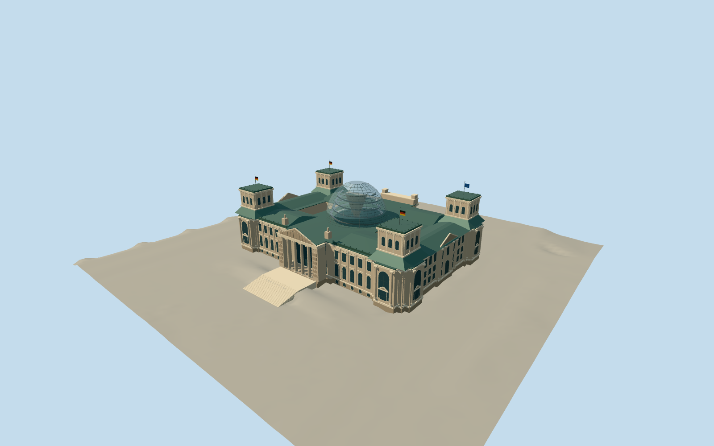

# Reichstag building

Present Berlin parliament exterior: mapped historic sandstone wings, two open courtyards, four square towers, west visitor colonnade and the transparent 40 m Foster dome.

Authoring state: **review-in-qa.json**. Current completion evidence is in [qa.json](qa.json) and the [local 100 ledger](../../../../qualla-structures/batches/PROGRESS.md).

- [Reichstag building](https://qualla.com/reichstag-building/)

Original medium-fi present exterior, using individually inspected 2014 west-front and 2017 northeast Qualla photographs; not a survey or photogrammetric reconstruction.

Mapped outline, courtyard voids and tower positions are generalized. Roof terrace, courtyard facades, side details and ornament are conservative interpretations.

Dome diameter 40 m and rise 23.5 m follow Bundestag figures; base is approximately 24 m above forecourt. Rounded published total heights differ slightly. Top opening modeled approximately 10 m; another official page says 8 m.

The dome has 24 ribs and 17 horizontal divisions at close range, with four bottom glazing rows omitted. Internal ramps and reflector cone are simplified exterior-visible cues; parliamentary rooms are excluded.

Fine sculpture and inscriptions are simplified original relief forms. No reference image pixels, adjacent buildings, landscaping or temporary security installations are embedded.

Independent terrain is preserved. Other host terrain datasets may differ from the reviewed Berlin DGM1 sample.

Build: `node packages/worldgen/scripts/generate-authored-places.mjs --ids=reichstag`. Add `--check` to verify exact regeneration. 35333 triangles; 6 materials; no embedded photographs.
