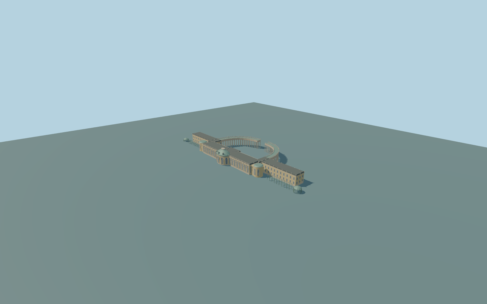

# Sanssouci Palace

Complete principal Sanssouci palace exterior and attached side wings,north open paired-row curved colonnades with entablature/balustrades/urns,offset bowed south pavilion/copper dome with roof oculi/crown,long south window/herm rhythm,north giant order/entrance,round end bays,two end trellis gazebos and two low wing-front trellis walks. Separate New Chambers,Picture Gallery,windmill and broader vineyard terraces/fountains/gardens/optical interiors excluded.

Rebuild: `node packages/worldgen/scripts/generate-sanssouci-palace.mjs`;append `--check` for exact source bytes. Select import/LOD/placement with `--ids=sanssouci_palace`. Detailed source and four browser tiers are separate ignored GLB outputs.

Complete principal Sanssouci palace exterior and attached side wings,north open paired-row curved colonnades with entablature/balustrades/urns,offset bowed south pavilion/copper dome with roof oculi/crown,long south window/herm rhythm,north giant order/entrance,round end bays,two end trellis gazebos and two low wing-front trellis walks. Separate New Chambers,Picture Gallery,windmill and broader vineyard terraces/fountains/gardens/optical interiors excluded.

Retained152.645x62.364m parent includes long palace/wings and curved open colonnades. Never extrude this whole composite as a solid block. Main palace is in the southern portion of the retained frame,not centered at local[0,0]. Native5 bowed south pavilion bounds[-7.8,20.23,7.71,31.11];native189 main bar[-36.44,11.85,36.36,25.19]. Actual curved colonnade polygons9/10 are geometric strip controls for paired open column rows;the forecourt stays open.

Native8m principal/child heights are generalized envelopes,not detailed cornice/dome heights. Original photo-proportional floor1.3m above51m approximate datum,eave9.1m,cornice9.55m,low roof10.3m,dome14.4m/crown15.05m. Colonnade entablature7.8..9.55m;individual column bases/plinth strips follow unchanged native field+.15m rather than raising the whole forecourt. Gazebos/trellises follow local field with original5.8m/4m envelopes. Exact historical thresholds,terrace/accessibility grades and vertical dimensions approximate.

Original exterior interpretation from four ordinary photographs and standard map/global terrain. Fine sculptural/heraldic/urn/window/column inventories and roof junctions approximate. No downloaded meshes,bespoke survey,PDF/archive research or copied reliefs/lettering. One unchanged129x129/2m field covers256m at51m datum. Main structural floor1.3m and variable-depth foundations adapt to it;colonnade plinths/column bases follow native field+.15m under a common entablature. Exact historic threshold/terrace/stair/accessibility grades unmeasured;no terrain flattening. Trellis walk and gazebo frames modeled structurally;foliage/furniture and wider gardens/fountains/independent buildings excluded. Closed exterior doors/window panes exclude optical interiors. Physical phone/laptop timings unmeasured.

Five existing256px plaster,limestone,copper,window-grid andpainted-metal graphs across six material groups;metric UVs/linear vertex colors. No private/new/embedded images,baked light or copied sculpted art/lettering. Parent footprint is composite;seven actual closed palace/range polygons and two open curved strip controls are differentiated. Window/door panes are closed. Ordinary south/front sculpture and corinthian capitals/urns are original simplified cues;fine window/column/urn/sculpture inventory approximate. Source keeps denser dome curves/seams,column capitals,window grids/frames and sculpture. Skyline aggregates closed massing,copper dome,round bays and gazebos,reduces paired-column stations/curves and omits subpixel trellis walks/ornament. District aggregates profiles/urns and keeps paired open colonnades;street uses flat frames and simplified herm/column profiles;close-up preserves denser windows/sculpture/rails. Error estimates4/2/1/.35m are not measured mesh distances. Physical laptop/phone/dense-city timings unmeasured.

Original geometry:repository license. Map:© OpenStreetMap contributors,ODbL-1.0;Protomaps. Standard terrain:terrain-grid.json. Ordinary pictures stay local and are not redistributed or used as textures. Current acceptance:qa.json.
