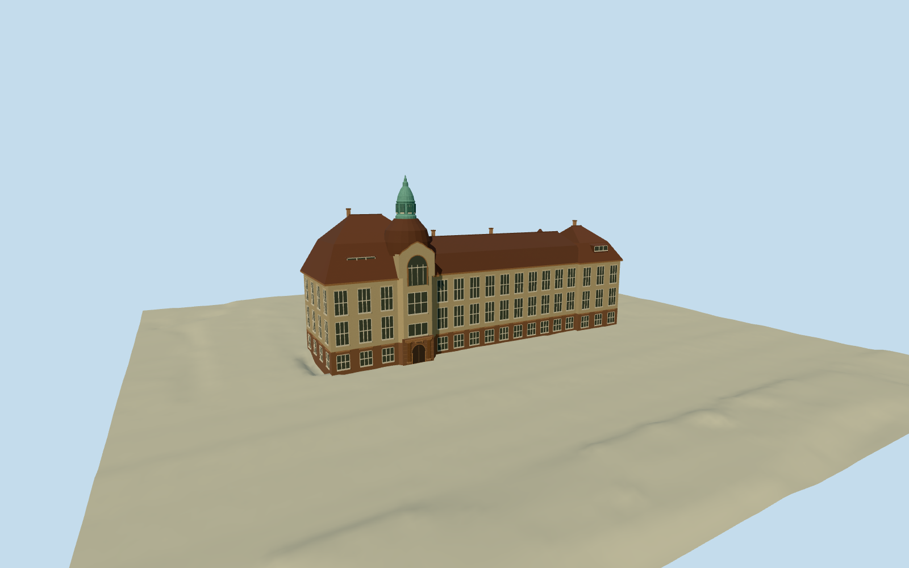

# Sugar Museum (Berlin)

The former Sugar Museum in Anton Adams’s sandstone and plaster institute at Amrumer Straße 32, with its projecting copper lantern and red mansards.

Authoring state: **review-in-qa.json**. Current completion evidence is in [qa.json](qa.json) and the [completion ledger](../../../../qualla-structures/batches/qualla-004.PROGRESS.md).

- [Sugar Museum (Berlin)](https://qualla.com/sugar-museum-berlin/)

The front geometry follows the exact 2008 photograph and official site records. Small ornament, rear sash divisions, finish colors, and the lantern above the numerical survey resolution are estimates.

The scope is the historic Amrumer Straße 32 main building. The adjacent laboratory and factory blocks and the museum’s later premises are outside this model.

Build: `node content/worldgen/source/places/u3/u33/sugar_museum_berlin/models/generate-sugar-museum-berlin.mjs`. Add `--check` to verify exact regeneration. 10216 triangles; 7 materials; no embedded photographs.
