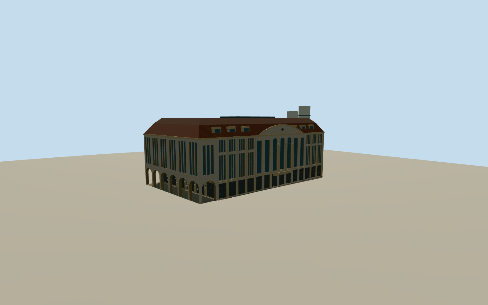

# Görlitz Department Store

Art Nouveau department store with tall stone piers, a shallow pediment, a covered public arcade and a red mansard roof.

Authoring state: **review-in-qa.json**. Current completion evidence is in [qa.json](qa.json) and the [completion ledger](../../../../qualla-structures/batches/qualla-003.PROGRESS.md).

- [Görlitz Department Store](https://qualla.com/gorlitz-department-store/)

The photographed south façade, west arcade and east loading wing control the design. The north façade and less visible roof details use approximate symmetry and the mapped perimeter.

The terraced mansard section, four principal floor bands and narrow light court reflect the documented massing. Story-era height and small reliefs are approximate.

The original composite terrain was preserved. Foundations and arcade paving follow approximate street grade.

The three exact Qualla photos are retained in the local Qualla corpus and recorded here with their hashes.

Build: `node content/worldgen/source/places/u3/u34/gorlitz_department_store/models/generate-gorlitz-store.mjs`. Add `--check` to verify exact regeneration. 13290 triangles; 6 materials; no embedded photographs.
