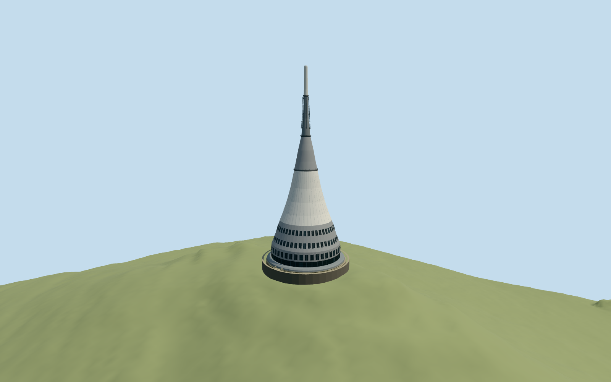

# Ještěd Tower

Ještěd’s conical mountain hotel and television tower with its stone summit gallery, panoramic glazing, laminate hyperboloid and narrow radio mast.

Authoring state: **review-in-qa.json**. Current completion evidence is in [qa.json](qa.json) and the [completion ledger](../../../../qualla-structures/batches/qualla-003.PROGRESS.md).

- [Ještěd Tower](https://qualla.com/jested-tower/)

The cadastral geometry includes the wider access deck. Intermediate levels, antenna supports and the series of skirting and glazing bands are estimated from the photo and documented public elevations.

The antenna and reinforcement hardware are simplified. The rock, retaining steps and walkway details use the measured slope with estimated architectural profiles.

Build: `node content/worldgen/source/places/u3/u34/jested_tower/models/generate-jested-tower.mjs`. Add `--check` to verify exact regeneration. 7068 triangles; 6 materials; no embedded photographs.
