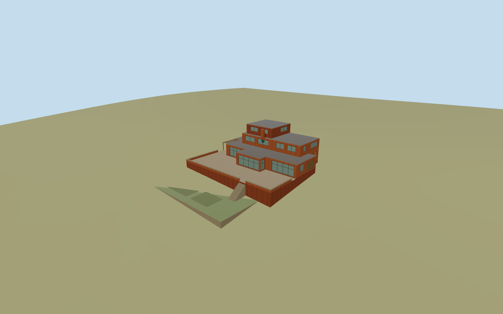

# Villa Wolf

Interwar Villa Wolf on the hillside above the Neisse, with interlocking clinker volumes, glazed river-facing rooms and retaining terraces.

Authoring state: **review-in-qa.json**. Current completion evidence is in [qa.json](qa.json) and the [completion ledger](../../../../qualla-structures/batches/qualla-003.PROGRESS.md).

- [Villa Wolf](https://qualla.com/villa-wolf/)

The historically reconstructed villa is shown in 1930 and its visibility uses a conservative 1927–1944 interval. The standing house was lost in 1945 and its precise completion date varies between accounts.

The ruins have a named geographic point. The historical outline, room and storey heights, exact opening rhythm and brick color are approximations informed by the written record. There is no surveyed footprint in the native source.

The terraces and wall heights are fitted to present source terrain. Early planting, historical grade changes and the interior are outside the model scope.

Qualla media were inspected first. Their historical image rights cannot be established under the public-domain policy, so this approximation uses mapped data and independently written factual records.

Build: `node content/worldgen/source/places/u3/u34/villa_wolf/models/generate-villa-wolf.mjs`. Add `--check` to verify exact regeneration. 1976 triangles; 6 materials; no embedded photographs.
