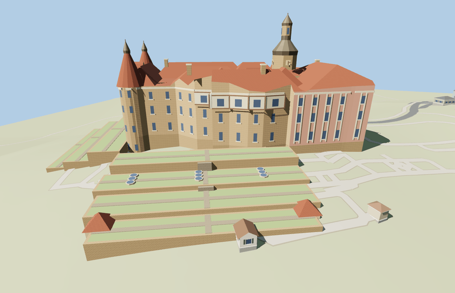

# Książ Castle and park complex — reviewed medium-fi exterior

Reviewed2026-10-12. **52 final rendered views inspected.**

Inspected all 12 final portable views. Coral-pink entrance wing, domed lantern tower, paired steep western roof towers, buff stone ranges and garden terraces retain the inspected aerial picture's castle identity. Courtyard/roof layout and terrace tops remain clear on coarse PMTiles ground. Separate Powder Tower geometry now uses its retained mapped location, with an explicit extra ground-fit view.

Inspected all 12 final shared-material views. Five common graphs provide sandstone, plaster, tile, cast bronze and timber, with explicit local garden-color and recess slots. Roof ranges, western gable, south gallery and terrace walls read correctly. Retained castle envelope/orientation fits approximately; relocated separate tower is visible in the map view. Material-cache reuse and unload checks passed.

Inspected all 28 final medium-fi views: noon/late light, high/economy quality, silhouette, six original feature views, the mapped Powder Tower view and all four matched tiers. Castle roofline, pink wing, paired western towers and visible terraces remain consistent through upgrades. Terrace tops use reconstructed levels above coarse PMTiles ground.

## Placement and runtime

The current castle preview uses the retained castle ring, four tower parts and Powder Tower footprint to remove their procedural duplicates. All four detail levels preserve the other seven mapped buildings and 220 transportation inputs in the viewer fixture. Failed loading restores all 13 mapped buildings. The current Earth viewer replay confirmed this behavior with the registered footprint masks. Park buildings outside this asset use their own catalog entries or native map features.

Inspected aerial picture confirms coral-pink Baroque entrance wing, tall domed central tower, paired western roof towers, buff stone ranges and stepped garden terraces. Retained mapped castle/court rings and standard viewer PMTiles set approximate location, scale and entrance-facing orientation. The derivative reconstructs a working court at Y5, keeps terrace tops above coarse ground and moves the separate Powder Tower to its retained mapped position at native [88.89756493084487,47.64031319972397] with a coarse-ground footing. This review covers the castle/terrace model; separately modeled park buildings retain their own QA status. Anchor 16.291558848,50.842218729; heading 0.487948990682; standard PMTiles datum 392.7276846126304m. Floors are reconstructed and foundations extend below the coarse sampled ground.

skyline: 991 triangles, 104088 bytes, 1 draws; district: 2914 triangles, 280684 bytes, 6 draws; street: 7119 triangles, 649636 bytes, 7 draws; closeup: 7839 triangles, 674548 bytes, 7 draws. Initial skyline+district 384772 bytes, below3MB phone/6MB laptop limits. Separate POSITION/NORMAL streams; physical-device timings remain unmeasured.

## Checks and accepted limits

Six GLBs validated with zero errors, zero warnings and zero embedded images. Original detailed master/hash/recipe preserved. Four tiers contain 991/2914/7119/7839 triangles and initial skyline+district downloads total 384772 bytes. Separate POSITION/NORMAL streams retained.

The castle and terraces follow the inspected aerial photograph and standard viewer PMTiles. The court, terraces, roofs and Powder Tower are reconstructed. The tower uses its mapped location. The wider heritage ensemble, remote Palm House, park buildings, planting, fountains, forest, interiors and thresholds still need their own review. Physical-device timings remain unmeasured.

## Pictures and map

- [Inspected picture 1](https://s6.tvp.pl/images2/f/7/5/uid_f75cbb6df4f2459295b31a77b4b4fd3e_width_1025_play_0_pos_0_gs_0_height_0.jpg) — actual pixels inspected; image not redistributed.
- Standard viewer Protomaps20261008/Mapzen Terrarium PMTiles; controls/hashes retained in pmtiles-fit.json. ©OpenStreetMap contributors/ODbL, elevation attribution retained with the fit data.
