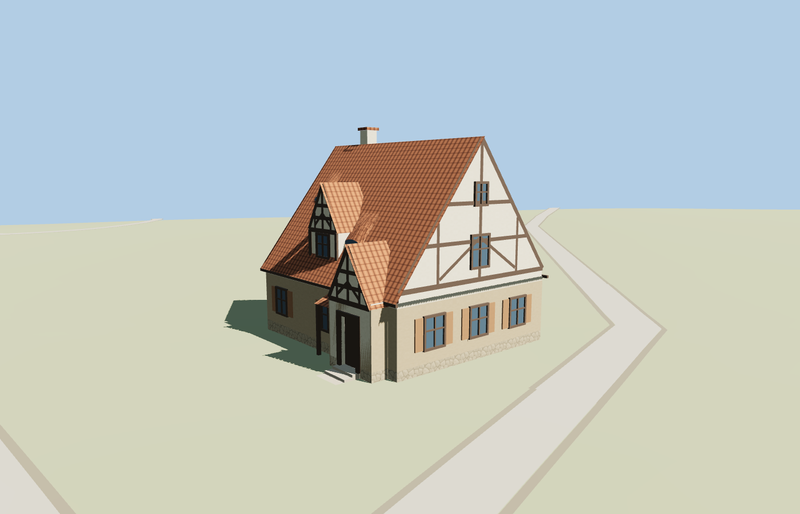

# Książ forester’s house

The forester’s house has the steep red roof, framed gables, two chimneys, shutters and the two photographed eyebrow dormers. A recessed timber door joins two sandstone steps and the stone base.

The porch faces the Jeździecka approach and the timber gable faces the mapped footpath. The original terrain supplies the datum. The pavement joins the original terrain within 8 mm at the sampled points across all four levels.

The placed model replaces its mapped footprint, preserving the 2 other buildings and 71 transportation inputs in the site fixture. A failed download restores its native footprint. Unload disposes all its geometry.

| Detail level | Triangles | Download bytes | Draws |
| --- | ---: | ---: | ---: |
| skyline | 252 | 22,092 | 1 |
| district | 414 | 42,092 | 6 |
| street | 1,306 | 118,872 | 6 |
| closeup | 1,606 | 144,432 | 6 |

Skyline and district total 64,184 bytes. Six GLBs validated with zero errors or warnings. Inspected 39 model views and 12 native views. The house follows the 2014 and 2016 photographs. The garden wall, detached yard structures and later restoration details are outside the model. Measurements are visualization estimates. The wider estate review remains open.

[Placement and terrain controls](map-frame.json) · [Verification report](qa.json) · [Reference photograph](https://commons.wikimedia.org/wiki/File:Le%C5%9Bnicz%C3%B3wka_(Ksi%C4%85%C5%BC).jpg)
