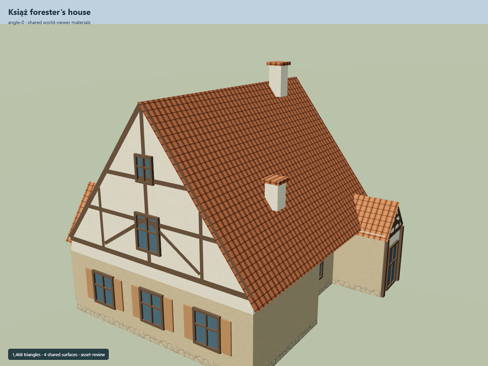

# Książ forester’s house

Own jogged footprint with a steep red tiled roof, cream timber-framed main gable, side dormer, small entrance gable, shutters and two masonry chimneys.

Independently placed component of [Książ Castle and park complex](../ksiaz_castle_and_park_complex/README.md). See the [placement review](QA-REVIEW.md) for the ground fit.

## Sources and reconstruction

- [Reference](https://eli.gov.pl/api/acts/DU/2025/1089/text.pdf)
- [Reference](https://commons.wikimedia.org/wiki/File:Le%C5%9Bnicz%C3%B3wka_(Ksi%C4%85%C5%BC).jpg)
- [Reference](https://www.flickr.com/photos/124589265@N07/14162255536/)
- [Reference](https://www.openstreetmap.org/way/262236292)

Original authored geometry under repository license. Mapped outline © OpenStreetMap contributors,ODbL-1.0;linked research photographs are not redistributed.

Own map footprint; native Y0 is estimated local ground contact. Heights, roof profiles, openings and unseen elevations are interpretations. An independent Wikidata identity is not asserted. Facade azimuth and actual geographic fit remain pending.

## Build

Run node content/worldgen/source/places/u3/u35/ksiaz_forester_house/models/generate-ksiaz-service-structures.mjs --ids=KSI_S01 (or --check).

1606 triangles;196424 source bytes;6 merged material groups;no embedded images. Four existing shared plaster, tile, rubble and timber graphs use metric UVs and linear palette tints. Flat muted glazing adds one material. Runtime LODs are separate generated outputs.

Source hash: sha256:e2b729b2edcc769aa34c1899ee3f7b55fe4e7c78062060879935058eb6f896e5
