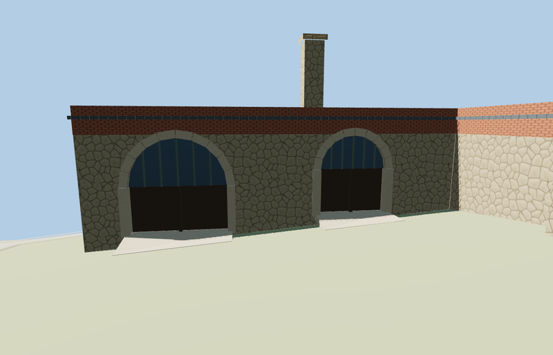

# Książ forge

The L-shaped forge has rubble masonry, a brick eave band and its tall stone chimney. The larger left and smaller right portals have separate stone voussoirs, recessed timber doors and upper grilles.

The two photographed portals face the inner yard of the mapped L-shaped footprint, with thresholds 54 cm apart on the slope. The pavement joins the original terrain within 8 mm at the sampled points across all four levels.

The placed model replaces its mapped footprint, preserving the 11 other buildings and 187 transportation inputs in the site fixture. A failed download restores its native footprint. Unload disposes all its geometry.

| Detail level | Triangles | Download bytes | Draws |
| --- | ---: | ---: | ---: |
| skyline | 142 | 12,212 | 1 |
| district | 234 | 23,816 | 6 |
| street | 512 | 48,628 | 7 |
| closeup | 612 | 59,060 | 8 |

Skyline and district total 36,028 bytes. Six GLBs validated with zero errors or warnings. Inspected 39 model views and 12 native views. The forge’s appearance follows the 2014 photograph. Its rear elevations and the portal step in grade are reconstructions. Measurements are visualization estimates. The wider estate review remains open.

[Placement and terrain controls](map-frame.json) · [Verification report](qa.json) · [Reference photograph](https://www.flickr.com/photos/124589265@N07/14185032925/)
