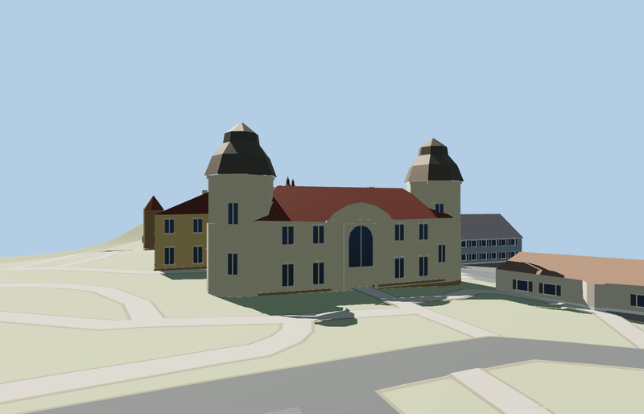

# Książ gatehouse

A cream gatehouse with two octagonal upper towers and dark caps frames the red-tiled hall and arched library window. The sandstone footing sits on the mapped slope.

The attributed gatehouse footprint and two tower parts set the signed location. The outer library facade faces the approach, and the base uses the uncovered Terrarium sample outside it.

The three entrance buildings replace five mapped records. Along with the castle, they retain 14 neighboring buildings, 240 transportation inputs and four water inputs in the fixture. A forced north-wing load failure restores its mapped record. Unloading releases model geometry.

| Detail level | Triangles | Download bytes | Draws |
| --- | ---: | ---: | ---: |
| skyline | 568 | 50,800 | 1 |
| district | 676 | 66,016 | 5 |
| street | 1,480 | 138,504 | 5 |
| closeup | 1,800 | 167,508 | 5 |

Skyline and district total 116,816 bytes. Six GLBs passed Khronos validation. Inspected 39 model views and 13 shared site views. Roof heights, profiles, facade ornament, and stair dimensions are reconstruction estimates based on ordinary photographs and the retained map. The review covers the building exterior. The wider park and Palm House remain separate.

[Signed position and terrain controls](map-frame.json) · [Verification report](qa.json) · [Aerial reference](https://commons.wikimedia.org/wiki/File:Ksiaz_w_jesiennej_scenerii.jpg)
